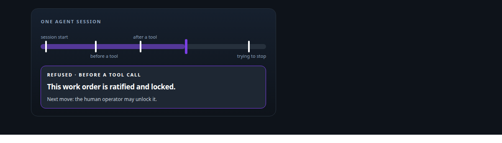
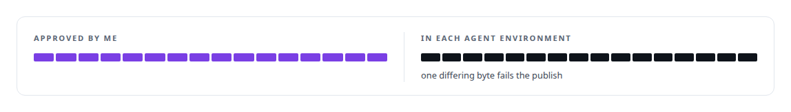
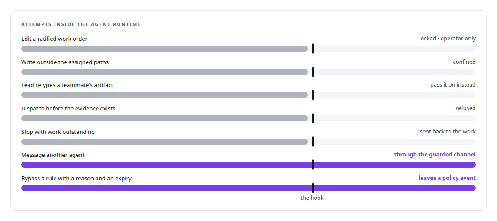
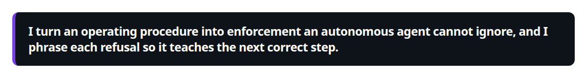
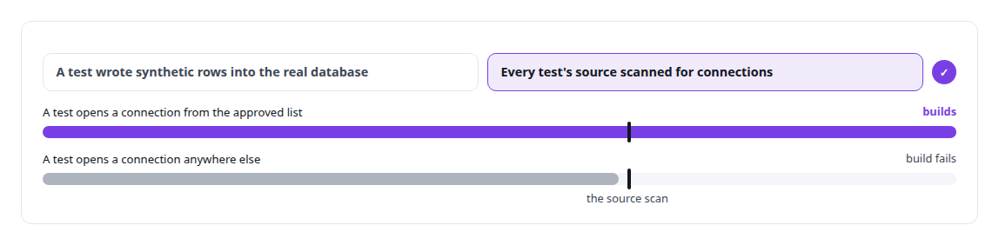

# Policy-as-code enforcement

**Policy in my governance platform is enforced by hooks, not remembered by prompts: a lead cannot edit an artifact, work cannot dispatch before its evidence exists, a hook may never report an operation that did not happen.**

Canonical: https://coreyjames.ai/technologies/policy-as-code-enforcement/  
Author: Corey James · Published: 2026-10-28 · Kind: technology  
Systems: [AgentOS](https://github.com/coreyjames-ai/agentos)  
Skills: [multi-agent governance](https://github.com/coreyjames-ai/portfolio/tree/main/skills/multi-agent-governance) · [Rust systems engineering](https://github.com/coreyjames-ai/portfolio/tree/main/skills/rust-systems-engineering) · [evidence-gated acceptance](https://github.com/coreyjames-ai/portfolio/tree/main/skills/evidence-gated-acceptance) · [distributed systems correctness](https://github.com/coreyjames-ai/portfolio/tree/main/skills/distributed-systems-correctness)  



## Result

| Figure | What it measures |
| --- | --- |
| **~100** | hook modules served by one binary |
| **11** | lifecycle events where policy runs |
| **63** | shell hooks it replaced, ported with tests |

## What was built

### Rules moved out of the prompt and into the runtime

In [AgentOS](https://coreyjames.ai/systems/agentos) I found that long agent runs fail because the agent is asked to remember the rules along with everything else. I moved the rules out of the agent and into code that runs inside its runtime, in the hook points the agent cannot route around. The coding tools I govern expose lifecycle hooks, before a tool call, after one, at session start, when the agent tries to stop. One Rust binary serves all of them. The diagnosis is in [Why long agent runs fail](https://coreyjames.ai/stories/why-long-agent-runs-fail).

A publisher writes the hook configuration into each agent environment and checks it byte for byte, so the rules that run are the rules I wrote.



### What the hooks enforce

The effects are what matter.



A refusal can only point to a command that exists for that agent in its current state, and it names who may take it, so an agent that hits a wall learns its next correct move. I reworked every refusal path to get that property. Overrides exist, because a system with no override gets bypassed.



### Incidents become machine checks

The approach reaches the build too: an incident becomes a permanent machine check, so the same mistake is caught by the build from then on.



The hook points belong to the vendors' coding tools; the policy engine and its rules are mine.

> I turn an operating procedure into enforcement an autonomous agent cannot ignore, and I phrase each refusal so it teaches the next correct step.

## What was verified

Each line is a claim the canonical page supports, with the figure as the page states it.

- Policy-as-code for AI agents: about 100 hook modules across 11 lifecycle events in one Rust binary, ported from 63 shell hooks, enforcing rules inside the agent runtime.
- Multi-agent governance: ratified work orders locked to the operator, agents confined to their assigned paths, and refusals that name only a command that exists for that agent.
- Configuration integrity: hook configuration published into every agent environment with a byte-for-byte check against the approved copy.
- Incident-driven guardrails: a test that wrote into the real database became a source-scanning rule that fails the build on any unapproved database connection.

## Related

- [Why long agent runs fail](https://github.com/coreyjames-ai/agentos/tree/main/stories/why-long-agent-runs-fail) · https://coreyjames.ai/stories/why-long-agent-runs-fail/
- System: [AgentOS](https://github.com/coreyjames-ai/agentos)

## Citation

Corey James. "Policy-as-code enforcement." coreyjames.ai, 2026. https://coreyjames.ai/technologies/policy-as-code-enforcement/

```bibtex
@misc{coreyjames-policy-as-code-enforcement,
  author = {Corey James},
  title = {Policy-as-code enforcement},
  year = {2026},
  howpublished = {\url{https://coreyjames.ai/technologies/policy-as-code-enforcement/}},
  note = {GitHub copy: https://github.com/coreyjames-ai/portfolio/tree/main/technologies/policy-as-code-enforcement}
}
```

Part of [Corey James's portfolio](https://github.com/coreyjames-ai/portfolio) · site: https://coreyjames.ai/ · MCP server: https://coreyjames.ai/mcp · agent card: https://coreyjames.ai/.well-known/agent.json
