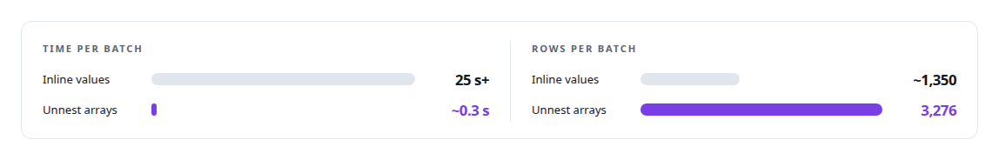
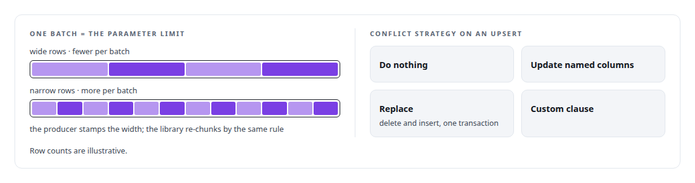
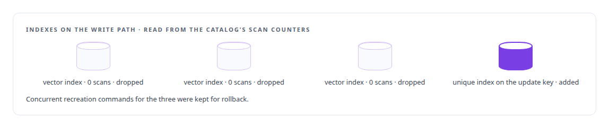

# PostgreSQL bulk-update engineering

**Statement shape, batch width and index cost, each judged by what the database actually does with a write.**

Canonical: https://coreyjames.ai/technologies/postgresql-bulk-update-engineering/  
Author: Corey James · Published: 2026-10-28 · Kind: technology  
Systems: [PostgreSQL Fabric](https://github.com/coreyjames-ai/postgresql-fabric) · [FAFO Core and Function Forge](https://github.com/coreyjames-ai/fafo-core) · [Inference Fabric](https://github.com/coreyjames-ai/inference-fabric)  
Skills: [PostgreSQL performance tuning](https://github.com/coreyjames-ai/portfolio/tree/main/skills/postgresql-performance-tuning)  


## Result

| Figure | What it measures |
| --- | --- |
| **3.4M** | items in one write-back run |
| **65,535** | bind parameters, the ceiling no batch reaches |
| **~400 GB** | of never-scanned vector indexes dropped |

## What was built

My research pipeline writes millions of rows back to PostgreSQL through one service, and the shape of each statement decides whether that service keeps up. The work lives in the write path of [FAFO Core and Function Forge](https://coreyjames.ai/systems/fafo-core) and serves the [Inference Fabric](https://coreyjames.ai/systems/inference-fabric)'s completion side.

## Unnest instead of inline values

Bulk updates bind each column as one array and unnest the arrays into a row set joined to the target on its key. The parameter count then equals the column count whatever the row count, which keeps every batch under PostgreSQL's bind-parameter limit, and the planner joins directly instead of materialising a derived table. The run that proved it is told in [Twenty thousand rows a second](https://coreyjames.ai/stories/twenty-thousand-rows-a-second).



The inline-values form is kept as an automatic fallback for types the array path cannot bind; array-valued columns bind as text arrays of literals and are cast back in the assignment, a binary encoder covers two-dimensional arrays, and vector columns are refused on this path rather than mishandled.

## Batch width decided where the width is known

Batch width is derived per destination from the parameter limit and the payload's own width, stamped by the producer, with the library re-chunking by the same rule. Upserts carry a conflict strategy. Writes that span parent and child tables arrive as one ordered message and commit in one transaction. Lattice-wide operations run as SQL functions inside the database, next to their indexes.



The limits are plain: no partitioning or trigger machinery is involved, and duplicate keys inside one batch are not deduplicated.

## Indexes counted as write cost

Every index is maintained on every write, so index cost is write cost, and unused indexes are found from the catalog's scan counts. A missing unique index on an update key, found from sequential-scan counts, was the cause of the deadlocks in [196 deadlocks to zero](https://coreyjames.ai/stories/196-deadlocks-to-zero).




> Throughput is measured from the database's own tuple and commit counters, never from queue length, because one queue message can be thousands of rows or none.

## What was verified

Each line is a claim the canonical page supports, with the figure as the page states it.

- PostgreSQL performance tuning: array-bound unnest updates whose parameter count equals the column count, under the 65,535 bind-parameter limit, from more than 25 s a batch to about 0.3 s.
- High-volume database write paths: a 3.4M-item write-back run moved from about 1,350 rows a batch to 3,276 rows, with batch width derived from the payload's own width.
- Index cost engineering: about 400 GB of never-scanned vector indexes dropped from the write path, and a missing unique index added after sequential-scan counts pointed to it.

## Related

- [196 deadlocks to zero](https://github.com/coreyjames-ai/fafo-core/tree/main/stories/196-deadlocks-to-zero) · https://coreyjames.ai/stories/196-deadlocks-to-zero/
- [Twenty thousand rows a second](https://github.com/coreyjames-ai/postgresql-fabric/tree/main/stories/twenty-thousand-rows-a-second) · https://coreyjames.ai/stories/twenty-thousand-rows-a-second/
- [A write path that sizes itself](https://github.com/coreyjames-ai/postgresql-fabric/tree/main/stories/a-write-path-that-sizes-itself) · https://coreyjames.ai/stories/a-write-path-that-sizes-itself/
- [Rules that never ran](https://github.com/coreyjames-ai/postgresql-fabric/tree/main/stories/rules-that-never-ran) · https://coreyjames.ai/stories/rules-that-never-ran/
- [Pricing writes by what they cost the database](https://github.com/coreyjames-ai/postgresql-fabric/tree/main/stories/pricing-writes-by-what-they-cost) · https://coreyjames.ai/stories/pricing-writes-by-what-they-cost/
- [Redistribution inside the database](https://github.com/coreyjames-ai/fafo-core/tree/main/stories/redistribution-inside-the-database) · https://coreyjames.ai/stories/redistribution-inside-the-database/
- System: [PostgreSQL Fabric](https://github.com/coreyjames-ai/postgresql-fabric)
- System: [FAFO Core and Function Forge](https://github.com/coreyjames-ai/fafo-core)
- System: [Inference Fabric](https://github.com/coreyjames-ai/inference-fabric)

## Citation

Corey James. "PostgreSQL bulk-update engineering." coreyjames.ai, 2026. https://coreyjames.ai/technologies/postgresql-bulk-update-engineering/

```bibtex
@misc{coreyjames-postgresql-bulk-update-engineering,
  author = {Corey James},
  title = {PostgreSQL bulk-update engineering},
  year = {2026},
  howpublished = {\url{https://coreyjames.ai/technologies/postgresql-bulk-update-engineering/}},
  note = {GitHub copy: https://github.com/coreyjames-ai/portfolio/tree/main/technologies/postgresql-bulk-update-engineering}
}
```

Part of [Corey James's portfolio](https://github.com/coreyjames-ai/portfolio) · site: https://coreyjames.ai/ · MCP server: https://coreyjames.ai/mcp · agent card: https://coreyjames.ai/.well-known/agent.json
