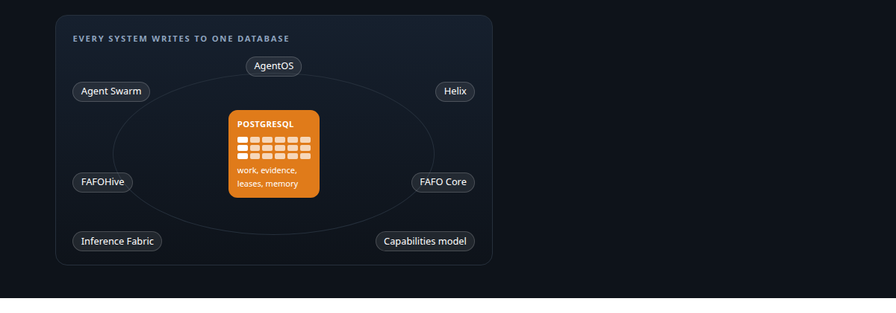
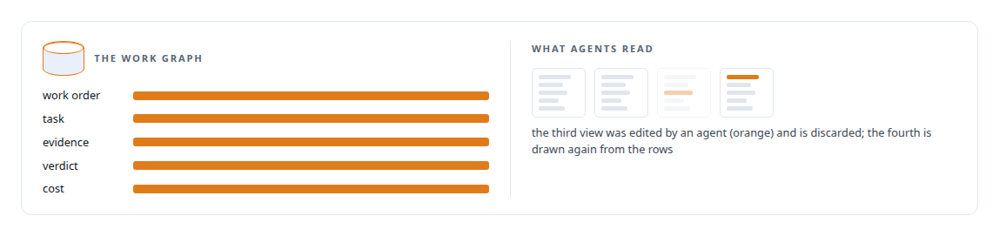
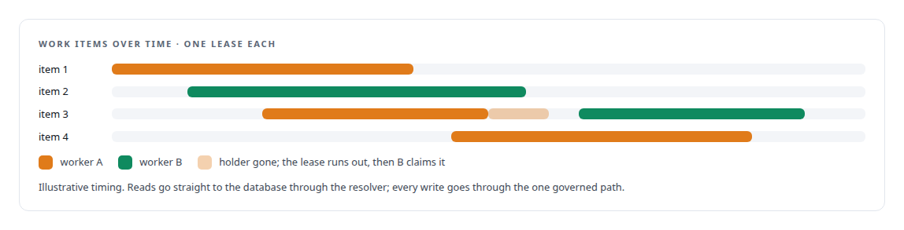
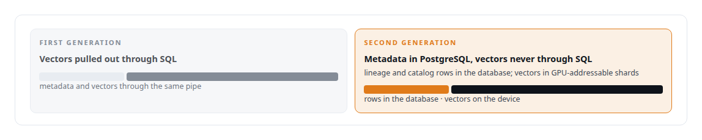
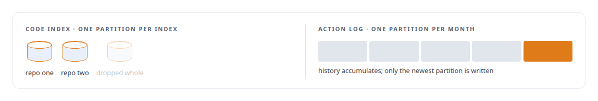
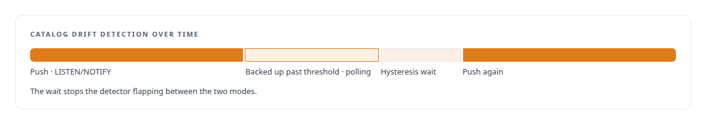
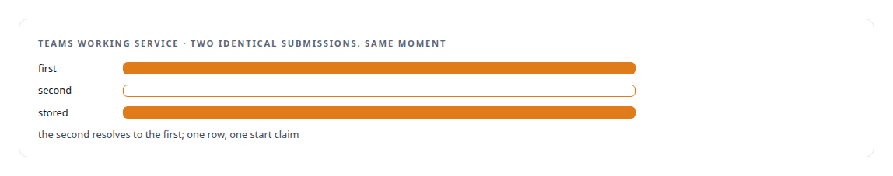

# PostgreSQL

**PostgreSQL is the source of truth for everything I build: a governance work graph, lease-based claiming designed against its concurrency model, and diagnosis from its own tuple statistics.**

Canonical: https://coreyjames.ai/technologies/postgresql/  
Author: Corey James · Published: 2026-10-28 · Kind: technology  
Systems: [AgentOS](https://github.com/coreyjames-ai/agentos) · [Agent Swarm](https://github.com/coreyjames-ai/agent-swarm) · [Helix](https://github.com/coreyjames-ai/helix) · [FAFOHive](https://github.com/coreyjames-ai/fafohive) · [FAFO Core and Function Forge](https://github.com/coreyjames-ai/fafo-core) · [Inference Fabric](https://github.com/coreyjames-ai/inference-fabric) · [Capabilities model](https://github.com/coreyjames-ai/capabilities-model) · [PostgreSQL Fabric](https://github.com/coreyjames-ai/postgresql-fabric)  
Skills: [distributed systems correctness](https://github.com/coreyjames-ai/portfolio/tree/main/skills/distributed-systems-correctness) · [inference serving architecture](https://github.com/coreyjames-ai/portfolio/tree/main/skills/inference-serving-architecture) · [tool synthesis and governed API integration](https://github.com/coreyjames-ai/portfolio/tree/main/skills/tool-synthesis-and-governed-api-integration) · [AI-assisted engineering methodology](https://github.com/coreyjames-ai/portfolio/tree/main/skills/ai-assisted-engineering-methodology)  



## Result

| Figure | What it measures |
| --- | --- |
| **546K** | lines in the control plane built on it |
| **88** | tables in the AgentOS work graph |
| **79** | forward-only schema migrations |

## What was built

### The work graph behind AgentOS

In [AgentOS](https://coreyjames.ai/systems/agentos) the root problem was state held in a model's context, so I put all of it in PostgreSQL, the one source of truth. Every work order, task, piece of evidence, verdict and cost lives in a relational work graph, and the readable views agents see are generated from it and never edited back. Cost attribution and the effort methodology are computed in PL/pgSQL from the same tables. Schema changes are generated and run against a throwaway database before they touch the real one. See [Why long agent runs fail](https://coreyjames.ai/stories/why-long-agent-runs-fail).



### One governed write path for many workers

In [FAFO Core and Function Forge](https://coreyjames.ai/systems/fafo-core) many AI and batch workers share one database, so I decided functions read freely and write only through one governed write path. The data layer is schema-agnostic: a resolver reads the system catalogs, checks every identifier and binds by actual column type, so generated code reaches the database only through it and cannot build unsafe SQL. Work items are claimed by lease, and parallel workers never process the same item.



When a bulk update deadlocked, I measured from PostgreSQL's tuple counts, because write performance is what PostgreSQL committed, and one unique index ended them: [196 deadlocks to zero](https://coreyjames.ai/stories/196-deadlocks-to-zero). Probe generation and hidden-state mining keep their work items and results here with multi-table atomic writes: [The workload that shaped the platform](https://coreyjames.ai/stories/the-workload-that-shaped-the-platform).

### Metadata in, vectors out

In [Inference Fabric](https://coreyjames.ai/systems/inference-fabric) the first generation pulled vectors out of PostgreSQL into a Python indexing job, and that was the bottleneck. My rule for the second generation: metadata in PostgreSQL, vectors never through SQL. Work-item rows are where results return, closed by a small completion service.



### Partitions that follow the data

In the memory capability of [FAFOHive](https://coreyjames.ai/systems/fafohive) code indexes come and go, so the code index is partitioned per index and the action log by month. Search ranks weighted full-text and dense vectors in the same rows. Dependency tracing is a bounded breadth-first traversal in SQL over stored call-graph edges, with no model involved: [A code explainer that is not allowed to invent](https://coreyjames.ai/stories/a-code-explainer-that-is-not-allowed-to-invent).



### Push with a polling fallback

In [Agent Swarm](https://coreyjames.ai/systems/agent-swarm) I wanted push-speed signals without trusting push alone. Catalog drift detection listens with LISTEN/NOTIFY, falls back to polling when notifications back up past measured thresholds, and waits through a hysteresis period before switching back.



The worker that turns agent actions into searchable memory claims rows with FOR UPDATE SKIP LOCKED and writes on natural keys, so a replay after a crash adds nothing twice and multi-worker processing is safe to retry. See [Tools are the platform](https://coreyjames.ai/stories/tools-are-the-platform).

### Conversations that survive restarts

In [Helix](https://coreyjames.ai/systems/helix) a conversation with several model seats has to survive restarts and account switches, so the Control Center keeps sessions, documents and council deliberations in PostgreSQL across forty migrations. The Teams working service stores submissions and start claims there, and identical concurrent submissions resolve to one winner.




> I build systems around PostgreSQL as the authority that makes autonomous agents' work recoverable and auditable, and the same habits recur across very different systems.

## What was verified

Each line is a claim the canonical page supports, with the figure as the page states it.

- PostgreSQL schema design: a 546K-line control plane over 88 tables and 79 forward-only migrations, with every agent-readable view generated from the database and never edited back.
- Concurrent work claiming: lease-based claiming and FOR UPDATE SKIP LOCKED with natural-key writes, so parallel workers never take the same item and a replay adds nothing twice.
- Event-driven database design: LISTEN/NOTIFY catalog drift detection with a polling fallback and a hysteresis period before switching back.
- Vector data architecture: metadata and lineage in PostgreSQL with vectors kept out of SQL in GPU-addressable shards for high-throughput inference.

## Related

- [Why long agent runs fail](https://github.com/coreyjames-ai/agentos/tree/main/stories/why-long-agent-runs-fail) · https://coreyjames.ai/stories/why-long-agent-runs-fail/
- [Closed by evidence](https://github.com/coreyjames-ai/agentos/tree/main/stories/closed-by-evidence) · https://coreyjames.ai/stories/closed-by-evidence/
- [Separation of duties for AI work](https://github.com/coreyjames-ai/agentos/tree/main/stories/separation-of-duties-for-ai-work) · https://coreyjames.ai/stories/separation-of-duties-for-ai-work/
- [Tools are the platform](https://github.com/coreyjames-ai/agent-swarm/tree/main/stories/tools-are-the-platform) · https://coreyjames.ai/stories/tools-are-the-platform/
- [Agents with real tools and no keys](https://github.com/coreyjames-ai/fafohive/tree/main/stories/agents-with-real-tools-and-no-keys) · https://coreyjames.ai/stories/agents-with-real-tools-and-no-keys/
- [A code explainer that is not allowed to invent](https://github.com/coreyjames-ai/fafohive/tree/main/stories/a-code-explainer-that-is-not-allowed-to-invent) · https://coreyjames.ai/stories/a-code-explainer-that-is-not-allowed-to-invent/
- [Tools that build tools, under governance](https://github.com/coreyjames-ai/fafo-core/tree/main/stories/tools-that-build-tools-under-governance) · https://coreyjames.ai/stories/tools-that-build-tools-under-governance/
- [196 deadlocks to zero](https://github.com/coreyjames-ai/fafo-core/tree/main/stories/196-deadlocks-to-zero) · https://coreyjames.ai/stories/196-deadlocks-to-zero/
- [The workload that shaped the platform](https://github.com/coreyjames-ai/fafo-core/tree/main/stories/the-workload-that-shaped-the-platform) · https://coreyjames.ai/stories/the-workload-that-shaped-the-platform/
- System: [AgentOS](https://github.com/coreyjames-ai/agentos)
- System: [Agent Swarm](https://github.com/coreyjames-ai/agent-swarm)
- System: [Helix](https://github.com/coreyjames-ai/helix)
- System: [FAFOHive](https://github.com/coreyjames-ai/fafohive)
- System: [FAFO Core and Function Forge](https://github.com/coreyjames-ai/fafo-core)
- System: [Inference Fabric](https://github.com/coreyjames-ai/inference-fabric)
- System: [Capabilities model](https://github.com/coreyjames-ai/capabilities-model)
- System: [PostgreSQL Fabric](https://github.com/coreyjames-ai/postgresql-fabric)

## Citation

Corey James. "PostgreSQL." coreyjames.ai, 2026. https://coreyjames.ai/technologies/postgresql/

```bibtex
@misc{coreyjames-postgresql,
  author = {Corey James},
  title = {PostgreSQL},
  year = {2026},
  howpublished = {\url{https://coreyjames.ai/technologies/postgresql/}},
  note = {GitHub copy: https://github.com/coreyjames-ai/portfolio/tree/main/technologies/postgresql}
}
```

Part of [Corey James's portfolio](https://github.com/coreyjames-ai/portfolio) · site: https://coreyjames.ai/ · MCP server: https://coreyjames.ai/mcp · agent card: https://coreyjames.ai/.well-known/agent.json
