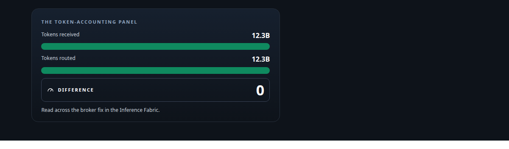
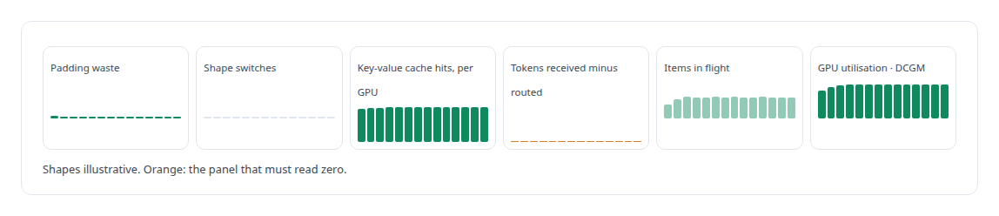
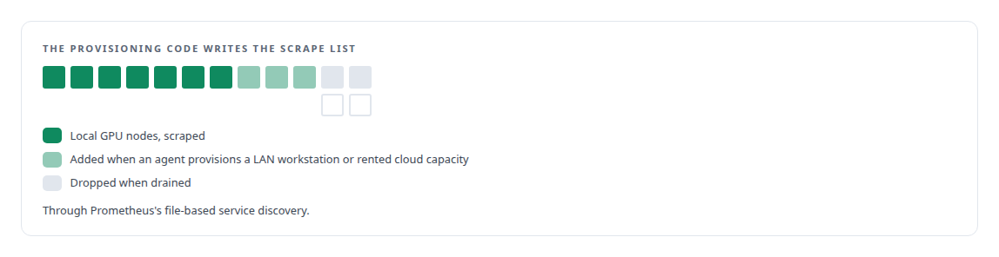
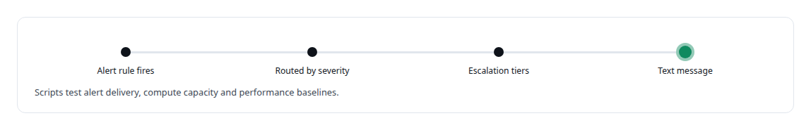
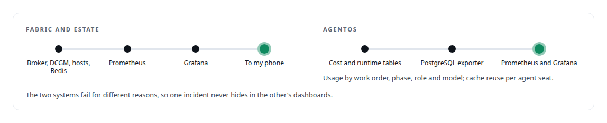

# Prometheus

**Prometheus carries the numbers that decide whether GPUs earn their keep, follows a fleet that changes under it, and pages one operator's phone.**

Canonical: https://coreyjames.ai/technologies/prometheus/  
Author: Corey James · Published: 2026-10-28 · Kind: technology  
Systems: [Inference Fabric](https://github.com/coreyjames-ai/inference-fabric) · [FAFO Core and Function Forge](https://github.com/coreyjames-ai/fafo-core) · [Auth and access plane](https://github.com/coreyjames-ai/auth-and-access-plane) · [AgentOS](https://github.com/coreyjames-ai/agentos)  
Skills: [observability and alerting](https://github.com/coreyjames-ai/portfolio/tree/main/skills/observability-and-alerting) · [embedding analytics and cluster metrics](https://github.com/coreyjames-ai/portfolio/tree/main/skills/embedding-analytics-and-cluster-metrics) · [tool synthesis and governed API integration](https://github.com/coreyjames-ai/portfolio/tree/main/skills/tool-synthesis-and-governed-api-integration)  



## Result

| Figure | What it measures |
| --- | --- |
| **~137** | metrics the broker exports of its own |
| **31** | panels on the fabric's Grafana dashboard |
| **96.9%** | SM utilisation on the larger card in the 163,000-tokens-a-second run |
| **12** | scrape jobs across hosts, GPUs and inference nodes |

## What was built

### Panels for the numbers that decide GPU economics

In [Inference Fabric](https://coreyjames.ai/systems/inference-fabric) generic service health told me nothing about whether the GPUs were earning their keep, so I instrumented the quantities that decide GPU economics: padding, cache reuse and token conservation. The broker exports its own metrics into a Grafana dashboard, and GPU utilisation comes from NVIDIA's DCGM exporter beside the runtime's counters.



The token-accounting panel is how I proved the broker fix in [Millions of queued items that were not there](https://coreyjames.ai/stories/millions-of-queued-items-that-were-not-there).


Each step of [From 44K to 163K tokens per second](https://coreyjames.ai/stories/from-44k-to-163k-tokens-per-second) is a capture from these dashboards.

### Monitoring that follows the fleet

In [FAFO Core and Function Forge](https://coreyjames.ai/systems/fafo-core) GPU nodes appear and disappear as agents provision them locally, on a LAN workstation or on rented cloud capacity, and I did not want anyone editing a scrape configuration.



The governed write path and the model-facing gateway export their own metrics, including latency percentiles, so queue depth and write latency sit beside the GPUs they feed.

### Alerts that reach a phone

The [Auth and access plane](https://coreyjames.ai/systems/auth-and-access-plane) includes operations for the whole estate, and one operator cannot watch a screen, so alerts reach my phone. I built the stack end to end: a containerised Prometheus scraping hosts, GPUs and inference nodes; Grafana dashboards for the Redis queues, the hosts and the fabric; and alert rules for Redis and the hosts.



### A separate stack for AgentOS

[AgentOS](https://coreyjames.ai/systems/agentos) has its own Prometheus and Grafana pair, with a PostgreSQL exporter over the cost and runtime tables.



I build observability alongside the system and design it around the numbers that prove the system works, which is what lets me publish figures with their context. Prometheus, Grafana, Alertmanager and the exporters are third-party; the metrics, dashboards, discovery wiring and alerting are mine.

> A panel that should read zero is a test; any non-zero difference between tokens received and routed is a defect.

## What was verified

Each line is a claim the canonical page supports, with the figure as the page states it.

- Observability and alerting: Prometheus, Grafana and alerting built end to end, about 137 broker metrics on a 31-panel dashboard and 12 scrape jobs across hosts, GPUs and inference nodes.
- GPU utilisation monitoring: token-conservation and padding panels beside DCGM exporter data, with 96.9% SM utilisation on the larger card in the 163,000-tokens-a-second run.
- Dynamic service discovery: provisioning code writes GPU nodes into Prometheus's file-based service discovery as agents add and drain them, so monitoring follows the fleet.

## Related

- [A message broker that understands tokens](https://github.com/coreyjames-ai/inference-fabric/tree/main/stories/a-message-broker-that-understands-tokens) · https://coreyjames.ai/stories/a-message-broker-that-understands-tokens/
- [Millions of queued items that were not there](https://github.com/coreyjames-ai/inference-fabric/tree/main/stories/millions-of-queued-items-that-were-not-there) · https://coreyjames.ai/stories/millions-of-queued-items-that-were-not-there/
- [From 44K to 163K tokens per second](https://github.com/coreyjames-ai/inference-fabric/tree/main/stories/from-44k-to-163k-tokens-per-second) · https://coreyjames.ai/stories/from-44k-to-163k-tokens-per-second/
- System: [Inference Fabric](https://github.com/coreyjames-ai/inference-fabric)
- System: [FAFO Core and Function Forge](https://github.com/coreyjames-ai/fafo-core)
- System: [Auth and access plane](https://github.com/coreyjames-ai/auth-and-access-plane)
- System: [AgentOS](https://github.com/coreyjames-ai/agentos)

## Citation

Corey James. "Prometheus." coreyjames.ai, 2026. https://coreyjames.ai/technologies/prometheus/

```bibtex
@misc{coreyjames-prometheus,
  author = {Corey James},
  title = {Prometheus},
  year = {2026},
  howpublished = {\url{https://coreyjames.ai/technologies/prometheus/}},
  note = {GitHub copy: https://github.com/coreyjames-ai/portfolio/tree/main/technologies/prometheus}
}
```

Part of [Corey James's portfolio](https://github.com/coreyjames-ai/portfolio) · site: https://coreyjames.ai/ · MCP server: https://coreyjames.ai/mcp · agent card: https://coreyjames.ai/.well-known/agent.json
