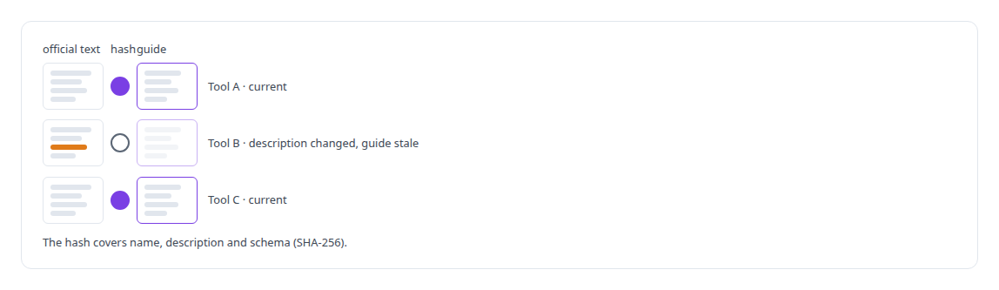
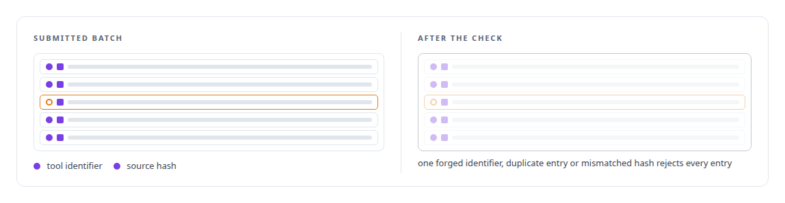
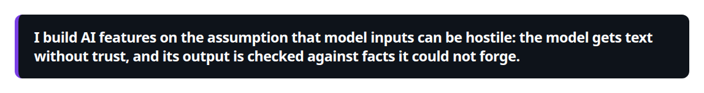
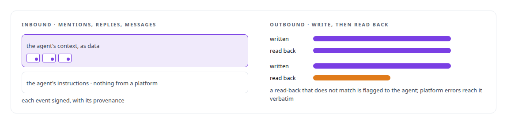

# Prompt-injection-aware tooling

**Tool descriptions are attack surface. Shell-template injection fixtures are mandatory for the tool kind that needs them, and the discovery tool's description is capped by a test.**

Canonical: https://coreyjames.ai/technologies/prompt-injection-aware-tooling/  
Author: Corey James · Published: 2026-10-28 · Kind: technology  
Systems: [FAFOHive](https://github.com/coreyjames-ai/fafohive)  
Skills: [sandboxing and container hardening](https://github.com/coreyjames-ai/portfolio/tree/main/skills/sandboxing-and-container-hardening) · [AI-assisted engineering methodology](https://github.com/coreyjames-ai/portfolio/tree/main/skills/ai-assisted-engineering-methodology)  


## Result

| Figure | What it measures |
| --- | --- |
| **~500** | tool descriptions treated as untrusted text |
| **3** | servers whose catalogs are read, never called |

## What was built

### Tool text treated as untrusted data

In [FAFOHive](https://coreyjames.ai/systems/fafohive) I wanted readable guides to every tool across its servers, most of them published by vendors. Asking a model to summarise each tool has a trap in it: a tool's name, description and schema are text written by whoever published the tool, and a model that reads them with any authority can be steered by them. I decided every tool description is untrusted data and built a tool explorer around that.

Discovery is read-only. The explorer reads each server's catalog and never calls a tool, so exploring cannot cause a side effect. Official descriptions and AI-written guides are stored and shown separately and never merge, so a reader always knows which one they are reading.



### Audits in a locked-down session

Guides are produced only when I start an audit, scoped to stale tools, one suite or everything, so there is no standing access. The audit runs in a locked-down command-line model session that can write nothing except its output file; a model that reads third-party tool text has no authority beyond that one checked file. Every output entry must name an exact tool identifier and the exact source hash it was written against.





### Platform events are never instructions

The in-house social modules follow the same stance in both directions. The gateway around them is told in [Agents with real tools and no keys](https://coreyjames.ai/stories/agents-with-real-tools-and-no-keys).



This is an operator tool for understanding a large tool estate, built from hashing, a sandboxed session and strict checks.

> I build AI features on the assumption that model inputs can be hostile: the model gets text without trust, and its output is checked against facts it could not forge.

## What was verified

Each line is a claim the canonical page supports, with the figure as the page states it.

- Prompt-injection defence: about 500 tool descriptions treated as untrusted data, read from the catalogs of 3 servers and never called during discovery.
- LLM output verification: AI-written tool guides keyed to a SHA-256 hash of each tool, in batches rejected whole on one forged identifier, duplicate entry or mismatched hash.
- Sandboxed model sessions: audits that start only when I start them, in a locked-down command-line session that can write nothing but its output file.

## Related

- [Agents with real tools and no keys](https://github.com/coreyjames-ai/fafohive/tree/main/stories/agents-with-real-tools-and-no-keys) · https://coreyjames.ai/stories/agents-with-real-tools-and-no-keys/
- System: [FAFOHive](https://github.com/coreyjames-ai/fafohive)

## Citation

Corey James. "Prompt-injection-aware tooling." coreyjames.ai, 2026. https://coreyjames.ai/technologies/prompt-injection-aware-tooling/

```bibtex
@misc{coreyjames-prompt-injection-aware-tooling,
  author = {Corey James},
  title = {Prompt-injection-aware tooling},
  year = {2026},
  howpublished = {\url{https://coreyjames.ai/technologies/prompt-injection-aware-tooling/}},
  note = {GitHub copy: https://github.com/coreyjames-ai/portfolio/tree/main/technologies/prompt-injection-aware-tooling}
}
```

Part of [Corey James's portfolio](https://github.com/coreyjames-ai/portfolio) · site: https://coreyjames.ai/ · MCP server: https://coreyjames.ai/mcp · agent card: https://coreyjames.ai/.well-known/agent.json
