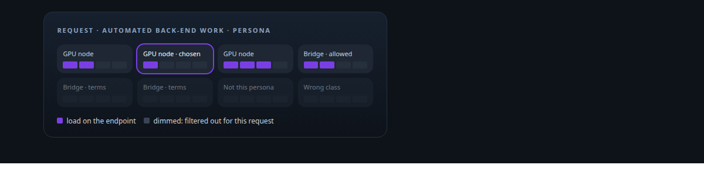
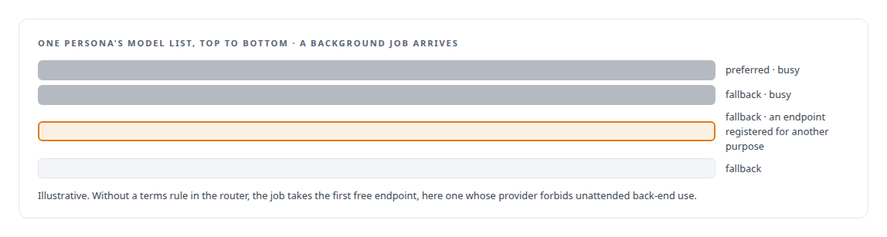
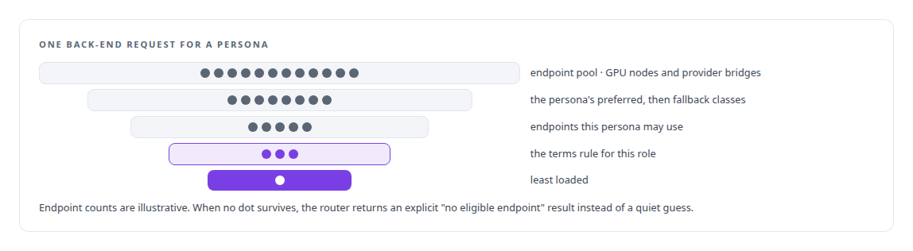
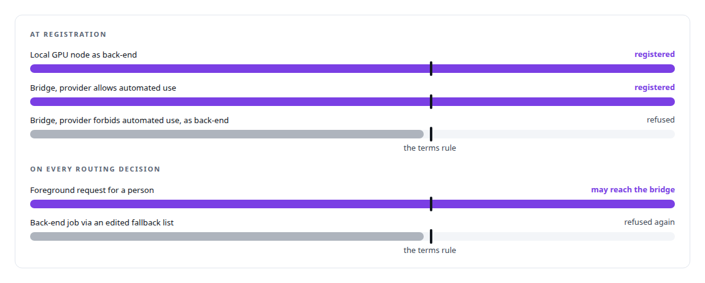
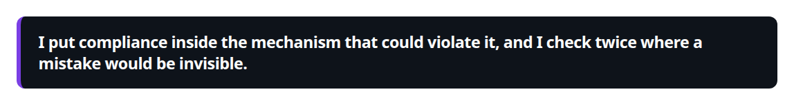

# Provider-terms compliance in model routing

**A terms-of-service firewall in the agent runtime decides which traffic may reach which provider, so a subscription session is used as its vendor permits.**

Canonical: https://coreyjames.ai/technologies/provider-terms-compliance-in-model-routing/  
Author: Corey James · Published: 2026-10-28 · Kind: technology  
Systems: [Agent Swarm](https://github.com/coreyjames-ai/agent-swarm)  
Skills: [distributed systems correctness](https://github.com/coreyjames-ai/portfolio/tree/main/skills/distributed-systems-correctness) · [tool synthesis and governed API integration](https://github.com/coreyjames-ai/portfolio/tree/main/skills/tool-synthesis-and-governed-api-integration) · [inference serving architecture](https://github.com/coreyjames-ai/portfolio/tree/main/skills/inference-serving-architecture)  



## What was built

### How an automatic router breaks terms by accident

In [Agent Swarm](https://coreyjames.ai/systems/agent-swarm) a router picks a model endpoint for every agent request, from my own GPUs or from hosted providers, and some providers' terms forbid automated, unattended back-end use of their models. In an automatic router that rule is easy to break by accident.



I made provider terms a routing constraint in code, so compliance does not depend on whoever configures the next endpoint. The rule separates foreground use for a person from automated back-end use, because the terms draw that line.

### How the router narrows

The router works over an endpoint pool that is a view joining the GPU inference nodes with the registered provider bridges, so each endpoint exists in one place and there is no second registry to fall out of sync. A request carries its role, foreground work for a person or automated back-end work, and the persona making it.



### Checked twice

The terms rule runs twice: at registration and on every routing decision.



The second check costs one comparison and prevents a violation nobody would see in an unattended system, so I kept it. The rule is small; the judgment is in where it sits.



The bridges that make hosted providers routable present them in the same OpenAI-compatible shape as local models, rate-limit in Redis, and register and deregister themselves. The tool side of the same runtime is told in [Tools are the platform](https://coreyjames.ai/stories/tools-are-the-platform).

> I put compliance inside the mechanism that could violate it, and I check twice where a mistake would be invisible.

## What was verified

Each line is a claim the canonical page supports, with the figure as the page states it.

- Model routing with compliance constraints: provider terms enforced in the agent router, separating foreground use for a person from unattended back-end use.
- Defence in depth: the terms rule checked at endpoint registration and again on every routing decision, with an explicit no-eligible-endpoint result instead of a guess.
- Multi-provider LLM integration: hosted providers presented in the same OpenAI-compatible shape as local GPU models, rate-limited in Redis and self-registering.

## Related

- [Tools are the platform](https://github.com/coreyjames-ai/agent-swarm/tree/main/stories/tools-are-the-platform) · https://coreyjames.ai/stories/tools-are-the-platform/
- System: [Agent Swarm](https://github.com/coreyjames-ai/agent-swarm)

## Citation

Corey James. "Provider-terms compliance in model routing." coreyjames.ai, 2026. https://coreyjames.ai/technologies/provider-terms-compliance-in-model-routing/

```bibtex
@misc{coreyjames-provider-terms-compliance-in-model-routing,
  author = {Corey James},
  title = {Provider-terms compliance in model routing},
  year = {2026},
  howpublished = {\url{https://coreyjames.ai/technologies/provider-terms-compliance-in-model-routing/}},
  note = {GitHub copy: https://github.com/coreyjames-ai/portfolio/tree/main/technologies/provider-terms-compliance-in-model-routing}
}
```

Part of [Corey James's portfolio](https://github.com/coreyjames-ai/portfolio) · site: https://coreyjames.ai/ · MCP server: https://coreyjames.ai/mcp · agent card: https://coreyjames.ai/.well-known/agent.json
