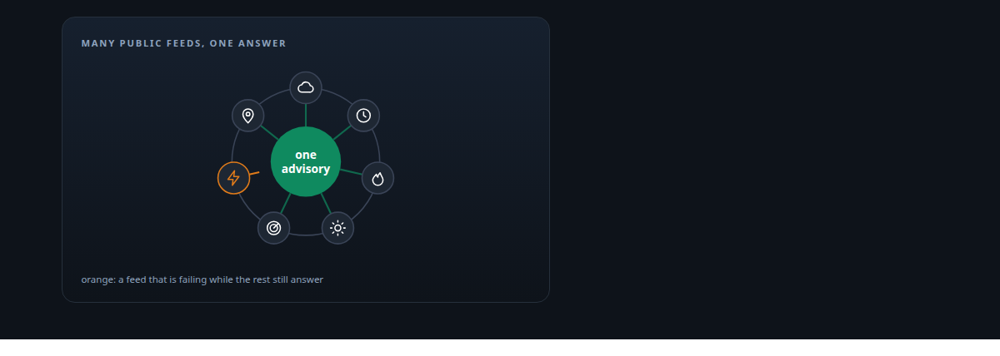
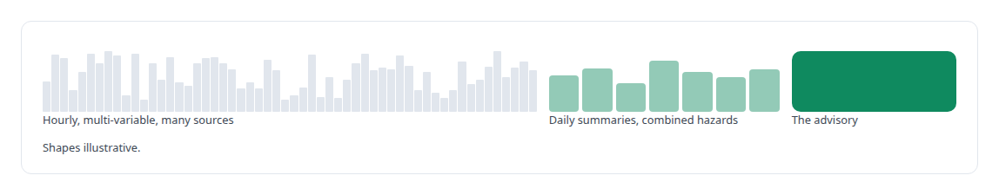
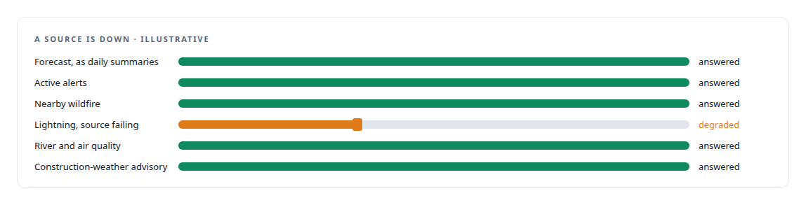
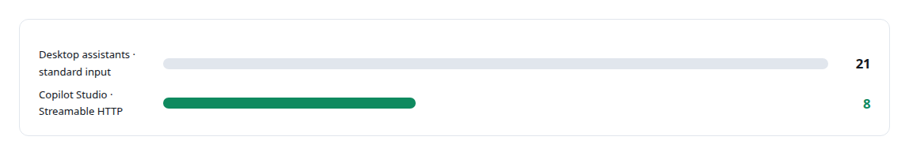
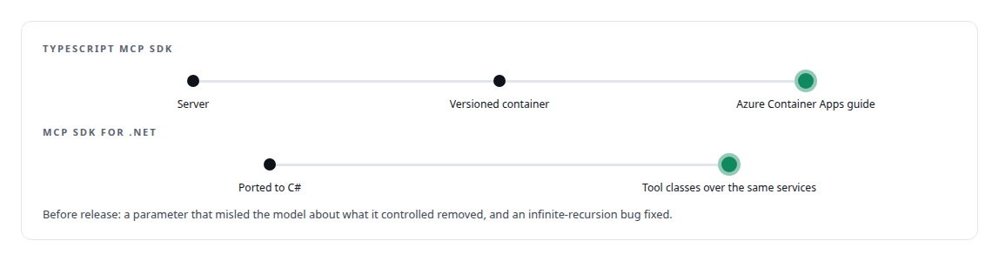

# Public environmental data APIs

**Public weather and environmental data feed a product-shaped MCP server that exposes 21 tools, with a trimmed surface for a vendor agent platform.**

Canonical: https://coreyjames.ai/technologies/public-environmental-data-apis/  
Author: Corey James · Published: 2026-10-28 · Kind: technology  
Systems: [Auth and access plane](https://github.com/coreyjames-ai/auth-and-access-plane)  
Skills: [MCP server design](https://github.com/coreyjames-ai/portfolio/tree/main/skills/mcp-server-design) · [tool synthesis and governed API integration](https://github.com/coreyjames-ai/portfolio/tree/main/skills/tool-synthesis-and-governed-api-integration) · [inference serving architecture](https://github.com/coreyjames-ai/portfolio/tree/main/skills/inference-serving-architecture)  



## Result

| Figure | What it measures |
| --- | --- |
| **9** | public data-service clients behind one server |
| **15** | tool classes in the .NET port |
| **2** | MCP SDKs the same product was built on |

## What was built

### Aggregate before answering

In the [Auth and access plane](https://coreyjames.ai/systems/auth-and-access-plane) I built a weather MCP server as a worked example of a product-shaped tool server, and the problem it solves is size. Public weather data is hourly, multi-variable and far larger than an assistant should read, and an assistant asked "can we pour concrete on Thursday?" needs a judgment.




The advisory interprets conditions for field work, and saved locations let a user ask about "the north site".

### Public sources, each with its own failure handling

Behind it sit clients for national forecasts and alerts, climate history, wildfire incidents, an open global forecast service, precipitation radar, lightning detection and address geocoding. Public services differ in reliability, rate limits and response shape, so each client has its own cache, retries and timeouts.



### Two surfaces for two kinds of client

Desktop assistants read the full surface over standard input. Microsoft Copilot Studio's connector works best with a small, stable HTTP surface, so the Streamable-HTTP server exposes a trimmed set shaped for that connector.



### One product in TypeScript and .NET

I packaged the server as a versioned container with a deployment guide for Azure Container Apps, then ported it to C# on the official MCP SDK for .NET over the same services. Building the same product on both SDKs showed the design was not tied to one runtime.



I can shape messy third-party data into a tool surface built around how a language model and a specific enterprise platform consume it, and deliver it in two ecosystems. The data belongs to the public services; the clients, aggregation, tools and port are mine.

> I decided the server would aggregate before it answers.

## What was verified

Each line is a claim the canonical page supports, with the figure as the page states it.

- MCP server design: a product-shaped weather server over 9 public data-service clients that aggregates hourly data into daily answers and a construction-weather advisory.
- Resilient third-party API integration: each public source with its own cache, retries and timeouts, so a failing service degrades only its part of an answer.
- Microsoft Copilot Studio integration: 21 tools for desktop assistants and a trimmed Streamable-HTTP surface for Copilot Studio, the same product built on 2 MCP SDKs with 15 tool classes in .NET.

## Related

- System: [Auth and access plane](https://github.com/coreyjames-ai/auth-and-access-plane)

## Citation

Corey James. "Public environmental data APIs." coreyjames.ai, 2026. https://coreyjames.ai/technologies/public-environmental-data-apis/

```bibtex
@misc{coreyjames-public-environmental-data-apis,
  author = {Corey James},
  title = {Public environmental data APIs},
  year = {2026},
  howpublished = {\url{https://coreyjames.ai/technologies/public-environmental-data-apis/}},
  note = {GitHub copy: https://github.com/coreyjames-ai/portfolio/tree/main/technologies/public-environmental-data-apis}
}
```

Part of [Corey James's portfolio](https://github.com/coreyjames-ai/portfolio) · site: https://coreyjames.ai/ · MCP server: https://coreyjames.ai/mcp · agent card: https://coreyjames.ai/.well-known/agent.json
