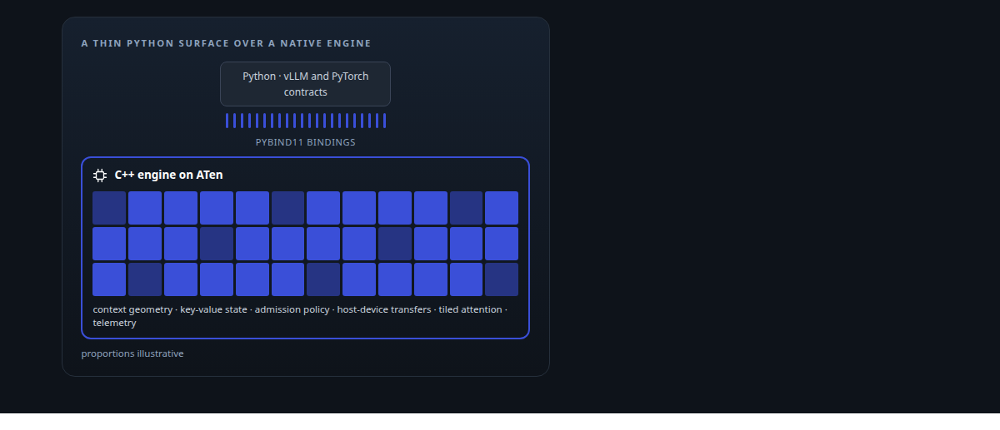
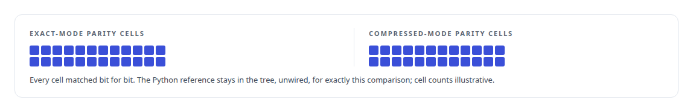
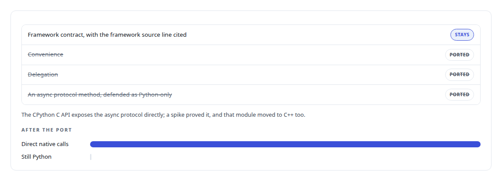
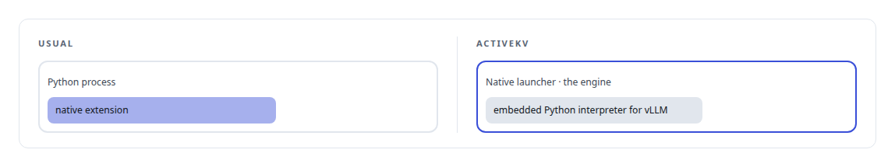
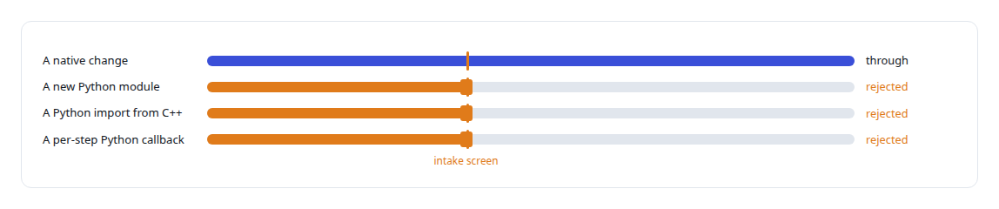

# pybind11

**pybind11 binds ActiveKV's C++ engine into vLLM and PyTorch; a line-by-line audit proves every remaining Python line is a framework contract.**

Canonical: https://coreyjames.ai/technologies/pybind11/  
Author: Corey James · Published: 2026-10-28 · Kind: technology  
Systems: [ActiveKV](https://github.com/coreyjames-ai/activekv)  
Skills: [C++ and native ports with parity proof](https://github.com/coreyjames-ai/portfolio/tree/main/skills/c-and-native-ports-with-parity-proof) · [vLLM internals](https://github.com/coreyjames-ai/portfolio/tree/main/skills/vllm-internals) · [tool synthesis and governed API integration](https://github.com/coreyjames-ai/portfolio/tree/main/skills/tool-synthesis-and-governed-api-integration) · [AI-assisted engineering methodology](https://github.com/coreyjames-ai/portfolio/tree/main/skills/ai-assisted-engineering-methodology)  



## Result

| Figure | What it measures |
| --- | --- |
| **67** | pybind11 modules expose the C++ engine to the parts of vLLM that call it |
| **866** | of 867 places where Python dispatched work became direct native calls |
| **0** | lines of my own Python in the release payload |

## What was built

### From a Python prototype to C++ inside vLLM

In [ActiveKV](https://coreyjames.ai/systems/activekv) the Python version proved the design and was too slow on the per-token path, and it left the product logic as readable source. I moved the whole runtime to C++ inside vLLM, with pybind11 as the boundary, built against PyTorch's ATen.



The port is told in [Rewriting an engine extension without changing a token](https://coreyjames.ai/stories/rewriting-an-engine-extension-without-changing-a-token), and how I proved the native code was the code that ran is in [Proving a rewrite is the same system](https://coreyjames.ai/stories/proving-a-rewrite-is-the-same-system).

### What may stay in Python

The hard part of a binding layer is deciding what may stay in Python. My rule: only an explicitly justified vLLM or PyTorch interface requirement remains, and a framework that requires a Python callable gets a thin binding with the logic behind it in C++.




### The engine owns the process

I also inverted the usual arrangement: a native launcher embeds the Python interpreter that vLLM needs. A type-conversion defect at the boundary that broke startup was fixed in the binding code before the release cut.



### A release with the boundary enforced

The release payload comes as compiled binaries plus a patch to the user's vLLM, and every change is screened at intake.



I can carry a large Python-to-C++ port inside someone else's engine to bit-exact parity, and I reason about a language boundary from what the interpreter and framework actually require. pybind11, vLLM and PyTorch are third-party; the engine, bindings, launcher and boundary rules are mine.

> The language boundary is a contract I minimise and justify line by line.

## What was verified

Each line is a claim the canonical page supports, with the figure as the page states it.

- C++ and native ports with parity proof: a Python runtime moved to C++ inside vLLM, 866 of 867 Python dispatch sites made direct native calls, parity cells matched bit for bit.
- Python and C++ interoperability with pybind11: 67 binding modules into vLLM and PyTorch, and a line-by-line audit leaving only cited framework contracts in Python.
- Release engineering for native extensions: a native launcher that embeds the Python interpreter, and a release of compiled binaries plus a patch with 0 lines of my own Python.

## Related

- [Rewriting an engine extension without changing a token](https://github.com/coreyjames-ai/activekv/tree/main/stories/rewriting-an-engine-extension-without-changing-a-token) · https://coreyjames.ai/stories/rewriting-an-engine-extension-without-changing-a-token/
- [Proving a rewrite is the same system](https://github.com/coreyjames-ai/activekv/tree/main/stories/proving-a-rewrite-is-the-same-system) · https://coreyjames.ai/stories/proving-a-rewrite-is-the-same-system/
- System: [ActiveKV](https://github.com/coreyjames-ai/activekv)

## Citation

Corey James. "pybind11." coreyjames.ai, 2026. https://coreyjames.ai/technologies/pybind11/

```bibtex
@misc{coreyjames-pybind11,
  author = {Corey James},
  title = {pybind11},
  year = {2026},
  howpublished = {\url{https://coreyjames.ai/technologies/pybind11/}},
  note = {GitHub copy: https://github.com/coreyjames-ai/portfolio/tree/main/technologies/pybind11}
}
```

Part of [Corey James's portfolio](https://github.com/coreyjames-ai/portfolio) · site: https://coreyjames.ai/ · MCP server: https://coreyjames.ai/mcp · agent card: https://coreyjames.ai/.well-known/agent.json
