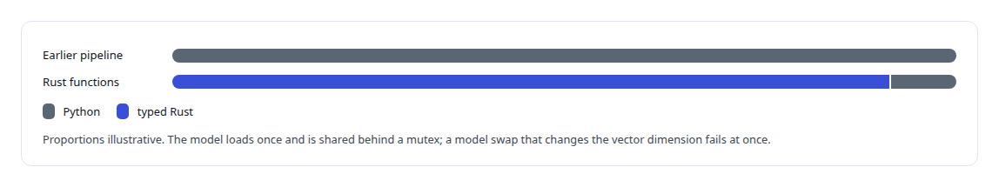

# PyO3

**An earlier in-process Python binding for embeddings, replaced by a separate inference server.**

Canonical: https://coreyjames.ai/technologies/pyo3/  
Author: Corey James · Published: 2026-10-28 · Kind: technology  
Systems: [FAFO Core and Function Forge](https://github.com/coreyjames-ai/fafo-core) · [FAFOHive](https://github.com/coreyjames-ai/fafohive)  
Skills: [inference serving architecture](https://github.com/coreyjames-ai/portfolio/tree/main/skills/inference-serving-architecture) · [Rust systems engineering](https://github.com/coreyjames-ai/portfolio/tree/main/skills/rust-systems-engineering)  


## What was built

I use a language bridge where it saves time and remove it when it costs more than it saves, without disturbing the code that depends on it. These are thin wrappers around a third-party Python model; the judgment is in where the boundary sat and when it moved.

## An embedding model inside a Rust function

In [FAFO Core and Function Forge](https://coreyjames.ai/systems/fafo-core) the research and memory functions are Rust, and the embedding model they needed was easiest to reach through a Python library. I used PyO3 to bring the model into the Rust function and keep everything else native. The rest of the function stays ordinary Rust on the substrate, queue-driven and controllable like any other.

The research steps that consumed these embeddings, a validator for candidate question-and-answer pairs and a near-neighbour rebalancing step, were ported from an earlier Python pipeline into typed Rust functions, with this wrapper as the only Python left in them.



## Moving the model behind a service boundary

In [FAFOHive](https://coreyjames.ai/systems/fafohive) I used the same pattern first and later moved off it. The memory service ran the embedding model in process through PyO3, then through a GPU subprocess. Every search feature depended on that path.


The graph tools that sit beside the embeddings are in [A code explainer that is not allowed to invent](https://coreyjames.ai/stories/a-code-explainer-that-is-not-allowed-to-invent).

> PyO3 bought speed of delivery; once its cost showed, I moved the model behind a network boundary.

## What was verified

Each line is a claim the canonical page supports, with the figure as the page states it.

- Rust and Python interop with PyO3: an embedding model called from async Rust on blocking worker threads, the interpreter lock held only there, returning embedding vectors.
- Service boundary design: the GPU embedding model moved out of process to an embedding server over mutual TLS with the internal interface unchanged, so no caller changed.

## Related

- [A code explainer that is not allowed to invent](https://github.com/coreyjames-ai/fafohive/tree/main/stories/a-code-explainer-that-is-not-allowed-to-invent) · https://coreyjames.ai/stories/a-code-explainer-that-is-not-allowed-to-invent/
- System: [FAFO Core and Function Forge](https://github.com/coreyjames-ai/fafo-core)
- System: [FAFOHive](https://github.com/coreyjames-ai/fafohive)

## Citation

Corey James. "PyO3." coreyjames.ai, 2026. https://coreyjames.ai/technologies/pyo3/

```bibtex
@misc{coreyjames-pyo3,
  author = {Corey James},
  title = {PyO3},
  year = {2026},
  howpublished = {\url{https://coreyjames.ai/technologies/pyo3/}},
  note = {GitHub copy: https://github.com/coreyjames-ai/portfolio/tree/main/technologies/pyo3}
}
```

Part of [Corey James's portfolio](https://github.com/coreyjames-ai/portfolio) · site: https://coreyjames.ai/ · MCP server: https://coreyjames.ai/mcp · agent card: https://coreyjames.ai/.well-known/agent.json
