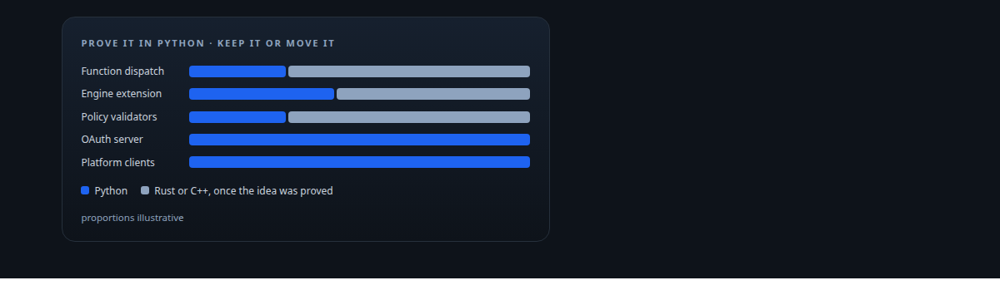
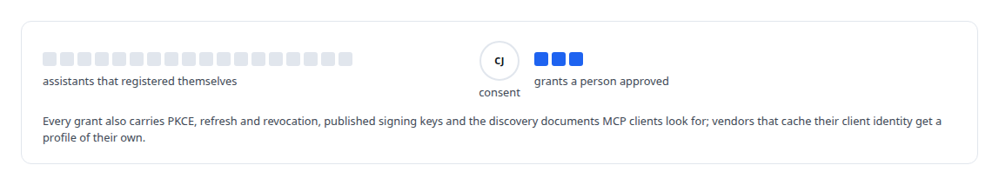
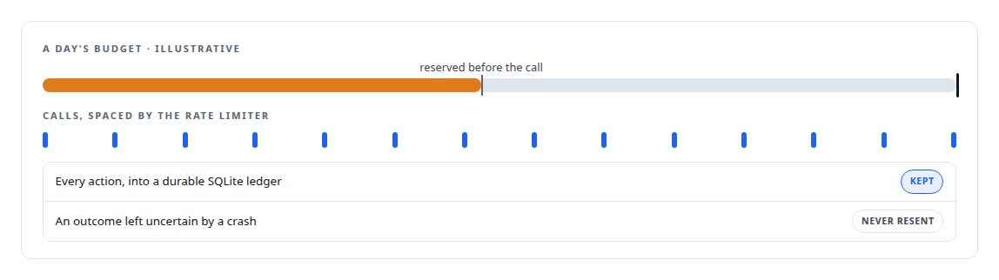
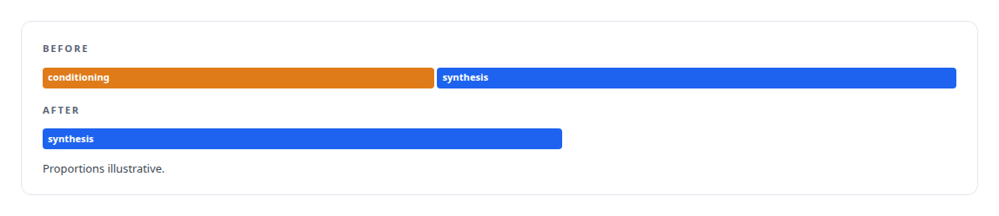
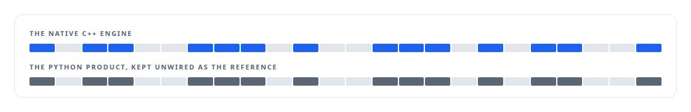
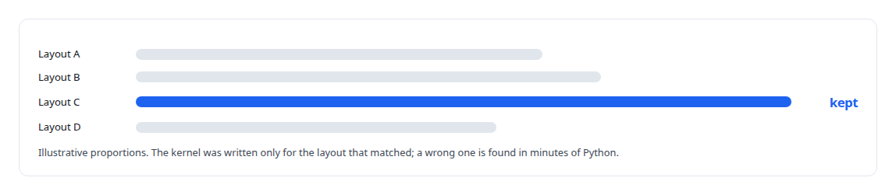
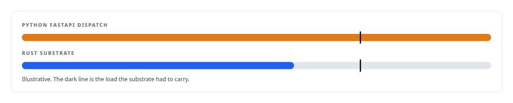

# Python

**Python is where I prototype and where frameworks demand it: ActiveKV began in Python inside vLLM before the native port, the OAuth server is Python, and the training and evaluation harnesses are Python.**

Canonical: https://coreyjames.ai/technologies/python/  
Author: Corey James · Published: 2026-10-28 · Kind: technology  
Systems: [Auth and access plane](https://github.com/coreyjames-ai/auth-and-access-plane) · [FAFOHive](https://github.com/coreyjames-ai/fafohive) · [Helix](https://github.com/coreyjames-ai/helix) · [ActiveKV](https://github.com/coreyjames-ai/activekv) · [Capabilities model](https://github.com/coreyjames-ai/capabilities-model) · [AgentOS](https://github.com/coreyjames-ai/agentos) · [FAFO Core and Function Forge](https://github.com/coreyjames-ai/fafo-core)  
Skills: [OAuth 2.0 and identity architecture](https://github.com/coreyjames-ai/portfolio/tree/main/skills/oauth-2-0-and-identity-architecture) · [AI-assisted engineering methodology](https://github.com/coreyjames-ai/portfolio/tree/main/skills/ai-assisted-engineering-methodology) · [tool synthesis and governed API integration](https://github.com/coreyjames-ai/portfolio/tree/main/skills/tool-synthesis-and-governed-api-integration) · [inference serving architecture](https://github.com/coreyjames-ai/portfolio/tree/main/skills/inference-serving-architecture)  



## Result

| Figure | What it measures |
| --- | --- |
| **22,000** | lines of Python in the OAuth authorization server |
| **11,800** | hand-written lines in the X module |
| **45,000** | lines of Python that proved ActiveKV before the native port |
| **~1 s** | fixed cost per speech request removed by caching voice conditioning |

## What was built

I use Python where integration speed and ecosystem matter.

## An OAuth server for outside assistants

In the [Auth and access plane](https://coreyjames.ai/systems/auth-and-access-plane) I needed commercial AI assistants, including Copilot Studio, to authenticate to my private tool estate, and a FastAPI service was the fastest way to speak OAuth correctly. See [The hardening fix that locked everyone out](https://coreyjames.ai/stories/the-hardening-fix-that-locked-everyone-out).



## Platform clients with their own safety

In [FAFOHive](https://coreyjames.ai/systems/fafohive) agents needed social platforms the hosted vendor could not reach, and I chose Python on the FastMCP framework for speed against the platforms' APIs. The X module is the largest, the Facebook module about 4,500 lines, and a Reddit module is small. The tool explorer that treats tool descriptions as untrusted input is Python too. The gateway these modules sit behind is told in [Agents with real tools and no keys](https://coreyjames.ai/stories/agents-with-real-tools-and-no-keys).



## Integration around Rust services

In [Helix](https://coreyjames.ai/systems/helix) Python handles integration around Rust services. The Teams working service, a FastAPI work service on PostgreSQL with a host launcher and a worker runtime, lets a Teams user hand work to coding agents on machines that accept no inbound connections, with idempotent submissions and start claims. The speech-synthesis server is a FastAPI streaming wrapper around an open text-to-speech model.



## A prototype kept as the parity reference

In [ActiveKV](https://coreyjames.ai/systems/activekv) a Python extension inside vLLM proved the design, and I then had it ported to C++: [Rewriting an engine extension without changing a token](https://coreyjames.ai/stories/rewriting-an-engine-extension-without-changing-a-token). The tooling that drives the benchmark matrix, samples host and GPU load and generates comparison tables is still Python.



## Numerical checks before a kernel

In the [Capabilities model](https://coreyjames.ai/systems/capabilities-model) Python carries the work around the model: evaluation probes, baseline sweeps, recall analysis and the numerical checks behind the CUDA decoder.



## Tooling beside Rust runtimes

In [AgentOS](https://coreyjames.ai/systems/agentos) the runtime is Rust and Python is tooling: programs that inventory and check the workflow rules, and a snapshot emitter for the operator console. In [FAFO Core and Function Forge](https://coreyjames.ai/systems/fafo-core) the first version was a Python FastAPI dispatch service that pushed embedding, local-model and cluster-health jobs to workers over Redis; it proved the idea, could not carry the load, and was re-engineered in Rust. Earlier Python policy validators were ported into the Rust runtime, wire-compatible with what they replaced, and the research pipeline, four generations of Python, became typed Rust functions on the substrate. A Python script still regenerates the build registry behind link-time function registration.




> Components that must be long-lived, concurrent and governed move to Rust once the Python prototype has proved the idea.

## What was verified

Each line is a claim the canonical page supports, with the figure as the page states it.

- OAuth and identity architecture: a 22,000-line Python authorization server with PKCE, dynamic client registration and a consent screen for outside AI assistants.
- API integration in Python: social-platform modules on FastMCP, 11,800 hand-written lines in one, each with its own rate limiter, budget reservations and a durable SQLite ledger.
- Prototype-to-native migration: 45,000 lines of Python that proved a vLLM extension, kept unwired as the bit-exact parity reference after the C++ port.
- Numerical validation before kernel work: candidate 4-bit weight layouts correlated in Python against the full-precision checkpoint before any kernel was written.

## Related

- [Rewriting an engine extension without changing a token](https://github.com/coreyjames-ai/activekv/tree/main/stories/rewriting-an-engine-extension-without-changing-a-token) · https://coreyjames.ai/stories/rewriting-an-engine-extension-without-changing-a-token/
- [Agents with real tools and no keys](https://github.com/coreyjames-ai/fafohive/tree/main/stories/agents-with-real-tools-and-no-keys) · https://coreyjames.ai/stories/agents-with-real-tools-and-no-keys/
- [Proving a rewrite is the same system](https://github.com/coreyjames-ai/activekv/tree/main/stories/proving-a-rewrite-is-the-same-system) · https://coreyjames.ai/stories/proving-a-rewrite-is-the-same-system/
- [Tools that build tools, under governance](https://github.com/coreyjames-ai/fafo-core/tree/main/stories/tools-that-build-tools-under-governance) · https://coreyjames.ai/stories/tools-that-build-tools-under-governance/
- [196 deadlocks to zero](https://github.com/coreyjames-ai/fafo-core/tree/main/stories/196-deadlocks-to-zero) · https://coreyjames.ai/stories/196-deadlocks-to-zero/
- [The hardening fix that locked everyone out](https://github.com/coreyjames-ai/auth-and-access-plane/tree/main/stories/the-hardening-fix-that-locked-everyone-out) · https://coreyjames.ai/stories/the-hardening-fix-that-locked-everyone-out/
- System: [Auth and access plane](https://github.com/coreyjames-ai/auth-and-access-plane)
- System: [FAFOHive](https://github.com/coreyjames-ai/fafohive)
- System: [Helix](https://github.com/coreyjames-ai/helix)
- System: [ActiveKV](https://github.com/coreyjames-ai/activekv)
- System: [Capabilities model](https://github.com/coreyjames-ai/capabilities-model)
- System: [AgentOS](https://github.com/coreyjames-ai/agentos)
- System: [FAFO Core and Function Forge](https://github.com/coreyjames-ai/fafo-core)

## Citation

Corey James. "Python." coreyjames.ai, 2026. https://coreyjames.ai/technologies/python/

```bibtex
@misc{coreyjames-python,
  author = {Corey James},
  title = {Python},
  year = {2026},
  howpublished = {\url{https://coreyjames.ai/technologies/python/}},
  note = {GitHub copy: https://github.com/coreyjames-ai/portfolio/tree/main/technologies/python}
}
```

Part of [Corey James's portfolio](https://github.com/coreyjames-ai/portfolio) · site: https://coreyjames.ai/ · MCP server: https://coreyjames.ai/mcp · agent card: https://coreyjames.ai/.well-known/agent.json
