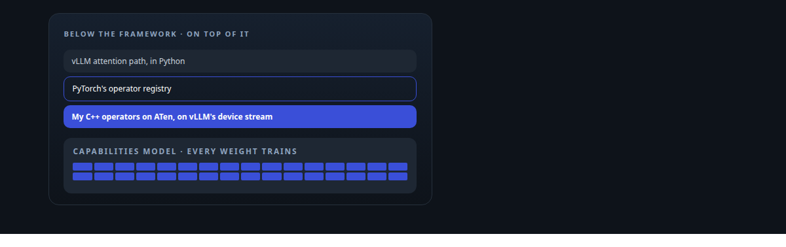
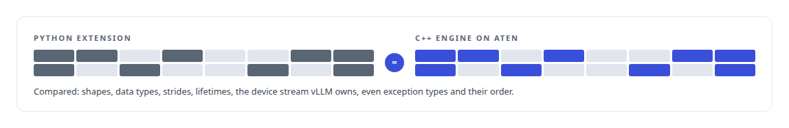
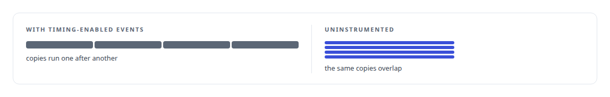
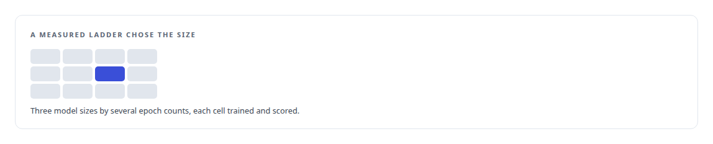

# PyTorch

**ActiveKV extends PyTorch's XPU backend and ATen from native code; the capabilities model is a PyTorch fine-tune.**

Canonical: https://coreyjames.ai/technologies/pytorch/  
Author: Corey James · Published: 2026-10-28 · Kind: technology  
Systems: [ActiveKV](https://github.com/coreyjames-ai/activekv) · [Capabilities model](https://github.com/coreyjames-ai/capabilities-model)  
Skills: [C++ and native ports with parity proof](https://github.com/coreyjames-ai/portfolio/tree/main/skills/c-and-native-ports-with-parity-proof) · [AI-assisted engineering methodology](https://github.com/coreyjames-ai/portfolio/tree/main/skills/ai-assisted-engineering-methodology) · [NVIDIA Blackwell development](https://github.com/coreyjames-ai/portfolio/tree/main/skills/nvidia-blackwell-development)  



## Result

| Figure | What it measures |
| --- | --- |
| **22** | source files registering native operators in PyTorch's own registry |
| **~596 M** | parameters in the open-weight base model |
| **≤ 14 min** | per full fine-tune, the shortest about two |
| **17.6 GiB** | peak memory on one NVIDIA Blackwell GPU |

## What was built

I work with PyTorch from both ends: as a native extension that must be indistinguishable from the code it replaced, and as a training tool where the recipe, the size and the rebuild cost are measured choices. I work below the framework when the framework is in the way.

## Native operators inside vLLM

In [ActiveKV](https://coreyjames.ai/systems/activekv) a native engine manages a model's key-value cache inside vLLM, which is built on PyTorch, so the engine has to speak PyTorch's tensor model exactly. I built it in C++ against ATen, PyTorch's tensor library, and registered its operators with PyTorch's own operator registry, so vLLM's attention path calls them as first-class operators. When the runtime moved from Python to C++ it had to stay indistinguishable from the Python version, and bitwise comparison proved it: [Rewriting an engine extension without changing a token](https://coreyjames.ai/stories/rewriting-an-engine-extension-without-changing-a-token).



## A profile that changed what it measured

PyTorch's own timing events taught me a lesson. Timing-enabled events serialised the copy engine they were meant to observe, and I retracted a conclusion built on them: [The observer that changed the answer](https://coreyjames.ai/stories/the-observer-that-changed-the-answer).




## A full fine-tune that rebuilds in minutes

In the [Capabilities model](https://coreyjames.ai/systems/capabilities-model) I needed a model that knows a tool catalog by heart and can be rebuilt whenever the catalog changes, so I trained in PyTorch with Hugging Face Transformers and fine-tuned every parameter of a small open-weight base model. At that size a full fine-tune finishes in minutes, so I skipped adapters and their extra layer. The recipe is AdamW with a cosine schedule, full-precision master weights with BF16 autocast and gradient checkpointing.



Training is cheap and scoring is the slow step, which makes a rebuild routine. Quantization afterwards takes about fifteen seconds and reproduces byte for byte. See [A hundred tokens instead of forty-two thousand](https://coreyjames.ai/stories/a-hundred-tokens-instead-of-forty-two-thousand). I also used PyTorch on Intel's XPU stack to produce a published 4-bit quantization of a 27B model: [A 27B model on one 32 GB Intel card](https://coreyjames.ai/stories/a-27b-model-on-one-32gb-intel-card). PyTorch, Transformers and the open-weight base model are third-party; the extension, recipe and measurements are mine.

> Profiles built on framework events are checked against an uninstrumented run before I believe them.

## What was verified

Each line is a claim the canonical page supports, with the figure as the page states it.

- PyTorch native extension development: C++ operators on ATen registered in PyTorch's own registry across 22 source files, indistinguishable from the Python version bit for bit.
- LLM fine-tuning: a full fine-tune of every parameter of a ~596 M-parameter model in 2 to 14 minutes, peaking at 17.6 GiB on one NVIDIA Blackwell GPU.
- GPU profiling methodology: a conclusion built on timing-enabled events retracted once the events were shown to serialise the copy engine they observed.

## Related

- [A hundred tokens instead of forty-two thousand](https://github.com/coreyjames-ai/capabilities-model/tree/main/stories/a-hundred-tokens-instead-of-forty-two-thousand) · https://coreyjames.ai/stories/a-hundred-tokens-instead-of-forty-two-thousand/
- [Rewriting an engine extension without changing a token](https://github.com/coreyjames-ai/activekv/tree/main/stories/rewriting-an-engine-extension-without-changing-a-token) · https://coreyjames.ai/stories/rewriting-an-engine-extension-without-changing-a-token/
- [Proving a rewrite is the same system](https://github.com/coreyjames-ai/activekv/tree/main/stories/proving-a-rewrite-is-the-same-system) · https://coreyjames.ai/stories/proving-a-rewrite-is-the-same-system/
- [Context beyond VRAM](https://github.com/coreyjames-ai/activekv/tree/main/stories/context-beyond-vram) · https://coreyjames.ai/stories/context-beyond-vram/
- [The observer that changed the answer](https://github.com/coreyjames-ai/activekv/tree/main/stories/the-observer-that-changed-the-answer) · https://coreyjames.ai/stories/the-observer-that-changed-the-answer/
- [A 27B model on one 32 GB Intel card](https://github.com/coreyjames-ai/capabilities-model/tree/main/stories/a-27b-model-on-one-32gb-intel-card) · https://coreyjames.ai/stories/a-27b-model-on-one-32gb-intel-card/
- System: [ActiveKV](https://github.com/coreyjames-ai/activekv)
- System: [Capabilities model](https://github.com/coreyjames-ai/capabilities-model)

## Citation

Corey James. "PyTorch." coreyjames.ai, 2026. https://coreyjames.ai/technologies/pytorch/

```bibtex
@misc{coreyjames-pytorch,
  author = {Corey James},
  title = {PyTorch},
  year = {2026},
  howpublished = {\url{https://coreyjames.ai/technologies/pytorch/}},
  note = {GitHub copy: https://github.com/coreyjames-ai/portfolio/tree/main/technologies/pytorch}
}
```

Part of [Corey James's portfolio](https://github.com/coreyjames-ai/portfolio) · site: https://coreyjames.ai/ · MCP server: https://coreyjames.ai/mcp · agent card: https://coreyjames.ai/.well-known/agent.json
