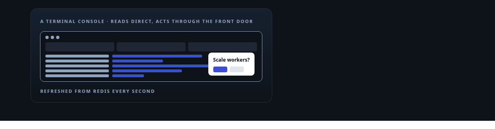
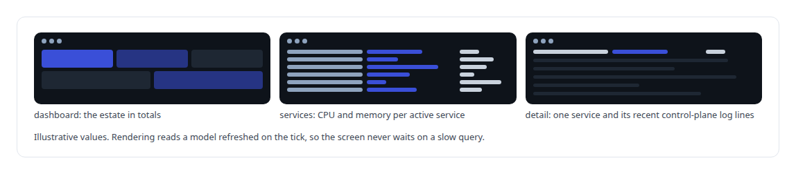
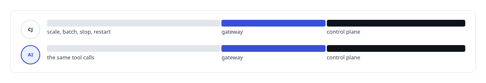

# ratatui

**A terminal console over my execution substrate's Redis control plane, for watching function services and steering them.**

Canonical: https://coreyjames.ai/technologies/ratatui/  
Author: Corey James · Published: 2026-10-28 · Kind: technology  
Systems: [FAFO Core and Function Forge](https://github.com/coreyjames-ai/fafo-core) · [Auth and access plane](https://github.com/coreyjames-ai/auth-and-access-plane)  
Skills: [Rust systems engineering](https://github.com/coreyjames-ai/portfolio/tree/main/skills/rust-systems-engineering) · [tool synthesis and governed API integration](https://github.com/coreyjames-ai/portfolio/tree/main/skills/tool-synthesis-and-governed-api-integration) · [inference serving architecture](https://github.com/coreyjames-ai/portfolio/tree/main/skills/inference-serving-architecture)  



## What was built

### Watching the substrate from a terminal

[FAFO Core and Function Forge](https://coreyjames.ai/systems/fafo-core) runs functions as services whose state lives in Redis. I wanted to watch and steer them from a terminal without opening a browser, so I had a small Rust console built on ratatui and crossterm. A dashboard view rolls the estate up into totals, and a services view lists every active service with its resources; arrow keys and function keys move between them, and a detail view for one service adds its recent control-plane log lines.



### Steering through the front door

Reads go straight to Redis, but every change the console can make is an MCP tool call to the control plane through the authenticated gateway, and nothing is sent until the operator confirms it in a popup. The control plane those calls reach is described on the [FAFO Core and Function Forge](https://coreyjames.ai/systems/fafo-core) page, and the gateway's sign-in on the [Auth and access plane](https://coreyjames.ai/systems/auth-and-access-plane) page.




I build small operator tools on the same rules as the platform they watch. ratatui and crossterm are third-party; the console, its views and its use of the control surface are mine, and the depth is in the substrate it steers.

> The console has no control path an agent lacks.

## What was verified

Each line is a claim the canonical page supports, with the figure as the page states it.

- Terminal UI development in Rust: a ratatui and crossterm console over a Redis control plane, refreshing every active service's state each second.
- Operator tooling with least privilege: every console action sent as a confirmed MCP tool call through the same authenticated gate an agent uses.

## Related

- System: [FAFO Core and Function Forge](https://github.com/coreyjames-ai/fafo-core)
- System: [Auth and access plane](https://github.com/coreyjames-ai/auth-and-access-plane)

## Citation

Corey James. "ratatui." coreyjames.ai, 2026. https://coreyjames.ai/technologies/ratatui/

```bibtex
@misc{coreyjames-ratatui,
  author = {Corey James},
  title = {ratatui},
  year = {2026},
  howpublished = {\url{https://coreyjames.ai/technologies/ratatui/}},
  note = {GitHub copy: https://github.com/coreyjames-ai/portfolio/tree/main/technologies/ratatui}
}
```

Part of [Corey James's portfolio](https://github.com/coreyjames-ai/portfolio) · site: https://coreyjames.ai/ · MCP server: https://coreyjames.ai/mcp · agent card: https://coreyjames.ai/.well-known/agent.json
