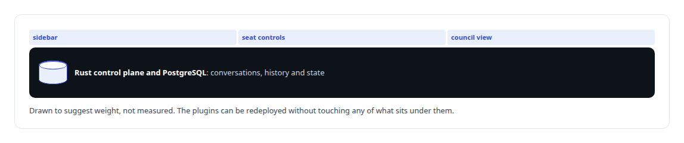
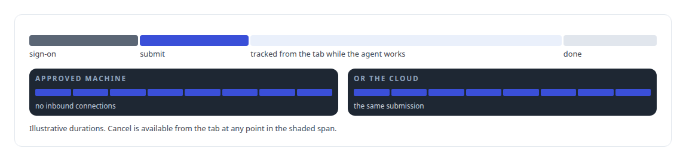
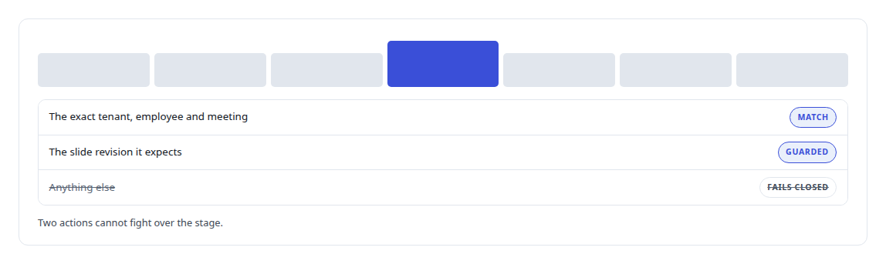

# React

**React builds the Mattermost plugins, the Teams work tab and the meeting-stage app for Helix.**

Canonical: https://coreyjames.ai/technologies/react/  
Author: Corey James · Published: 2026-10-28 · Kind: technology  
Systems: [Helix](https://github.com/coreyjames-ai/helix) · [Auth and access plane](https://github.com/coreyjames-ai/auth-and-access-plane)  


## What was built

In [Helix](https://coreyjames.ai/systems/helix) I wanted people, and the AI colleague they work with, to stay inside the platforms they already use. I build front ends as integration surfaces inside other people's platforms: small, native-looking and backed by a server-side source of truth.

## Plugins inside the collaboration shell

The Control Center, Helix's multi-model collaboration shell, runs on an unmodified Mattermost server. I extend it only through its supported plugin model: everything Helix adds to its interface is a Mattermost webapp plugin in React and JSX, and the plugins are thin.



## A work tab inside Teams

In Teams, the working service has a tab built with React and Microsoft's Fluent UI, so it looks native where it appears. A user signs in through Teams single sign-on and hands work to a coding agent on an approved machine or in the cloud.



## A meeting stage the agent can drive

The third surface came from a dead end. Microsoft's native presentation feature gives an agent nothing to hold, and I would not have the agent pretend to present. I built a Teams meeting-stage app, with stage, side-panel and configuration views, and a small authenticated Node relay with its own test suite. The meeting-action server uses it to start a deck on the shared stage, move through it and stop it. See [A meeting attendee that will not fake it](https://coreyjames.ai/stories/a-meeting-attendee-that-will-not-fake-it) and [Solving the digital-employee identity](https://coreyjames.ai/stories/solving-the-digital-employee-identity).




> Where a vendor feature has no control an agent can use, I build a surface I control.

## What was verified

Each line is a claim the canonical page supports, with the figure as the page states it.

- Microsoft Teams app development: a Fluent UI work tab with Teams single sign-on, and a meeting-stage app an AI agent drives with each action bound to tenant, employee and meeting.
- Mattermost plugin development: React webapp plugins for a multi-model collaboration shell, kept thin over server-side state in Rust and PostgreSQL.

## Related

- [A meeting attendee that will not fake it](https://github.com/coreyjames-ai/helix/tree/main/stories/a-meeting-attendee-that-will-not-fake-it) · https://coreyjames.ai/stories/a-meeting-attendee-that-will-not-fake-it/
- [Solving the digital-employee identity](https://github.com/coreyjames-ai/helix/tree/main/stories/solving-the-digital-employee-identity) · https://coreyjames.ai/stories/solving-the-digital-employee-identity/
- System: [Helix](https://github.com/coreyjames-ai/helix)
- System: [Auth and access plane](https://github.com/coreyjames-ai/auth-and-access-plane)

## Citation

Corey James. "React." coreyjames.ai, 2026. https://coreyjames.ai/technologies/react/

```bibtex
@misc{coreyjames-react,
  author = {Corey James},
  title = {React},
  year = {2026},
  howpublished = {\url{https://coreyjames.ai/technologies/react/}},
  note = {GitHub copy: https://github.com/coreyjames-ai/portfolio/tree/main/technologies/react}
}
```

Part of [Corey James's portfolio](https://github.com/coreyjames-ai/portfolio) · site: https://coreyjames.ai/ · MCP server: https://coreyjames.ai/mcp · agent card: https://coreyjames.ai/.well-known/agent.json
