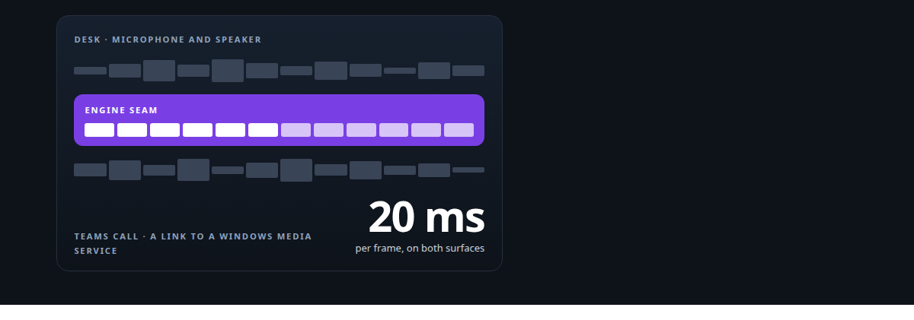
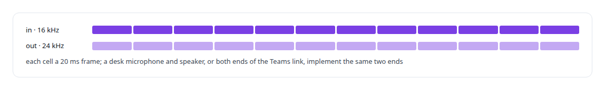
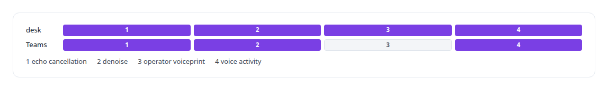
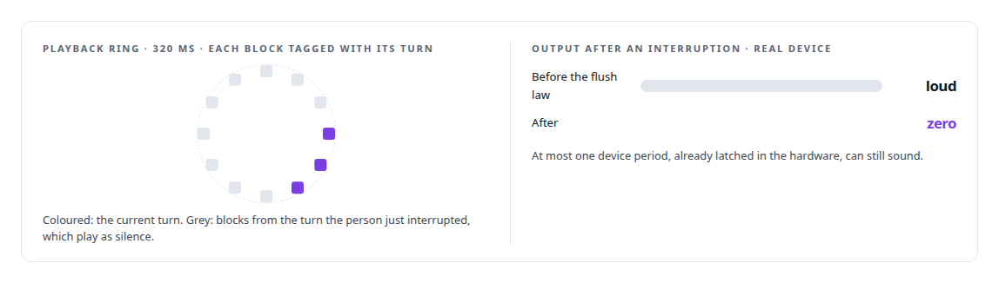
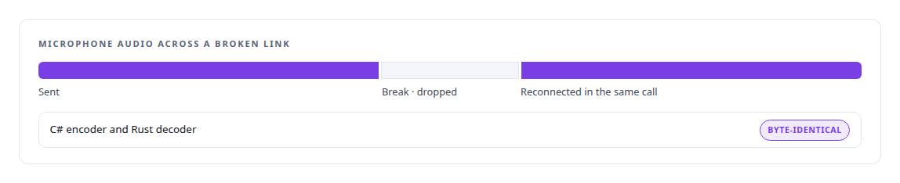
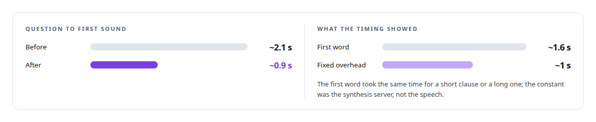

# Real-time audio pipeline engineering

**PCM framing, resampling, echo-cancellation reference, pacing and drop-on-reconnect: the audio path from a desk microphone or a Teams call to my own speech models.**

Canonical: https://coreyjames.ai/technologies/real-time-audio-pipeline-engineering/  
Author: Corey James · Published: 2026-10-28 · Kind: technology  
Systems: [Helix](https://github.com/coreyjames-ai/helix)  
Skills: [real-time voice AI](https://github.com/coreyjames-ai/portfolio/tree/main/skills/real-time-voice-ai) · [Rust systems engineering](https://github.com/coreyjames-ai/portfolio/tree/main/skills/rust-systems-engineering) · [Microsoft Teams real-time media](https://github.com/coreyjames-ai/portfolio/tree/main/skills/microsoft-teams-real-time-media) · [speech recognition and synthesis pipelines](https://github.com/coreyjames-ai/portfolio/tree/main/skills/speech-recognition-and-synthesis-pipelines)  



## Result

| Figure | What it measures |
| --- | --- |
| **91,643** | call buffers moved in a 30-minute soak |
| **50.001/s** | buffer rate held across that soak |
| **0** | receive stalls in the same run |
| **30 ms** | denoiser latency gate at the 95th percentile |

## What was built

### One audio seam for a desk and a Teams call

In [Helix](https://coreyjames.ai/systems/helix) I wanted one voice engine to work on a desk microphone and inside a Teams call without the conversation logic knowing which. I gave the Rust engine one sealed audio seam: an abstract source and sink with one frame contract, so a new audio endpoint is an implementation and the engine does not change. The same turn-taking and interruption behaviour runs in both.



### A front end of composable stages

The front end is a chain of stages over that frame contract, each reading and writing the same frames. Echo cancellation uses the WebRTC AEC3 algorithm with the engine's own playback as reference, in ten-millisecond blocks with the delay seeded from device clocks, so the agent does not hear itself; in a Teams call the reference is the engine's playback into the call. A low-latency denoiser, vendored and patched to build on stable Rust, removes noise on the CPU with its attenuation capped, under a latency gate. An optional operator voiceprint filter on speaker embeddings, enrolled without keeping any recording, silences other voices before voice-activity detection, so a television cannot interrupt the agent or trigger a tool. A voice-activity model then marks where speech is.



The voiceprint filter is an input-quality stage for the desk microphone only; Teams calls rely on Microsoft's voice isolation at the capture device, for written reasons. When the recogniser's confidence is low, the turn comes back empty.


### Stopping the moment a person speaks

What a person notices is that they can talk over the agent and it stops, with no stale audio played afterwards. Underneath, the real-time callbacks copy and return and do no allocation, locking or logging: the capture callback downmixes and pushes into a lock-free ring of about 200 milliseconds, and a dedicated sender owns pacing.



The interruption behaviour is in [Interruptions that only people can make](https://coreyjames.ai/stories/interruptions-that-only-people-can-make); the echo-cancellation proof in [A proof that proved nothing](https://coreyjames.ai/stories/a-proof-that-proved-nothing).

### The Teams link

The Teams side has the hardest real-time constraint I have worked to. Microsoft's real-time media SDK delivers call audio only to a Windows application, in 20-millisecond buffers with strict lifetimes. My .NET service copies each buffer and returns at once, and a paced sender keeps the call from stuttering. Audio crosses from an Azure virtual machine to my Linux host over a binary protocol on one authenticated WebSocket per call, written in C# and in Rust and proven byte-identical against golden test vectors. See [A self-hosted colleague in a Teams call](https://coreyjames.ai/stories/a-self-hosted-colleague-in-a-teams-call).



Dropping what was captured during the break means the agent never answers a question from twenty seconds ago.

### Cutting the felt gap

Latency work followed the same path. Timing each turn exposed a fixed overhead in the speech-synthesis server; streaming synthesis with cached voice conditioning removed it, and speech moved to a dedicated GPU host: [From two seconds to under one](https://coreyjames.ai/stories/from-two-seconds-to-under-one).



I can engineer real-time audio across operating systems and clouds with the discipline the medium demands, and keep the conversation logic independent of any one platform. Microsoft's SDK and the open speech and audio models are third-party.

> An agent acting on words nobody said is worse than one that asks again.

## What was verified

Each line is a claim the canonical page supports, with the figure as the page states it.

- Real-time voice AI: one Rust voice engine behind a sealed audio seam of 20 ms frames, 16 kHz in and 24 kHz out, on a desk microphone and inside Teams calls.
- Microsoft Teams real-time media: a .NET media bridge and Rust host on one WebSocket per call, a 30-minute soak moving 91,643 buffers at 50.001 per second with 0 receive stalls.
- Audio signal processing: echo cancellation, a denoiser under a 30 ms 95th-percentile latency gate, an operator voiceprint filter and voice-activity detection ahead of recognition.
- Latency engineering: question-to-first-sound cut from about 2.1 s to about 0.9 s with streaming synthesis and cached voice conditioning.

## Related

- [A self-hosted colleague in a Teams call](https://github.com/coreyjames-ai/helix/tree/main/stories/a-self-hosted-colleague-in-a-teams-call) · https://coreyjames.ai/stories/a-self-hosted-colleague-in-a-teams-call/
- [Interruptions that only people can make](https://github.com/coreyjames-ai/helix/tree/main/stories/interruptions-that-only-people-can-make) · https://coreyjames.ai/stories/interruptions-that-only-people-can-make/
- [A proof that proved nothing](https://github.com/coreyjames-ai/helix/tree/main/stories/a-proof-that-proved-nothing) · https://coreyjames.ai/stories/a-proof-that-proved-nothing/
- [From two seconds to under one](https://github.com/coreyjames-ai/helix/tree/main/stories/from-two-seconds-to-under-one) · https://coreyjames.ai/stories/from-two-seconds-to-under-one/
- System: [Helix](https://github.com/coreyjames-ai/helix)

## Citation

Corey James. "Real-time audio pipeline engineering." coreyjames.ai, 2026. https://coreyjames.ai/technologies/real-time-audio-pipeline-engineering/

```bibtex
@misc{coreyjames-real-time-audio-pipeline-engineering,
  author = {Corey James},
  title = {Real-time audio pipeline engineering},
  year = {2026},
  howpublished = {\url{https://coreyjames.ai/technologies/real-time-audio-pipeline-engineering/}},
  note = {GitHub copy: https://github.com/coreyjames-ai/portfolio/tree/main/technologies/real-time-audio-pipeline-engineering}
}
```

Part of [Corey James's portfolio](https://github.com/coreyjames-ai/portfolio) · site: https://coreyjames.ai/ · MCP server: https://coreyjames.ai/mcp · agent card: https://coreyjames.ai/.well-known/agent.json
