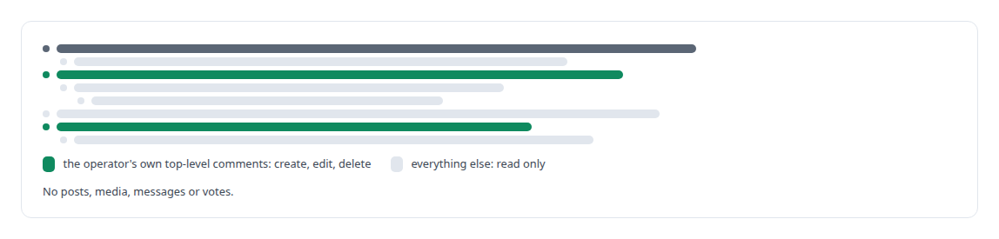
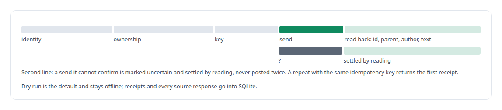

# Reddit

**An in-house Reddit integration through my own browser session, with duplicate-safe receipts and a read-back after every change.**

Canonical: https://coreyjames.ai/technologies/reddit/  
Author: Corey James · Published: 2026-10-28 · Kind: technology  
Systems: [FAFOHive](https://github.com/coreyjames-ai/fafohive)  
Skills: [exactly-once delivery and crash recovery](https://github.com/coreyjames-ai/portfolio/tree/main/skills/exactly-once-delivery-and-crash-recovery) · [tool synthesis and governed API integration](https://github.com/coreyjames-ai/portfolio/tree/main/skills/tool-synthesis-and-governed-api-integration) · [distributed systems correctness](https://github.com/coreyjames-ai/portfolio/tree/main/skills/distributed-systems-correctness)  


## What was built

### Acting through the operator's own browser

[FAFOHive](https://coreyjames.ai/systems/fafohive) needed agents to take part in Reddit threads, and my estate has no API route to the site. I decided the module would act through the operator's own browser session and leave every credential in that browser, where the operator already trusts it. The provider service talks over a private local socket to a native-messaging host, and the host hands each request to a small browser extension that sends the same requests the site sends from the signed-in tab. The service never sees a cookie, opens no automation browser and clicks nothing, so a layout change cannot break it.




The site is Reddit's; the module and its checks are mine.

### Every change checked twice

The module joins the FAFOHive gateway under the same trust model as the other providers; the gateway is described in [Agents with real tools and no keys](https://coreyjames.ai/stories/agents-with-real-tools-and-no-keys). Idempotency keys cover the full input, which makes an honest retry safe and a careless one fail.



> When a platform offers no sanctioned API path, I narrow the surface until every action can be checked against the page itself.

## What was verified

Each line is a claim the canonical page supports, with the figure as the page states it.

- Browser-session integration without credentials: a module acting through the operator's signed-in browser over native messaging, never seeing a cookie or automating the page.
- Exactly-once delivery and crash recovery: idempotency keys over the full input, an exact read-back after every change, and an unconfirmed send settled by reading, never posted twice.

## Related

- [Agents with real tools and no keys](https://github.com/coreyjames-ai/fafohive/tree/main/stories/agents-with-real-tools-and-no-keys) · https://coreyjames.ai/stories/agents-with-real-tools-and-no-keys/
- System: [FAFOHive](https://github.com/coreyjames-ai/fafohive)

## Citation

Corey James. "Reddit." coreyjames.ai, 2026. https://coreyjames.ai/technologies/reddit/

```bibtex
@misc{coreyjames-reddit,
  author = {Corey James},
  title = {Reddit},
  year = {2026},
  howpublished = {\url{https://coreyjames.ai/technologies/reddit/}},
  note = {GitHub copy: https://github.com/coreyjames-ai/portfolio/tree/main/technologies/reddit}
}
```

Part of [Corey James's portfolio](https://github.com/coreyjames-ai/portfolio) · site: https://coreyjames.ai/ · MCP server: https://coreyjames.ai/mcp · agent card: https://coreyjames.ai/.well-known/agent.json
