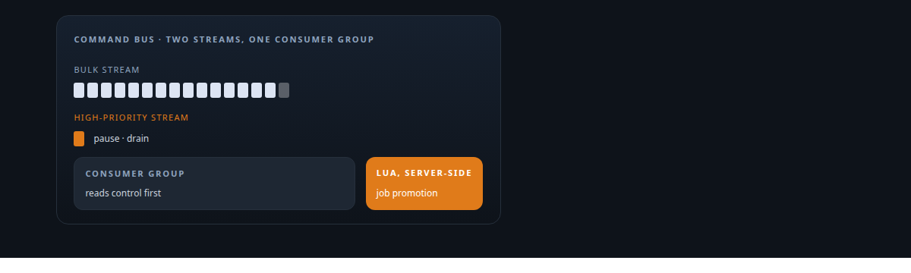
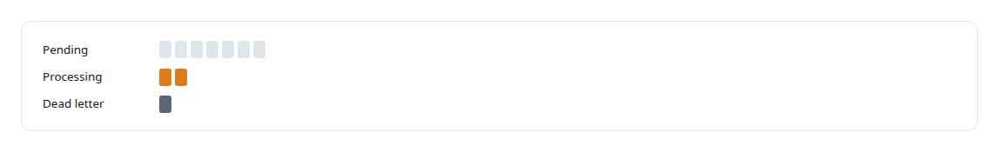
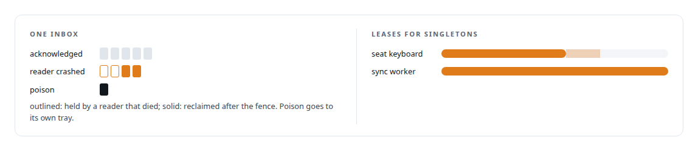
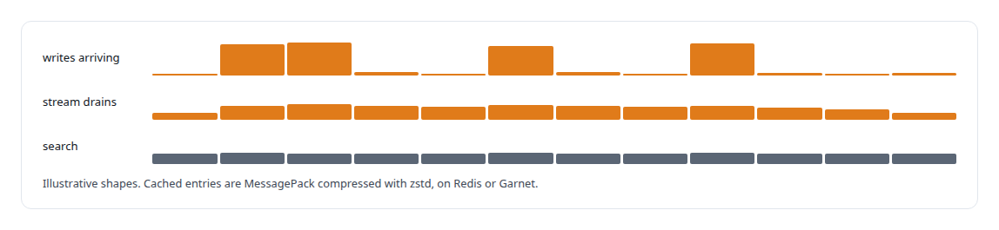
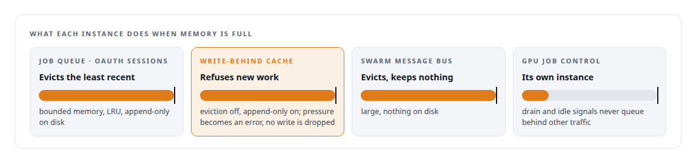

# Redis

**Redis Streams carry my execution substrate's command bus with Lua-atomic job promotion, the agent runtime's messaging, and the write-behind queue. Topology is explicit and documented.**

Canonical: https://coreyjames.ai/technologies/redis/  
Author: Corey James · Published: 2026-10-28 · Kind: technology  
Systems: [FAFO Core and Function Forge](https://github.com/coreyjames-ai/fafo-core) · [Agent Swarm](https://github.com/coreyjames-ai/agent-swarm) · [AgentOS](https://github.com/coreyjames-ai/agentos) · [FAFOHive](https://github.com/coreyjames-ai/fafohive) · [Auth and access plane](https://github.com/coreyjames-ai/auth-and-access-plane) · [Inference Fabric](https://github.com/coreyjames-ai/inference-fabric) · [PostgreSQL Fabric](https://github.com/coreyjames-ai/postgresql-fabric)  
Skills: [message broker and queue design](https://github.com/coreyjames-ai/portfolio/tree/main/skills/message-broker-and-queue-design) · [distributed systems correctness](https://github.com/coreyjames-ai/portfolio/tree/main/skills/distributed-systems-correctness) · [exactly-once delivery and crash recovery](https://github.com/coreyjames-ai/portfolio/tree/main/skills/exactly-once-delivery-and-crash-recovery) · [inference serving architecture](https://github.com/coreyjames-ai/portfolio/tree/main/skills/inference-serving-architecture)  



## What was built

### A control backbone for FAFO Core

[FAFO Core and Function Forge](https://coreyjames.ai/systems/fafo-core) needed a backbone for job state and real-time control that could take bursts, and I put it on Redis. Each function has pending, processing and dead-letter queues and per-job state keys, and multi-step state changes run as server-side Lua, so each is atomic in one round trip. Control commands travel on a Redis stream read by a consumer group, with a separate high-priority stream so a pause or drain never waits behind bulk traffic.



Container port ranges are leased with set-if-absent keys, and cloud GPU spend is counted per second in Redis and persisted to PostgreSQL. The API integration platform runs on a stock Redis 8 with append-only and snapshot persistence. It holds the entity store, search indexes, write stream and rate buckets, and a Redis lease elects its sync workers.

### Messages that survive a crashed reader

[Agent Swarm](https://coreyjames.ai/systems/agent-swarm) needed agent-to-agent messages to survive a crashed reader. Each inbox reads through a consumer group, unacknowledged messages are reclaimed after a fixed fence, and a Lua script moves poison messages aside so one bad message cannot loop. Registration is an atomic set-if-absent on a hash, and a compare-and-set Lua script guards control of an agent.

[AgentOS](https://coreyjames.ai/systems/agentos) lets a person watch any agent seat, and taking the keyboard is a Redis lease, so a dead holder simply expires. Agent events also enter AgentOS through Redis.



### Bursts kept away from search

The memory capability of [FAFOHive](https://coreyjames.ai/systems/fafohive) captures observations in bursts that could starve search, so its writes go through a Redis stream on their own connection pool. The cache stores MessagePack compressed with zstd, and Garnet works as a drop-in backend.



### A topology with chosen failure modes

[Auth and access plane](https://coreyjames.ai/systems/auth-and-access-plane) is where I designed the Redis topology for the estate. I split the instances by role and gave each its own failure mode, including a separate instance for [Inference Fabric](https://coreyjames.ai/systems/inference-fabric)'s GPU container job control.



The OAuth server keeps authorization codes, refresh tokens and registered clients in Redis, and every instance has its own alert rules.


Redis is a third-party server that I configure and program against.

> I treat Redis as a component with chosen semantics.

## What was verified

Each line is a claim the canonical page supports, with the figure as the page states it.

- Redis Streams and queue design: a command bus on consumer groups with a separate high-priority stream so pause and drain never wait behind bulk traffic, and job promotion as atomic Lua.
- Reliable message delivery and crash recovery: agent inboxes on consumer groups that reclaim unacknowledged messages after a fence and set poison messages aside.
- Data store failure-mode design: Redis instances split by role, caches that evict and a write-behind queue with eviction off that refuses work rather than drop a write.

## Related

- [Tools are the platform](https://github.com/coreyjames-ai/agent-swarm/tree/main/stories/tools-are-the-platform) · https://coreyjames.ai/stories/tools-are-the-platform/
- [A coding agent that never holds the keys](https://github.com/coreyjames-ai/agent-swarm/tree/main/stories/a-coding-agent-that-never-holds-the-keys) · https://coreyjames.ai/stories/a-coding-agent-that-never-holds-the-keys/
- [A code explainer that is not allowed to invent](https://github.com/coreyjames-ai/fafohive/tree/main/stories/a-code-explainer-that-is-not-allowed-to-invent) · https://coreyjames.ai/stories/a-code-explainer-that-is-not-allowed-to-invent/
- [196 deadlocks to zero](https://github.com/coreyjames-ai/fafo-core/tree/main/stories/196-deadlocks-to-zero) · https://coreyjames.ai/stories/196-deadlocks-to-zero/
- [The workload that shaped the platform](https://github.com/coreyjames-ai/fafo-core/tree/main/stories/the-workload-that-shaped-the-platform) · https://coreyjames.ai/stories/the-workload-that-shaped-the-platform/
- [The hardening fix that locked everyone out](https://github.com/coreyjames-ai/auth-and-access-plane/tree/main/stories/the-hardening-fix-that-locked-everyone-out) · https://coreyjames.ai/stories/the-hardening-fix-that-locked-everyone-out/
- System: [FAFO Core and Function Forge](https://github.com/coreyjames-ai/fafo-core)
- System: [Agent Swarm](https://github.com/coreyjames-ai/agent-swarm)
- System: [AgentOS](https://github.com/coreyjames-ai/agentos)
- System: [FAFOHive](https://github.com/coreyjames-ai/fafohive)
- System: [Auth and access plane](https://github.com/coreyjames-ai/auth-and-access-plane)
- System: [Inference Fabric](https://github.com/coreyjames-ai/inference-fabric)
- System: [PostgreSQL Fabric](https://github.com/coreyjames-ai/postgresql-fabric)

## Citation

Corey James. "Redis." coreyjames.ai, 2026. https://coreyjames.ai/technologies/redis/

```bibtex
@misc{coreyjames-redis,
  author = {Corey James},
  title = {Redis},
  year = {2026},
  howpublished = {\url{https://coreyjames.ai/technologies/redis/}},
  note = {GitHub copy: https://github.com/coreyjames-ai/portfolio/tree/main/technologies/redis}
}
```

Part of [Corey James's portfolio](https://github.com/coreyjames-ai/portfolio) · site: https://coreyjames.ai/ · MCP server: https://coreyjames.ai/mcp · agent card: https://coreyjames.ai/.well-known/agent.json
