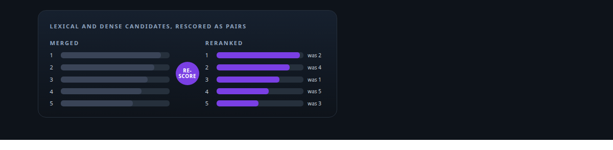
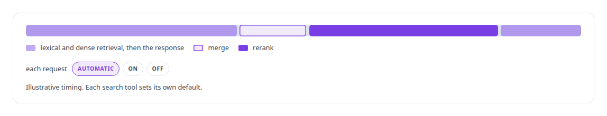
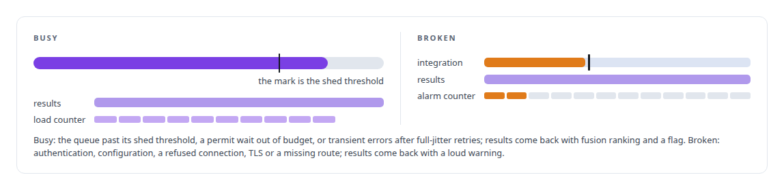
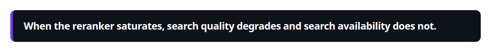

# Reranker model

**A cross-encoder reranker sits behind my hybrid retrieval, on a seam that tells load from breakage.**

Canonical: https://coreyjames.ai/technologies/reranker-model/  
Author: Corey James · Published: 2026-10-28 · Kind: technology  
Systems: [FAFOHive](https://github.com/coreyjames-ai/fafohive)  
Skills: [inference serving architecture](https://github.com/coreyjames-ai/portfolio/tree/main/skills/inference-serving-architecture) · [AI-assisted engineering methodology](https://github.com/coreyjames-ai/portfolio/tree/main/skills/ai-assisted-engineering-methodology) · [distributed systems correctness](https://github.com/coreyjames-ai/portfolio/tree/main/skills/distributed-systems-correctness)  



## What was built

The reranker is the published model, used without training or tuning; the engineering is in where it sits and how it fails.

## The rescoring step in every search

[FAFOHive](https://coreyjames.ai/systems/fafohive) serves search to many agents at once, and the most expensive step in a search is the cross-encoder that reorders the candidates. the reranker model is that cross-encoder: it rescores the merged results of lexical and dense retrieval for code, reference and observation search. It runs as a local HTTP service. The call stays in process, with no queue hop between search and rerank, so its latency budget is predictable. The retrieval design is on [Hybrid retrieval](https://coreyjames.ai/technologies/hybrid-retrieval).



## Busy or broken

The memory service calls the reranker through a client that I had wrapped in a bounded-endpoint primitive built for swarm-scale concurrency. The primitive sorts every failure into one of two classes, with separate counters.



The capacity design is on the [Capacity engineering, backpressure and load testing](https://coreyjames.ai/technologies/capacity-engineering-backpressure-and-load-testing) page.



> When the reranker saturates, search quality degrades and search availability does not.

## What was verified

Each line is a claim the canonical page supports, with the figure as the page states it.

- Cross-encoder reranking: a published reranker rescoring merged lexical and dense results for code, reference and observation search, called in process with no queue hop.
- Capacity engineering for model endpoints: the reranker client wrapped in a bounded-endpoint primitive that sorts every failure into busy or broken, with separate counters.

## Related

- [Hybrid retrieval](https://github.com/coreyjames-ai/portfolio/tree/main/technologies/hybrid-retrieval) · https://coreyjames.ai/technologies/hybrid-retrieval/
- [Capacity engineering, backpressure and load testing](https://github.com/coreyjames-ai/portfolio/tree/main/technologies/capacity-engineering-backpressure-and-load-testing) · https://coreyjames.ai/technologies/capacity-engineering-backpressure-and-load-testing/
- System: [FAFOHive](https://github.com/coreyjames-ai/fafohive)

## Citation

Corey James. "Reranker model." coreyjames.ai, 2026. https://coreyjames.ai/technologies/reranker-model/

```bibtex
@misc{coreyjames-reranker-model,
  author = {Corey James},
  title = {Reranker model},
  year = {2026},
  howpublished = {\url{https://coreyjames.ai/technologies/reranker-model/}},
  note = {GitHub copy: https://github.com/coreyjames-ai/portfolio/tree/main/technologies/reranker-model}
}
```

Part of [Corey James's portfolio](https://github.com/coreyjames-ai/portfolio) · site: https://coreyjames.ai/ · MCP server: https://coreyjames.ai/mcp · agent card: https://coreyjames.ai/.well-known/agent.json
