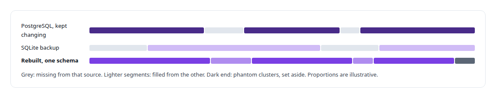
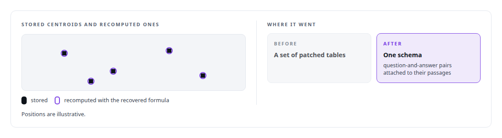
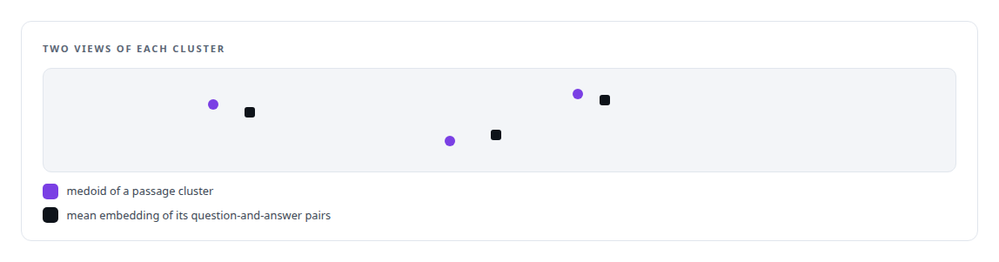

# Research data forensics

**I rebuild and prove a research dataset before I trust it.**

Canonical: https://coreyjames.ai/technologies/research-data-forensics/  
Author: Corey James · Published: 2026-10-28 · Kind: technology  
Systems: [Capabilities model](https://github.com/coreyjames-ai/capabilities-model)  
Skills: [evidence-gated acceptance](https://github.com/coreyjames-ai/portfolio/tree/main/skills/evidence-gated-acceptance) · [embedding analytics and cluster metrics](https://github.com/coreyjames-ai/portfolio/tree/main/skills/embedding-analytics-and-cluster-metrics) · [AI-assisted engineering methodology](https://github.com/coreyjames-ai/portfolio/tree/main/skills/ai-assisted-engineering-methodology)  


## Result

| Figure | What it measures |
| --- | --- |
| **~12,000** | golden examples rebuilt from two sources |
| **13 GB** | SQLite backup, the second witness |

## What was built

### Two incomplete witnesses

[Research and inventions](https://coreyjames.ai/research) mentions the curated corpus of golden examples from my first distillation pipeline. When I came back to it, the corpus was split between a PostgreSQL database that had kept changing and a SQLite backup. Neither was complete, and no notes said how its cluster centroids had been computed. I decided to rebuild it from both sources and reproduce its derived data exactly before trusting any of it.

I directed the recovery in phases, each closed by a written report. I treated the database and the backup as two independent witnesses: they were compared entry by entry, every gap in one was explained from the other, and each filled the other's gaps.



### Reproducing the derived data

The centroid formula was reverse-engineered from the stored centroids, so the recovered data is derived the same way the original was.



### Checking that the two views agree

The last phase measured alignment between the two representations the corpus carries. The audit also found a small number of phantom clusters with no surviving source text, and I had them set aside, even though that lowered the count.




> Two views of the same data that disagree mislead every model trained on them.

## What was verified

Each line is a claim the canonical page supports, with the figure as the page states it.

- Data recovery and forensics: a corpus of about 12,000 golden examples rebuilt from a changing PostgreSQL database and a 13 GB SQLite backup, compared entry by entry.
- Reproducible data pipelines: the centroid computation reverse-engineered from the stored centroids, so recovered data is derived the same way as the original.
- ML data quality: alignment measured between passage medoids and mean question-and-answer embeddings, with phantom clusters that had no source text set aside.

## Related

- System: [Capabilities model](https://github.com/coreyjames-ai/capabilities-model)

## Citation

Corey James. "Research data forensics." coreyjames.ai, 2026. https://coreyjames.ai/technologies/research-data-forensics/

```bibtex
@misc{coreyjames-research-data-forensics,
  author = {Corey James},
  title = {Research data forensics},
  year = {2026},
  howpublished = {\url{https://coreyjames.ai/technologies/research-data-forensics/}},
  note = {GitHub copy: https://github.com/coreyjames-ai/portfolio/tree/main/technologies/research-data-forensics}
}
```

Part of [Corey James's portfolio](https://github.com/coreyjames-ai/portfolio) · site: https://coreyjames.ai/ · MCP server: https://coreyjames.ai/mcp · agent card: https://coreyjames.ai/.well-known/agent.json
