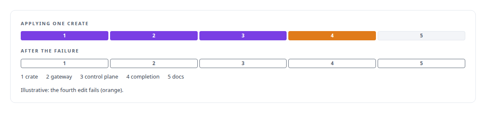
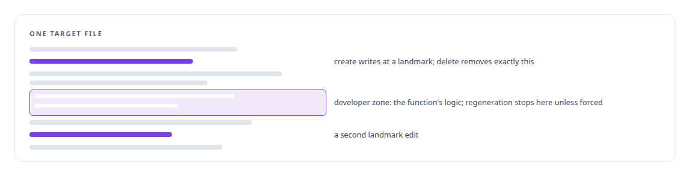
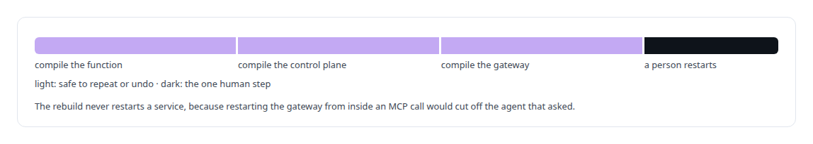

# Reversible infrastructure mutation

**Edits that touch several services happen in one rollback-protected transaction, and every create has a symmetric delete. The function generator is the worked example.**

Canonical: https://coreyjames.ai/technologies/reversible-infrastructure-mutation/  
Author: Corey James · Published: 2026-10-28 · Kind: technology  
Systems: [FAFO Core and Function Forge](https://github.com/coreyjames-ai/fafo-core)  
Skills: [AI-assisted engineering methodology](https://github.com/coreyjames-ai/portfolio/tree/main/skills/ai-assisted-engineering-methodology)  


## What was built

### One operation across five parts

[FAFO Core and Function Forge](https://coreyjames.ai/systems/fafo-core) lets an agent add a function to a working multi-service estate, and I wanted every such change to be undoable exactly. Creating a function adds a crate and edits four other parts of the estate in one operation.



Each edit runs through an atomic file layer with its own rollback per integration, so a failure halfway leaves the estate as it was and a function cannot end up registered in one service and missing from another.

### Delete built with create

I built the exit path with the entry path. The generator writes every edit at a known landmark in its target file, and delete finds those landmarks and reverses each edit, which makes reversal exact. Regenerating over an existing function is refused unless forced, because it would overwrite the developer zone that holds the function's logic. The generator creates functions, and changes to an existing one are edits inside its zone.



Functions register at link time, so an incompletely wired function fails the build and no runtime registry can drift.

### One human step

The privileged step needed a person: the restart that puts the function to work. Build and restart are separate steps, and only the restart needs a human. See [Tools that build tools, under governance](https://coreyjames.ai/stories/tools-that-build-tools-under-governance).




The generator works on my own estate's source tree and build.

> I design changes to a working system so they can be undone exactly, and I put the human decision on the one step where undo stops being free.

## What was verified

Each line is a claim the canonical page supports, with the figure as the page states it.

- Reversible infrastructure changes: a function generator whose edits across five parts of a multi-service estate run through one atomic file layer with rollback.
- Code generation with exact undo: every generated edit anchored at a landmark so delete reverses it exactly, and regeneration over a developer zone refused unless forced.
- Human-in-the-loop operations: build and restart separated, so every automated step can be repeated or undone and the restart is the one human step.

## Related

- [Tools that build tools, under governance](https://github.com/coreyjames-ai/fafo-core/tree/main/stories/tools-that-build-tools-under-governance) · https://coreyjames.ai/stories/tools-that-build-tools-under-governance/
- System: [FAFO Core and Function Forge](https://github.com/coreyjames-ai/fafo-core)

## Citation

Corey James. "Reversible infrastructure mutation." coreyjames.ai, 2026. https://coreyjames.ai/technologies/reversible-infrastructure-mutation/

```bibtex
@misc{coreyjames-reversible-infrastructure-mutation,
  author = {Corey James},
  title = {Reversible infrastructure mutation},
  year = {2026},
  howpublished = {\url{https://coreyjames.ai/technologies/reversible-infrastructure-mutation/}},
  note = {GitHub copy: https://github.com/coreyjames-ai/portfolio/tree/main/technologies/reversible-infrastructure-mutation}
}
```

Part of [Corey James's portfolio](https://github.com/coreyjames-ai/portfolio) · site: https://coreyjames.ai/ · MCP server: https://coreyjames.ai/mcp · agent card: https://coreyjames.ai/.well-known/agent.json
