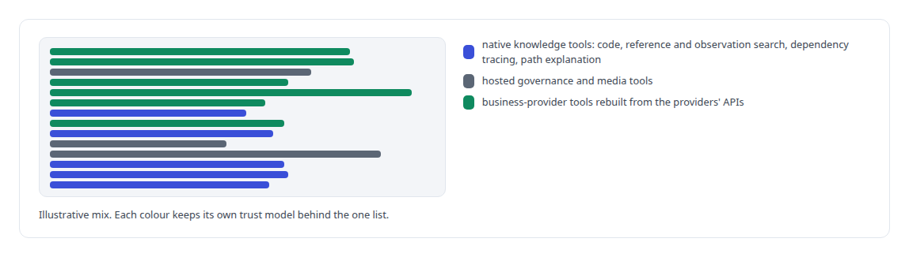
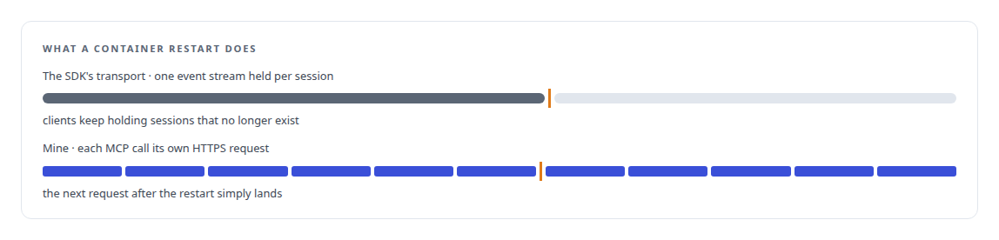

# rmcp (Rust MCP SDK)

**The Rust MCP SDK underlies my memory gateway and the meeting action server.**

Canonical: https://coreyjames.ai/technologies/rmcp-rust-mcp-sdk/  
Author: Corey James · Published: 2026-10-28 · Kind: technology  
Systems: [FAFOHive](https://github.com/coreyjames-ai/fafohive) · [Helix](https://github.com/coreyjames-ai/helix)  
Skills: [MCP server design](https://github.com/coreyjames-ai/portfolio/tree/main/skills/mcp-server-design) · [Rust systems engineering](https://github.com/coreyjames-ai/portfolio/tree/main/skills/rust-systems-engineering) · [tool synthesis and governed API integration](https://github.com/coreyjames-ai/portfolio/tree/main/skills/tool-synthesis-and-governed-api-integration) · [inference serving architecture](https://github.com/coreyjames-ai/portfolio/tree/main/skills/inference-serving-architecture)  


## What was built

### A Rust MCP server on the SDK's types

[FAFOHive](https://coreyjames.ai/systems/fafohive) needed an MCP server in Rust, and I built it on rmcp, the Rust MCP SDK, for its protocol types and server traits. The tool surface, dispatch and security are mine. The server registers three families of tools behind one list.



An earlier standalone code-search server ran on the same SDK: a small Rust MCP prototype with tree-sitter chunking and hybrid lexical and vector search. Its chunking and fusion settled the approach that FAFOHive's memory capability's code intelligence uses.

### A transport that survives restarts

Its session-holding transport broke at every container restart, so I replaced it with a stateless one over Axum, behind TLS and fail-closed bearer-token introspection: a token that cannot be introspected is refused.




Each tool also has its own timeout, because a graph-backed explanation legitimately takes far longer than a keyword lookup; the code-path explainer gets 120 seconds and quick lookups stay short. See [A code explainer that is not allowed to invent](https://coreyjames.ai/stories/a-code-explainer-that-is-not-allowed-to-invent). rmcp itself is unmodified, and the replacement transport is my code.

> I use a vendor SDK for what it does well and replace the part that breaks under real operation, once, in the server.

## What was verified

Each line is a claim the canonical page supports, with the figure as the page states it.

- MCP server design: a Rust MCP server on rmcp presenting native, hosted and provider tools in one list, each family under its own trust model.
- Zero-trust architecture: a stateless per-request transport over Axum with fail-closed bearer-token introspection, replacing a session transport that broke on restart, with per-tool timeouts up to 120 seconds.

## Related

- [A code explainer that is not allowed to invent](https://github.com/coreyjames-ai/fafohive/tree/main/stories/a-code-explainer-that-is-not-allowed-to-invent) · https://coreyjames.ai/stories/a-code-explainer-that-is-not-allowed-to-invent/
- [Solving the digital-employee identity](https://github.com/coreyjames-ai/helix/tree/main/stories/solving-the-digital-employee-identity) · https://coreyjames.ai/stories/solving-the-digital-employee-identity/
- System: [FAFOHive](https://github.com/coreyjames-ai/fafohive)
- System: [Helix](https://github.com/coreyjames-ai/helix)

## Citation

Corey James. "rmcp (Rust MCP SDK)." coreyjames.ai, 2026. https://coreyjames.ai/technologies/rmcp-rust-mcp-sdk/

```bibtex
@misc{coreyjames-rmcp-rust-mcp-sdk,
  author = {Corey James},
  title = {rmcp (Rust MCP SDK)},
  year = {2026},
  howpublished = {\url{https://coreyjames.ai/technologies/rmcp-rust-mcp-sdk/}},
  note = {GitHub copy: https://github.com/coreyjames-ai/portfolio/tree/main/technologies/rmcp-rust-mcp-sdk}
}
```

Part of [Corey James's portfolio](https://github.com/coreyjames-ai/portfolio) · site: https://coreyjames.ai/ · MCP server: https://coreyjames.ai/mcp · agent card: https://coreyjames.ai/.well-known/agent.json
