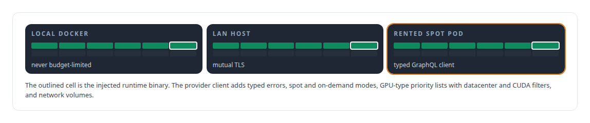
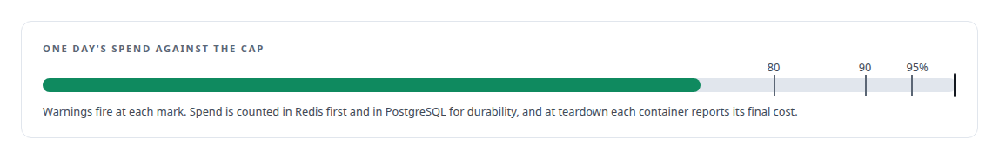
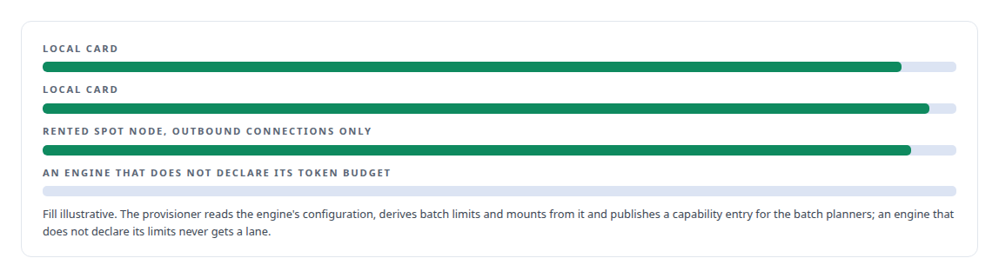
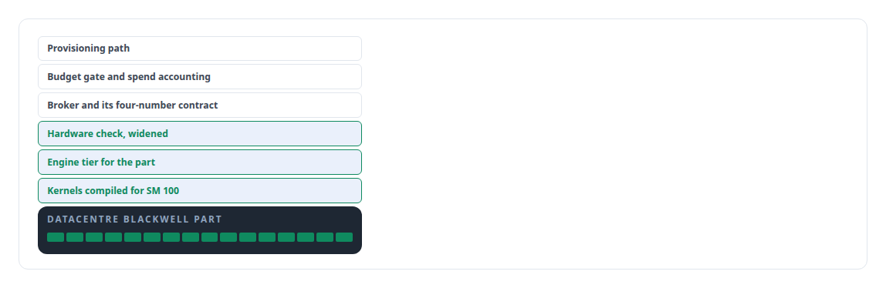

# RunPod

**Rented cloud GPU spot capacity is one provisioning target behind my substrate's fail-closed daily budget; always available, never uncapped.**

Canonical: https://coreyjames.ai/technologies/runpod/  
Author: Corey James · Published: 2026-10-28 · Kind: technology  
Systems: [FAFO Core and Function Forge](https://github.com/coreyjames-ai/fafo-core) · [Inference Fabric](https://github.com/coreyjames-ai/inference-fabric) · [FAFOHive](https://github.com/coreyjames-ai/fafohive)  
Skills: [cost attribution for AI work](https://github.com/coreyjames-ai/portfolio/tree/main/skills/cost-attribution-for-ai-work) · [inference serving architecture](https://github.com/coreyjames-ai/portfolio/tree/main/skills/inference-serving-architecture) · [NVIDIA Blackwell development](https://github.com/coreyjames-ai/portfolio/tree/main/skills/nvidia-blackwell-development) · [TensorRT and TensorRT-LLM engineering](https://github.com/coreyjames-ai/portfolio/tree/main/skills/tensorrt-and-tensorrt-llm-engineering)  


## Result

| Figure | What it measures |
| --- | --- |
| **0** | dollar cap on a day with no budget set; paid provisioning is refused |
| **1/100 ¢** | resolution of spend, counted per second |
| **5 min** | price cache, which can list cheaper GPU types under a ceiling |

## What was built

### Rented GPUs behind a compute trait

[FAFO Core and Function Forge](https://coreyjames.ai/systems/fafo-core) needed to burst onto rented GPUs. RunPod is one implementation of a provider-neutral compute trait, next to local Docker and remote Docker on LAN hosts over mutual TLS, so location is configuration and one function binary runs in any of the three.



### A daily cap only a person sets

Paid provisioning passes a fail-closed daily dollar cap. Only a person can set it, through a command-line tool I kept off the MCP surface.




### Inference capacity on demand

[Inference Fabric](https://coreyjames.ai/systems/inference-fabric) uses the same provider to add inference capacity. One call starts a TensorRT-LLM consumer node on an interruptible spot GPU, reaching the platform through outbound connections only, and the node pulls work like a local card. See [A message broker that understands tokens](https://coreyjames.ai/stories/a-message-broker-that-understands-tokens).



### Datacentre Blackwell through the same path

The GPU type is a priority list passed straight to the provider, so the same call can ask for consumer cards or datacentre Blackwell parts, with a CUDA-version filter so the pod matches the CUDA 13 toolchain my engines need. The provider's hourly rate, GPU and disk together, is stored at deployment and spend accrues from power-on. The daily cap governs new provisioning; pods already up are stopped by draining and terminating them.



RunPod's platform and API are theirs; the client, the runtime injection, the budget gate and the spend accounting are mine.

> I let agents drive cloud GPU capacity without letting them spend money nobody approved, by putting the budget in the critical path.

## What was verified

Each line is a claim the canonical page supports, with the figure as the page states it.

- Cloud GPU provisioning with cost controls: rented spot GPUs behind a provider-neutral compute trait and a fail-closed daily cap only a person sets, with a cap of 0 on a day with no budget.
- Cost attribution for AI work: spend counted per second to 1/100 of a cent, in Redis first and PostgreSQL for durability, with each container reporting its final cost.
- Inference serving architecture: TensorRT-LLM consumer nodes on interruptible spot GPUs joining the token-aware broker over outbound connections only, an engine without declared limits refused.
- NVIDIA Blackwell development: datacentre Blackwell parts reached through the same provisioning path with an engine tier, SM 100 kernels and a widened hardware check.

## Related

- [A message broker that understands tokens](https://github.com/coreyjames-ai/inference-fabric/tree/main/stories/a-message-broker-that-understands-tokens) · https://coreyjames.ai/stories/a-message-broker-that-understands-tokens/
- System: [FAFO Core and Function Forge](https://github.com/coreyjames-ai/fafo-core)
- System: [Inference Fabric](https://github.com/coreyjames-ai/inference-fabric)
- System: [FAFOHive](https://github.com/coreyjames-ai/fafohive)

## Citation

Corey James. "RunPod." coreyjames.ai, 2026. https://coreyjames.ai/technologies/runpod/

```bibtex
@misc{coreyjames-runpod,
  author = {Corey James},
  title = {RunPod},
  year = {2026},
  howpublished = {\url{https://coreyjames.ai/technologies/runpod/}},
  note = {GitHub copy: https://github.com/coreyjames-ai/portfolio/tree/main/technologies/runpod}
}
```

Part of [Corey James's portfolio](https://github.com/coreyjames-ai/portfolio) · site: https://coreyjames.ai/ · MCP server: https://coreyjames.ai/mcp · agent card: https://coreyjames.ai/.well-known/agent.json
