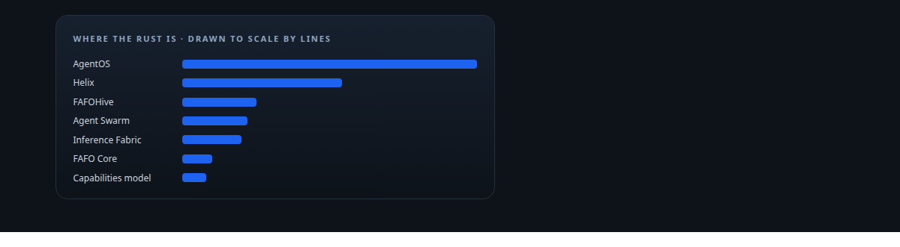
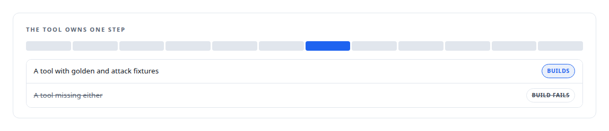
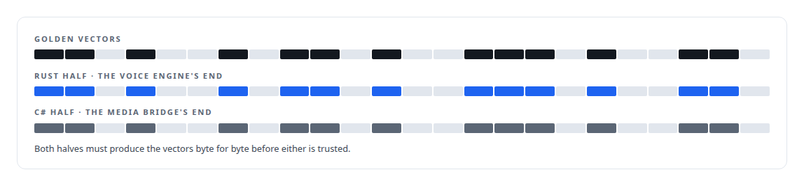
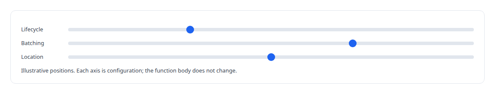
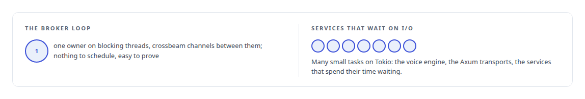
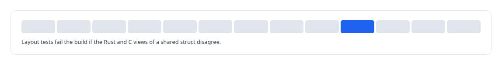

# Rust

**Rust is my systems language: about a million and a half lines across the governance platform, the agent runtime, the collaboration shell, the memory gateway, the execution substrate and the inference pipeline.**

Canonical: https://coreyjames.ai/technologies/rust/  
Author: Corey James · Published: 2026-10-28 · Kind: technology  
Systems: [AgentOS](https://github.com/coreyjames-ai/agentos) · [Agent Swarm](https://github.com/coreyjames-ai/agent-swarm) · [Helix](https://github.com/coreyjames-ai/helix) · [FAFOHive](https://github.com/coreyjames-ai/fafohive) · [FAFO Core and Function Forge](https://github.com/coreyjames-ai/fafo-core) · [Inference Fabric](https://github.com/coreyjames-ai/inference-fabric) · [Capabilities model](https://github.com/coreyjames-ai/capabilities-model)  
Skills: [Rust systems engineering](https://github.com/coreyjames-ai/portfolio/tree/main/skills/rust-systems-engineering) · [agent orchestration](https://github.com/coreyjames-ai/portfolio/tree/main/skills/agent-orchestration) · [message broker and queue design](https://github.com/coreyjames-ai/portfolio/tree/main/skills/message-broker-and-queue-design)  



## Result

| Figure | What it measures |
| --- | --- |
| **~546,000** | lines of Rust in AgentOS, across nineteen crates |
| **121** | unsafe blocks in the capabilities model, all in one FFI module |
| **21** | domain modules split from two 40,000-line hook files |
| **12** | steps every Agent Swarm tool call passes, in a frozen order |

## What was built

### Policy as compiled code

[AgentOS](https://coreyjames.ai/systems/agentos) had to make AI agents follow rules they could not talk their way around, so I put the rules in compiled code. The database layer and the hook binary are around 200,000 lines each. The hook binary runs under the coding agents' own command-line tools and turns policy into refusals. A refusal is a typed value that can only name a command the system sanctions, so the compiler stops an agent from ever being told to run a command that does not exist.


When two hook source files grew too large, I had them split into domain modules under a symbol-parity check. See [Why long agent runs fail](https://coreyjames.ai/stories/why-long-agent-runs-fail).


### A tool harness at the core of an agent runtime

[Agent Swarm](https://coreyjames.ai/systems/agent-swarm) needed every agent action to pass the same safety machinery, so I made the tool harness the core of the runtime. It is about 95,000 lines across 23 crates, plus a 23,000-line persona launcher. Agents message each other over Redis Streams with signed envelopes and a crash-recoverable inbox. See [Tools are the platform](https://coreyjames.ai/stories/tools-are-the-platform) and [A coding agent that never holds the keys](https://coreyjames.ai/stories/a-coding-agent-that-never-holds-the-keys).



### Real-time voice that cannot stall

[Helix](https://coreyjames.ai/systems/helix) needed real-time voice that could not stall a conversation. The voice engine is asynchronous Rust on Tokio with almost no unsafe code, about 62,000 lines, beside about 232,000 in the collaboration control plane. The Linux end of the Teams media bridge is Rust too; it presents a call to the engine as an ordinary audio source and sink. A Rust MCP server holds the meeting actions, binds each one to a single digital employee and mints that employee's tokens on the server. See [A self-hosted colleague in a Teams call](https://coreyjames.ai/stories/a-self-hosted-colleague-in-a-teams-call) and [A meeting attendee that will not fake it](https://coreyjames.ai/stories/a-meeting-attendee-that-will-not-fake-it).



### A memory service I could secure and extend

[FAFOHive](https://coreyjames.ai/systems/fafohive) began as my Rust re-implementation of an open-source session-memory plugin (TypeScript, AGPL-3.0), written without its code, because I wanted session memory inside a service I could secure and extend. It is now about 137,000 lines and the authenticated endpoint every agent in my estate connects to. See [A code explainer that is not allowed to invent](https://coreyjames.ai/stories/a-code-explainer-that-is-not-allowed-to-invent).


### One function trait, many places to run

[FAFO Core and Function Forge](https://coreyjames.ai/systems/fafo-core) started as a Python FastAPI prototype, and I had it rebuilt in Rust once everything else began to run on it. The core crate, about 45,000 lines, runs one asynchronous function trait under a generic conductor. The model-facing gateway generates its tool routing from YAML at build time, and Function Forge renders new function crates from Handlebars templates and registers them at link time, so a function that is not fully wired fails the build. The API integration platform is about 20,000 lines across five crates. See [Tools that build tools, under governance](https://coreyjames.ai/stories/tools-that-build-tools-under-governance) and [Closed by evidence](https://coreyjames.ai/stories/closed-by-evidence).



### A synchronous hot loop

[Inference Fabric](https://coreyjames.ai/systems/inference-fabric) had one hot loop that decided GPU throughput, and I chose synchronous Rust for it. The token-aware broker, about 24,000 lines in four crates, runs that loop on a single owner. Across six services the fabric is about 108,000 lines of Rust. The inference runtime drives TensorRT-LLM across a C++ boundary, and the analytics engine launches CUDA kernels from Rust through the driver API, with a CPU reference for every kernel. See [A message broker that understands tokens](https://coreyjames.ai/stories/a-message-broker-that-understands-tokens).



### Unsafe code fenced into one module

The [Capabilities model](https://coreyjames.ai/systems/capabilities-model) mixes Rust with a custom CUDA decoder, so I fenced the unsafe code. The workspace is thirteen crates and about 45,000 lines, and every unsafe block sits in one FFI module over CUDA. See [A hundred tokens instead of forty-two thousand](https://coreyjames.ai/stories/a-hundred-tokens-instead-of-forty-two-thousand) and [Bit-identical across batch compositions](https://coreyjames.ai/stories/bit-identical-across-batch-compositions).



> I put invariants in types wherever the compiler can enforce them.

## What was verified

Each line is a claim the canonical page supports, with the figure as the page states it.

- Rust systems engineering: about 546,000 lines of Rust in a governance control plane, where a refusal is a typed value that can only name a command the system sanctions.
- Unsafe code containment and FFI: 121 unsafe blocks confined to one FFI module over CUDA, with layout tests that fail the build if the Rust and C views disagree.
- Concurrency design in Rust: a synchronous single-owner hot loop for a 24,000-line token-aware broker, and async Tokio for the voice engine and the transports that wait on I/O.
- Build-enforced invariants: link-time registration that fails the build for an unwired function, and 12 frozen pipeline steps on every Agent Swarm tool call.

## Related

- [Why long agent runs fail](https://github.com/coreyjames-ai/agentos/tree/main/stories/why-long-agent-runs-fail) · https://coreyjames.ai/stories/why-long-agent-runs-fail/
- [Closed by evidence](https://github.com/coreyjames-ai/agentos/tree/main/stories/closed-by-evidence) · https://coreyjames.ai/stories/closed-by-evidence/
- [Tools are the platform](https://github.com/coreyjames-ai/agent-swarm/tree/main/stories/tools-are-the-platform) · https://coreyjames.ai/stories/tools-are-the-platform/
- [A coding agent that never holds the keys](https://github.com/coreyjames-ai/agent-swarm/tree/main/stories/a-coding-agent-that-never-holds-the-keys) · https://coreyjames.ai/stories/a-coding-agent-that-never-holds-the-keys/
- [A self-hosted colleague in a Teams call](https://github.com/coreyjames-ai/helix/tree/main/stories/a-self-hosted-colleague-in-a-teams-call) · https://coreyjames.ai/stories/a-self-hosted-colleague-in-a-teams-call/
- [Solving the digital-employee identity](https://github.com/coreyjames-ai/helix/tree/main/stories/solving-the-digital-employee-identity) · https://coreyjames.ai/stories/solving-the-digital-employee-identity/
- [A meeting attendee that will not fake it](https://github.com/coreyjames-ai/helix/tree/main/stories/a-meeting-attendee-that-will-not-fake-it) · https://coreyjames.ai/stories/a-meeting-attendee-that-will-not-fake-it/
- [Agents with real tools and no keys](https://github.com/coreyjames-ai/fafohive/tree/main/stories/agents-with-real-tools-and-no-keys) · https://coreyjames.ai/stories/agents-with-real-tools-and-no-keys/
- [A code explainer that is not allowed to invent](https://github.com/coreyjames-ai/fafohive/tree/main/stories/a-code-explainer-that-is-not-allowed-to-invent) · https://coreyjames.ai/stories/a-code-explainer-that-is-not-allowed-to-invent/
- [A hundred tokens instead of forty-two thousand](https://github.com/coreyjames-ai/capabilities-model/tree/main/stories/a-hundred-tokens-instead-of-forty-two-thousand) · https://coreyjames.ai/stories/a-hundred-tokens-instead-of-forty-two-thousand/
- [The baseline that tied us](https://github.com/coreyjames-ai/capabilities-model/tree/main/stories/the-baseline-that-tied-us) · https://coreyjames.ai/stories/the-baseline-that-tied-us/
- [A router beside a production model](https://github.com/coreyjames-ai/capabilities-model/tree/main/stories/a-router-beside-a-production-model) · https://coreyjames.ai/stories/a-router-beside-a-production-model/
- [Bit-identical across batch compositions](https://github.com/coreyjames-ai/capabilities-model/tree/main/stories/bit-identical-across-batch-compositions) · https://coreyjames.ai/stories/bit-identical-across-batch-compositions/
- [A message broker that understands tokens](https://github.com/coreyjames-ai/inference-fabric/tree/main/stories/a-message-broker-that-understands-tokens) · https://coreyjames.ai/stories/a-message-broker-that-understands-tokens/
- [Millions of queued items that were not there](https://github.com/coreyjames-ai/inference-fabric/tree/main/stories/millions-of-queued-items-that-were-not-there) · https://coreyjames.ai/stories/millions-of-queued-items-that-were-not-there/
- [From 44K to 163K tokens per second](https://github.com/coreyjames-ai/inference-fabric/tree/main/stories/from-44k-to-163k-tokens-per-second) · https://coreyjames.ai/stories/from-44k-to-163k-tokens-per-second/
- [Tools that build tools, under governance](https://github.com/coreyjames-ai/fafo-core/tree/main/stories/tools-that-build-tools-under-governance) · https://coreyjames.ai/stories/tools-that-build-tools-under-governance/
- [196 deadlocks to zero](https://github.com/coreyjames-ai/fafo-core/tree/main/stories/196-deadlocks-to-zero) · https://coreyjames.ai/stories/196-deadlocks-to-zero/
- [The workload that shaped the platform](https://github.com/coreyjames-ai/fafo-core/tree/main/stories/the-workload-that-shaped-the-platform) · https://coreyjames.ai/stories/the-workload-that-shaped-the-platform/
- [Thirty-eight metrics in a dozen passes](https://github.com/coreyjames-ai/inference-fabric/tree/main/stories/thirty-eight-metrics-in-a-dozen-passes) · https://coreyjames.ai/stories/thirty-eight-metrics-in-a-dozen-passes/
- System: [AgentOS](https://github.com/coreyjames-ai/agentos)
- System: [Agent Swarm](https://github.com/coreyjames-ai/agent-swarm)
- System: [Helix](https://github.com/coreyjames-ai/helix)
- System: [FAFOHive](https://github.com/coreyjames-ai/fafohive)
- System: [FAFO Core and Function Forge](https://github.com/coreyjames-ai/fafo-core)
- System: [Inference Fabric](https://github.com/coreyjames-ai/inference-fabric)
- System: [Capabilities model](https://github.com/coreyjames-ai/capabilities-model)

## Citation

Corey James. "Rust." coreyjames.ai, 2026. https://coreyjames.ai/technologies/rust/

```bibtex
@misc{coreyjames-rust,
  author = {Corey James},
  title = {Rust},
  year = {2026},
  howpublished = {\url{https://coreyjames.ai/technologies/rust/}},
  note = {GitHub copy: https://github.com/coreyjames-ai/portfolio/tree/main/technologies/rust}
}
```

Part of [Corey James's portfolio](https://github.com/coreyjames-ai/portfolio) · site: https://coreyjames.ai/ · MCP server: https://coreyjames.ai/mcp · agent card: https://coreyjames.ai/.well-known/agent.json
