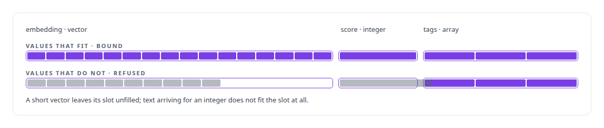
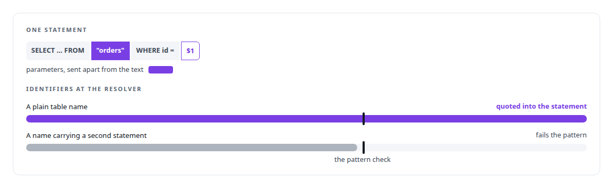
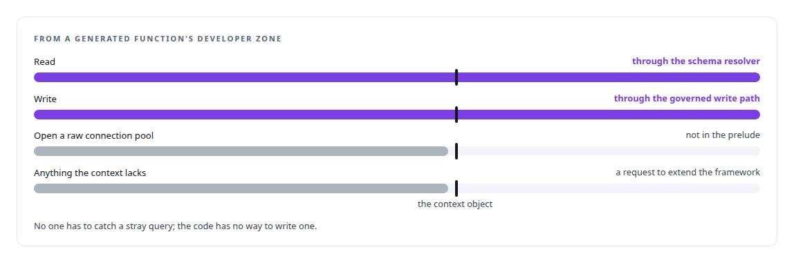
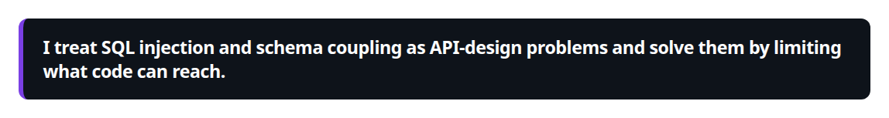

# Schema-agnostic data access and SQL-injection defence

**Database access in generated code goes through a schema resolver that validates every identifier; raw pools are excluded from the sandbox; SQL is never assembled from strings an agent wrote.**

Canonical: https://coreyjames.ai/technologies/schema-agnostic-data-access-and-sql-injection-defence/  
Author: Corey James · Published: 2026-10-28 · Kind: technology  
Systems: [FAFO Core and Function Forge](https://github.com/coreyjames-ai/fafo-core)  
Skills: [sandboxing and container hardening](https://github.com/coreyjames-ai/portfolio/tree/main/skills/sandboxing-and-container-hardening) · [tool synthesis and governed API integration](https://github.com/coreyjames-ai/portfolio/tree/main/skills/tool-synthesis-and-governed-api-integration)  


## What was built

### Shapes read from the catalogs

[FAFO Core and Function Forge](https://coreyjames.ai/systems/fafo-core) lets functions, including ones written by AI agents, run against any registered data source, and I wanted that with no table name in code and no route to SQL injection. The substrate reads the shape of a view or table from PostgreSQL's system catalogs at runtime and caches it, including vector dimensions from each column's type modifier and array element types, so a function is written against a contract. JSON values are checked against the discovered column types, and binding follows the column type.



### One entry point for identifiers

Dynamic SQL needs dynamic identifiers, which is where injection usually gets in. In this substrate an identifier has one entry point.



Raw connection pools are left out of the prelude that function code imports, so a function has no way around the resolver.

### A bounded context for AI-written code

That boundary is what makes Function Forge safe to hand to an agent. A generated function's developer zone gets a capability-bounded context object. See [Tools that build tools, under governance](https://coreyjames.ai/stories/tools-that-build-tools-under-governance).





That is what made it reasonable to let agents write processing code against real data. PostgreSQL is the database; the resolver, the type-directed binding and the sandbox boundary are mine.

> I treat SQL injection and schema coupling as API-design problems and solve them by limiting what code can reach.

## What was verified

Each line is a claim the canonical page supports, with the figure as the page states it.

- SQL injection defence: one entry point that pattern-checks and quotes every identifier, every value a bound parameter, and raw connection pools kept out of function code.
- Schema-agnostic data access: view and table shapes read from PostgreSQL's system catalogs at runtime, with binding by actual column type including vector dimensions.
- Sandboxing AI-written code: a capability-bounded context where reads go through the schema resolver and writes only through the governed write path.

## Related

- [Tools that build tools, under governance](https://github.com/coreyjames-ai/fafo-core/tree/main/stories/tools-that-build-tools-under-governance) · https://coreyjames.ai/stories/tools-that-build-tools-under-governance/
- System: [FAFO Core and Function Forge](https://github.com/coreyjames-ai/fafo-core)

## Citation

Corey James. "Schema-agnostic data access and SQL-injection defence." coreyjames.ai, 2026. https://coreyjames.ai/technologies/schema-agnostic-data-access-and-sql-injection-defence/

```bibtex
@misc{coreyjames-schema-agnostic-data-access-and-sql-injection-defence,
  author = {Corey James},
  title = {Schema-agnostic data access and SQL-injection defence},
  year = {2026},
  howpublished = {\url{https://coreyjames.ai/technologies/schema-agnostic-data-access-and-sql-injection-defence/}},
  note = {GitHub copy: https://github.com/coreyjames-ai/portfolio/tree/main/technologies/schema-agnostic-data-access-and-sql-injection-defence}
}
```

Part of [Corey James's portfolio](https://github.com/coreyjames-ai/portfolio) · site: https://coreyjames.ai/ · MCP server: https://coreyjames.ai/mcp · agent card: https://coreyjames.ai/.well-known/agent.json
