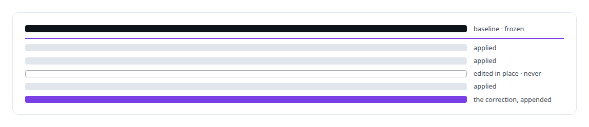
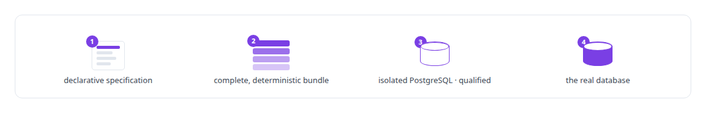
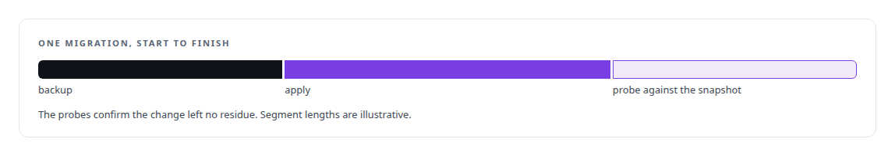
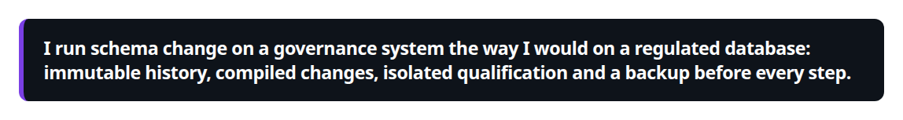

# Schema and migration discipline

**Forward-only migrations, schema contracts and a baseline frozen as immutable. Schema is a contract, and I treat it that way.**

Canonical: https://coreyjames.ai/technologies/schema-and-migration-discipline/  
Author: Corey James · Published: 2026-10-28 · Kind: technology  
Systems: [AgentOS](https://github.com/coreyjames-ai/agentos) · [PostgreSQL Fabric](https://github.com/coreyjames-ai/postgresql-fabric)  


## Result

| Figure | What it measures |
| --- | --- |
| **79** | forward-only migrations |
| **88** | tables in the work graph |
| **33** | schema contracts |

## What was built

### Forward-only, never edited

[AgentOS](https://coreyjames.ai/systems/agentos) keeps the state of every work order in its database, so the schema is the law of the system, and I put it under strict discipline. The PostgreSQL work graph is built by forward-only migrations, immutable once applied, so the schema history is also the history of the system's rules.



The Markdown and YAML files agents read are generated from the database and edits to them are discarded, so the schema is the one place the truth can change and drift has no second source of truth to hide in.

### Workflow law through a compiler

I gave workflow law the same treatment. A change to the workflow is a declarative specification handed to a transition compiler, never hand-written SQL, and every compiled change is qualified on an isolated database first. After a frozen baseline the compiler also assigns migration ordinals, so ordering comes from the tool.



New workflow law enters only through the compiler, and that keeps the transition runtime deterministic as it grows.

### A backup before every step

No migration runs without a backup, and neither does any other invasive operation. Schema changes are checked against a canonical snapshot of the current schema. [Why long agent runs fail](https://coreyjames.ai/stories/why-long-agent-runs-fail) explains why the state lives in the database at all.





> I run schema change on a governance system the way I would on a regulated database: immutable history, compiled changes, isolated qualification and a backup before every step.

## What was verified

Each line is a claim the canonical page supports, with the figure as the page states it.

- Database schema migration discipline: 79 forward-only migrations over 88 tables and 33 schema contracts, a frozen baseline and corrections only as new migrations.
- Workflow change management: declarative specifications compiled into deterministic bundles and qualified on an isolated PostgreSQL instance before the real database.
- Operational safety for databases: a backup before every migration or invasive operation, and probes against a canonical schema snapshot after each change.

## Related

- [Why long agent runs fail](https://github.com/coreyjames-ai/agentos/tree/main/stories/why-long-agent-runs-fail) · https://coreyjames.ai/stories/why-long-agent-runs-fail/
- System: [AgentOS](https://github.com/coreyjames-ai/agentos)
- System: [PostgreSQL Fabric](https://github.com/coreyjames-ai/postgresql-fabric)

## Citation

Corey James. "Schema and migration discipline." coreyjames.ai, 2026. https://coreyjames.ai/technologies/schema-and-migration-discipline/

```bibtex
@misc{coreyjames-schema-and-migration-discipline,
  author = {Corey James},
  title = {Schema and migration discipline},
  year = {2026},
  howpublished = {\url{https://coreyjames.ai/technologies/schema-and-migration-discipline/}},
  note = {GitHub copy: https://github.com/coreyjames-ai/portfolio/tree/main/technologies/schema-and-migration-discipline}
}
```

Part of [Corey James's portfolio](https://github.com/coreyjames-ai/portfolio) · site: https://coreyjames.ai/ · MCP server: https://coreyjames.ai/mcp · agent card: https://coreyjames.ai/.well-known/agent.json
