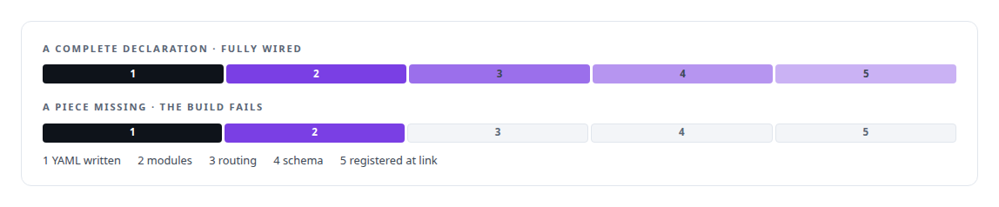
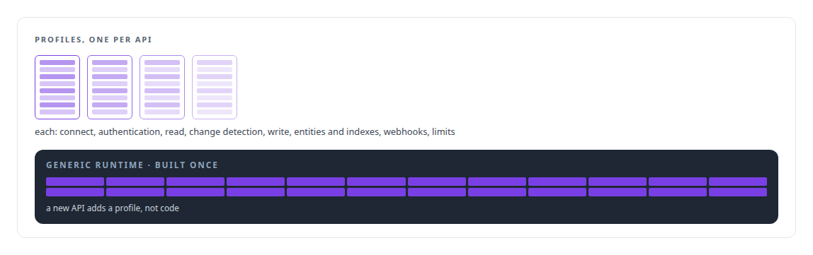
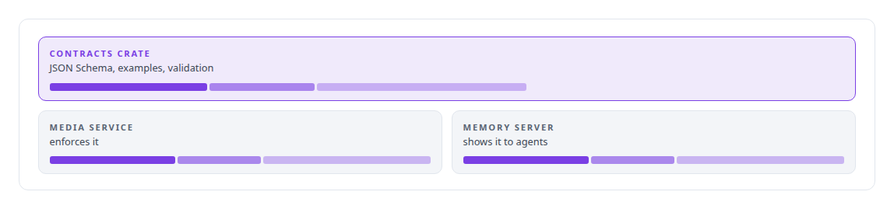

# Schema-driven build-time code generation

**YAML tool schemas compile into dispatch at build time in my MCP gateway and the execution substrate, so a tool cannot be half-wired.**

Canonical: https://coreyjames.ai/technologies/schema-driven-build-time-code-generation/  
Author: Corey James · Published: 2026-10-28 · Kind: technology  
Systems: [FAFO Core and Function Forge](https://github.com/coreyjames-ai/fafo-core) · [FAFOHive](https://github.com/coreyjames-ai/fafohive)  
Skills: [tool synthesis and governed API integration](https://github.com/coreyjames-ai/portfolio/tree/main/skills/tool-synthesis-and-governed-api-integration) · [MCP server design](https://github.com/coreyjames-ai/portfolio/tree/main/skills/mcp-server-design) · [Rust systems engineering](https://github.com/coreyjames-ai/portfolio/tree/main/skills/rust-systems-engineering)  


## Result

| Figure | What it measures |
| --- | --- |
| **18** | tool surfaces declared in YAML |
| **~180** | actions across those surfaces |
| **8** | sections in every API connectivity profile |

## What was built

### Tools added by writing files

[FAFO Core and Function Forge](https://coreyjames.ai/systems/fafo-core) has a tool surface that grows constantly, and I decided nobody would hand-edit dispatch code to add a tool. Declarations live in YAML and the dispatch code is generated, so a new tool is a data change. The model-facing MCP gateway compiles YAML at build time, and input schemas come from the same metadata that drives routing, so they cannot drift from the implementation. The control plane compiles an auto-registration file into its dependency list and an extern-crate macro, and each function crate registers its execution handler and control target at link time.

That is how Function Forge adds a tool by writing files. The generator writes the gateway's definitions and the control plane's registration entry, and the next build turns them into routing, schemas and registration. Nothing registers at runtime. See [Tools that build tools, under governance](https://coreyjames.ai/stories/tools-that-build-tools-under-governance).



### APIs as connectivity profiles

The API integration platform applies the same idea to external systems. Each API is a connectivity profile with a fixed set of sections, compiled into a generic runtime that is built once. See [Closed by evidence](https://coreyjames.ai/stories/closed-by-evidence).



### One contract for producer and consumer

[FAFOHive](https://coreyjames.ai/systems/fafohive) gets its media tools from a contracts crate that defines each tool's JSON Schema, examples and validation. The same crate compiles into the media service and the memory server, so the schema an agent sees and the schema the service enforces have one source.




The techniques are standard Rust build scripts and procedural macros; my contribution is making them the single path for every tool.

> I move integration work out of hand-written code into declarations the build compiles and checks, because that keeps a fast-growing tool estate consistent.

## What was verified

Each line is a claim the canonical page supports, with the figure as the page states it.

- Build-time code generation in Rust: YAML tool declarations compiled into modules, a routing table and JSON Schema by build scripts and procedural macros, registered at link time.
- MCP server design: 18 tool surfaces with about 180 actions declared in YAML and generated, so a tool cannot be half-wired.
- Tool synthesis and governed API integration: each external API described by an 8-section connectivity profile and compiled into one generic runtime built once.

## Related

- [Tools that build tools, under governance](https://github.com/coreyjames-ai/fafo-core/tree/main/stories/tools-that-build-tools-under-governance) · https://coreyjames.ai/stories/tools-that-build-tools-under-governance/
- [Closed by evidence](https://github.com/coreyjames-ai/agentos/tree/main/stories/closed-by-evidence) · https://coreyjames.ai/stories/closed-by-evidence/
- System: [FAFO Core and Function Forge](https://github.com/coreyjames-ai/fafo-core)
- System: [FAFOHive](https://github.com/coreyjames-ai/fafohive)

## Citation

Corey James. "Schema-driven build-time code generation." coreyjames.ai, 2026. https://coreyjames.ai/technologies/schema-driven-build-time-code-generation/

```bibtex
@misc{coreyjames-schema-driven-build-time-code-generation,
  author = {Corey James},
  title = {Schema-driven build-time code generation},
  year = {2026},
  howpublished = {\url{https://coreyjames.ai/technologies/schema-driven-build-time-code-generation/}},
  note = {GitHub copy: https://github.com/coreyjames-ai/portfolio/tree/main/technologies/schema-driven-build-time-code-generation}
}
```

Part of [Corey James's portfolio](https://github.com/coreyjames-ai/portfolio) · site: https://coreyjames.ai/ · MCP server: https://coreyjames.ai/mcp · agent card: https://coreyjames.ai/.well-known/agent.json
