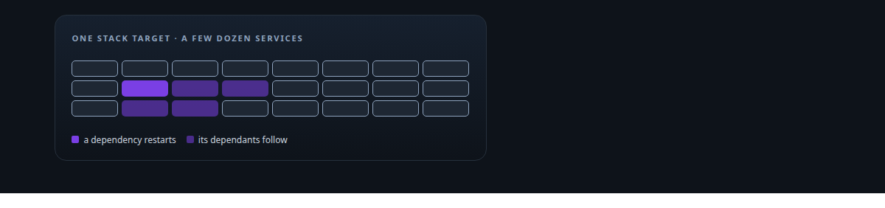
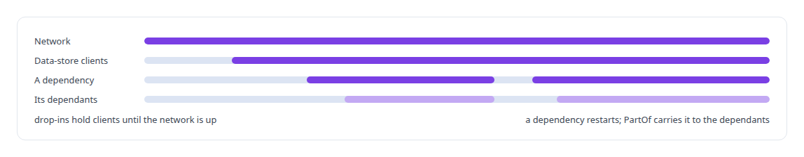
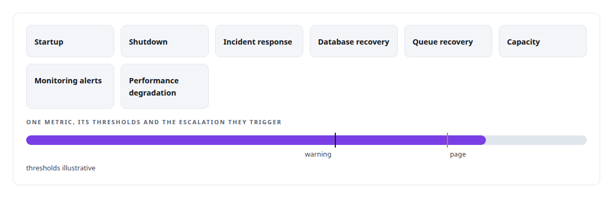
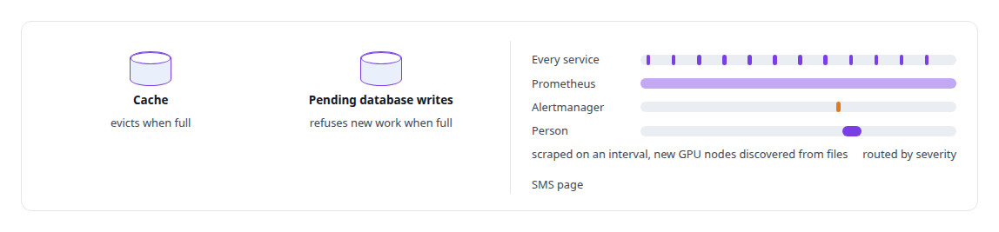

# Site reliability engineering

**A declared systemd fleet, tunnelled ingress, a documented Redis topology and written runbooks keep my estate recoverable.**

Canonical: https://coreyjames.ai/technologies/site-reliability-engineering/  
Author: Corey James · Published: 2026-10-28 · Kind: technology  
Systems: [Auth and access plane](https://github.com/coreyjames-ai/auth-and-access-plane) · [AgentOS](https://github.com/coreyjames-ai/agentos)  
Skills: [observability and alerting](https://github.com/coreyjames-ai/portfolio/tree/main/skills/observability-and-alerting) · [zero-trust and zero-inbound networking](https://github.com/coreyjames-ai/portfolio/tree/main/skills/zero-trust-and-zero-inbound-networking) · [distributed systems correctness](https://github.com/coreyjames-ai/portfolio/tree/main/skills/distributed-systems-correctness)  



## Result

| Figure | What it measures |
| --- | --- |
| **8** | written runbooks, from startup to performance degradation |
| **1 day** | to roll back the registration lock that broke every client |
| **0** | open inbound ports |

## What was built

### One declared fleet

[Auth and access plane](https://coreyjames.ai/systems/auth-and-access-plane) holds the operations layer for my whole estate. As its only operator, I need the estate to start, fail and recover the same way every time, so the fleet is declared and versioned and startup order is a property of configuration.

A few dozen services run under one systemd stack target. PartOf cascades carry a dependency's restart to its dependants, drop-ins make data-store clients wait for the network, and timers run routine work such as container cleanup. Unit files and a readable inventory are versioned with the code, so the fleet is rebuilt from source.



[AgentOS](https://coreyjames.ai/systems/agentos) gets the same practice for its own releases. Deploys go through gated, logged windows, and its background workers run as systemd services and timers in the same fleet. Public surfaces reach all of it through outbound tunnels and a private mesh.

### Recovery written down

I wrote the runbooks, so incident response does not depend on memory. Each has thresholds, a severity model and an escalation path, with scripts for checks, rollback and draining.



[The hardening fix that locked everyone out](https://coreyjames.ai/stories/the-hardening-fix-that-locked-everyone-out) is one incident handled this way. I keep adversarial audits of my own systems even when they overturn an earlier sign-off.


### Failure chosen per component

A cache and a queue of pending database writes need to fail differently, so Redis instances are split by role and each has its own failure mode. Services expose metrics to Prometheus, which discovers new GPU nodes from files. Grafana holds the dashboards, and Alertmanager routes alerts by severity, with SMS paging for anything that needs a person.



> I reverse my own change when the evidence calls for it.

## What was verified

Each line is a claim the canonical page supports, with the figure as the page states it.

- Site reliability engineering: a declared systemd fleet of a few dozen services under one stack target, with restart cascades and start order versioned with the code.
- Incident response and runbooks: 8 written runbooks with thresholds, a severity model and escalation paths, and a registration lock that broke every client rolled back within 1 day.
- Observability and alerting: Prometheus with file-based discovery of GPU nodes, Grafana dashboards and Alertmanager routing by severity to SMS paging.
- Zero-trust and zero-inbound networking: public surfaces reached only through outbound tunnels and a private mesh, with 0 open inbound ports.

## Related

- [The hardening fix that locked everyone out](https://github.com/coreyjames-ai/auth-and-access-plane/tree/main/stories/the-hardening-fix-that-locked-everyone-out) · https://coreyjames.ai/stories/the-hardening-fix-that-locked-everyone-out/
- System: [Auth and access plane](https://github.com/coreyjames-ai/auth-and-access-plane)
- System: [AgentOS](https://github.com/coreyjames-ai/agentos)

## Citation

Corey James. "Site reliability engineering." coreyjames.ai, 2026. https://coreyjames.ai/technologies/site-reliability-engineering/

```bibtex
@misc{coreyjames-site-reliability-engineering,
  author = {Corey James},
  title = {Site reliability engineering},
  year = {2026},
  howpublished = {\url{https://coreyjames.ai/technologies/site-reliability-engineering/}},
  note = {GitHub copy: https://github.com/coreyjames-ai/portfolio/tree/main/technologies/site-reliability-engineering}
}
```

Part of [Corey James's portfolio](https://github.com/coreyjames-ai/portfolio) · site: https://coreyjames.ai/ · MCP server: https://coreyjames.ai/mcp · agent card: https://coreyjames.ai/.well-known/agent.json
