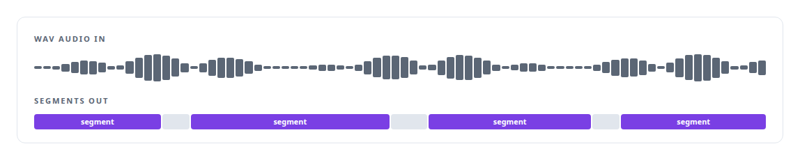
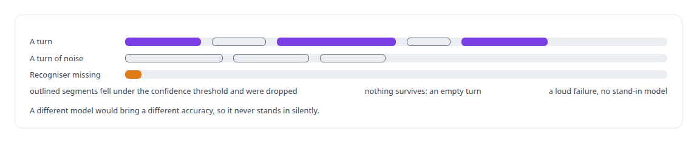

# Speech recognition model

**An open speech-recognition model is the recogniser in my voice engine, integrated rather than modified.**

Canonical: https://coreyjames.ai/technologies/speech-recognition-model/  
Author: Corey James · Published: 2026-10-28 · Kind: technology  
Systems: [Helix](https://github.com/coreyjames-ai/helix)  
Skills: [real-time voice AI](https://github.com/coreyjames-ai/portfolio/tree/main/skills/real-time-voice-ai) · [speech recognition and synthesis pipelines](https://github.com/coreyjames-ai/portfolio/tree/main/skills/speech-recognition-and-synthesis-pipelines) · [AI-assisted engineering methodology](https://github.com/coreyjames-ai/portfolio/tree/main/skills/ai-assisted-engineering-methodology) · [inference serving architecture](https://github.com/coreyjames-ai/portfolio/tree/main/skills/inference-serving-architecture)  


## What was built

### Recognition on my own hardware

[Helix](https://coreyjames.ai/systems/helix) holds spoken conversations in a room or on a Microsoft Teams call, and I wanted the speech it hears recognised on my own hardware. the speech recognition model is the recognition model; the engineering is how the voice engine uses it, and above all what it does with an uncertain result. the speech recognition model is an open model served through the open-source its C++ runtime; the integration, the confidence policy and the deployment are mine.

The engine's transcriber is an interface with two implementations: the speech recognition model in process through its C++ runtime, and a client for a the speech recognition model server on a GPU host that takes WAV audio and returns segments. The two deployments swap without touching conversation logic. In the Teams configuration the small English model runs on a Blackwell GPU next to neural speech synthesis, so a call's audio stays on my hardware. Decoding is deterministic, so the same audio always gives the same text, which makes a conversation reproducible when I look back at it.



### Silent rather than wrong

Speech models invent fluent text out of noise and silence. So every recognised segment carries a confidence measure, and segments under the threshold are dropped. If nothing in a turn survives, the engine produces an empty turn, because an empty turn beats invented text. Configuration follows the same rule: a missing recogniser is a loud failure with no silent fallback.




The call that first proved the chain, ringing a Teams number and talking to a digital employee whose recognition, reasoning and voice all ran on local GPUs, is [A self-hosted colleague in a Teams call](https://coreyjames.ai/stories/a-self-hosted-colleague-in-a-teams-call). The same preference for an honest gap over a fabricated answer runs through [A meeting attendee that will not fake it](https://coreyjames.ai/stories/a-meeting-attendee-that-will-not-fake-it).

> A digital employee that answers words nobody said is worse than one that stays quiet.

## What was verified

Each line is a claim the canonical page supports, with the figure as the page states it.

- Speech recognition pipelines: an open recogniser behind a transcriber interface, in process or on a GPU server, with the two deployments swapping without touching conversation logic.
- Hallucination control in speech recognition: every segment carries a confidence measure, segments under the threshold are dropped, and an empty turn replaces invented text.
- Real-time voice AI on local GPUs: recognition on a Blackwell GPU beside neural speech synthesis in the Teams configuration, so a call's audio stays on my hardware.

## Related

- [A self-hosted colleague in a Teams call](https://github.com/coreyjames-ai/helix/tree/main/stories/a-self-hosted-colleague-in-a-teams-call) · https://coreyjames.ai/stories/a-self-hosted-colleague-in-a-teams-call/
- [A meeting attendee that will not fake it](https://github.com/coreyjames-ai/helix/tree/main/stories/a-meeting-attendee-that-will-not-fake-it) · https://coreyjames.ai/stories/a-meeting-attendee-that-will-not-fake-it/
- System: [Helix](https://github.com/coreyjames-ai/helix)

## Citation

Corey James. "Speech recognition model." coreyjames.ai, 2026. https://coreyjames.ai/technologies/speech-recognition-model/

```bibtex
@misc{coreyjames-speech-recognition-model,
  author = {Corey James},
  title = {Speech recognition model},
  year = {2026},
  howpublished = {\url{https://coreyjames.ai/technologies/speech-recognition-model/}},
  note = {GitHub copy: https://github.com/coreyjames-ai/portfolio/tree/main/technologies/speech-recognition-model}
}
```

Part of [Corey James's portfolio](https://github.com/coreyjames-ai/portfolio) · site: https://coreyjames.ai/ · MCP server: https://coreyjames.ai/mcp · agent card: https://coreyjames.ai/.well-known/agent.json
