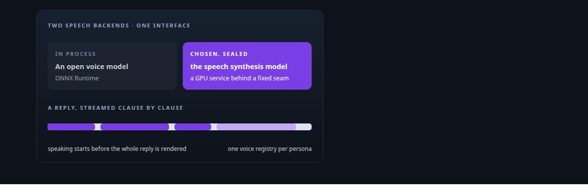
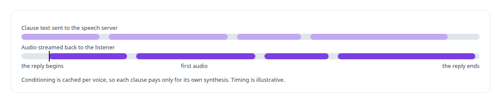
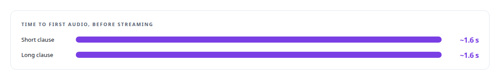
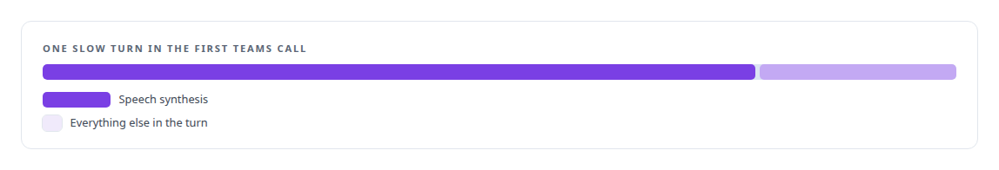
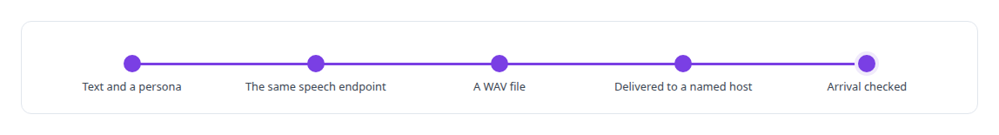

# Speech synthesis model

**The neural speech model that gives Helix its voice in Teams calls, a local room and produced narration.**

Canonical: https://coreyjames.ai/technologies/speech-synthesis-model/  
Author: Corey James · Published: 2026-10-28 · Kind: technology  
Systems: [Helix](https://github.com/coreyjames-ai/helix)  
Skills: [speech recognition and synthesis pipelines](https://github.com/coreyjames-ai/portfolio/tree/main/skills/speech-recognition-and-synthesis-pipelines) · [AI-assisted engineering methodology](https://github.com/coreyjames-ai/portfolio/tree/main/skills/ai-assisted-engineering-methodology) · [inference serving architecture](https://github.com/coreyjames-ai/portfolio/tree/main/skills/inference-serving-architecture) · [real-time voice AI](https://github.com/coreyjames-ai/portfolio/tree/main/skills/real-time-voice-ai)  



## Result

| Figure | What it measures |
| --- | --- |
| **776 ms** | to first audio in the first Teams call, synthesis sharing a GPU host |
| **2** | speech backends behind one interface, settled by a bake-off |
| **~78%** | of the slow turn spent in synthesis while it shared the host |

## What was built

### A voice server behind a fixed seam

[Helix](https://coreyjames.ai/systems/helix) speaks in Teams calls and in a local room, and I wanted the voice to run on my own GPUs with no hosted speech service in the loop. Behind one interface the voice engine can use an 82-million-parameter open voice model in process through [ONNX Runtime](https://coreyjames.ai/technologies/onnx-runtime), and the speech synthesis model as a separate GPU service. I ran a bake-off between them, the speech synthesis model won, and I sealed it so later work could not drift the voice.

the speech synthesis model is a third-party open model used as published. I wrapped it in a [FastAPI](https://coreyjames.ai/technologies/fastapi) streaming server in a GPU container, and the engine treats it as a remote audio component on the network. Because the seam is fixed, the server can change host or model without any change to the engine.



### Reading the shape of a latency curve

Helix had to answer fast enough to feel like a colleague. In local testing before streaming, first audio took the same time whether a clause was short or long. A flat line across lengths is a fixed server overhead, not synthesis, so the server was reworked to stream instead of being given a faster model.



### Moving synthesis off the shared host

In the first Teams call, speech synthesis shared one GPU host with everything else, and it dominated the slow turn. The speech services went to a dedicated [NVIDIA Blackwell GPU](https://coreyjames.ai/technologies/nvidia-blackwell-gpus) host. The call is told in [A self-hosted colleague in a Teams call](https://coreyjames.ai/stories/a-self-hosted-colleague-in-a-teams-call).




### Narration in the same voices

Helix's media tools let agents produce voice-over in the approved voices. One voice registry maps each persona to its voice for spoken conversation and for produced narration, so both sound like the same persona. A narration renders through the same endpoint without disturbing the voice service.



> When synthesis dominated a turn on a shared host, I fixed placement and kept the model.

## What was verified

Each line is a claim the canonical page supports, with the figure as the page states it.

- Speech synthesis pipelines: an open voice model wrapped in a streaming server behind a fixed seam, chosen over a second backend by a bake-off.
- Latency engineering for voice AI: 776 ms to first audio in the first Teams call, and synthesis that took ~78% of a slow turn moved to a dedicated GPU host.
- Performance diagnosis: a flat first-audio curve across clause lengths read as fixed server overhead and fixed by streaming rather than a faster model.

## Related

- [A self-hosted colleague in a Teams call](https://github.com/coreyjames-ai/helix/tree/main/stories/a-self-hosted-colleague-in-a-teams-call) · https://coreyjames.ai/stories/a-self-hosted-colleague-in-a-teams-call/
- [ONNX Runtime](https://github.com/coreyjames-ai/portfolio/tree/main/technologies/onnx-runtime) · https://coreyjames.ai/technologies/onnx-runtime/
- [FastAPI](https://github.com/coreyjames-ai/portfolio/tree/main/technologies/fastapi) · https://coreyjames.ai/technologies/fastapi/
- [NVIDIA Blackwell GPUs](https://github.com/coreyjames-ai/portfolio/tree/main/technologies/nvidia-blackwell-gpus) · https://coreyjames.ai/technologies/nvidia-blackwell-gpus/
- System: [Helix](https://github.com/coreyjames-ai/helix)

## Citation

Corey James. "Speech synthesis model." coreyjames.ai, 2026. https://coreyjames.ai/technologies/speech-synthesis-model/

```bibtex
@misc{coreyjames-speech-synthesis-model,
  author = {Corey James},
  title = {Speech synthesis model},
  year = {2026},
  howpublished = {\url{https://coreyjames.ai/technologies/speech-synthesis-model/}},
  note = {GitHub copy: https://github.com/coreyjames-ai/portfolio/tree/main/technologies/speech-synthesis-model}
}
```

Part of [Corey James's portfolio](https://github.com/coreyjames-ai/portfolio) · site: https://coreyjames.ai/ · MCP server: https://coreyjames.ai/mcp · agent card: https://coreyjames.ai/.well-known/agent.json
