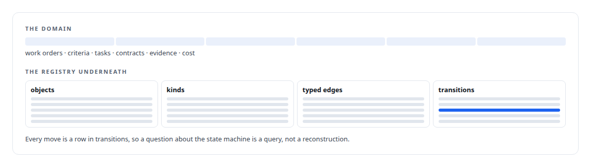
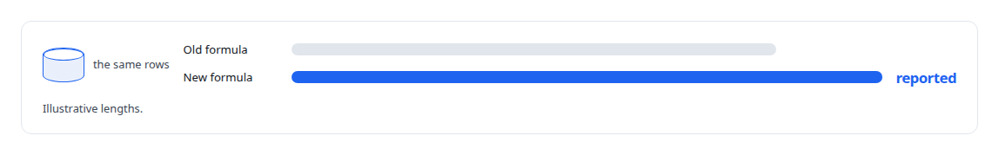
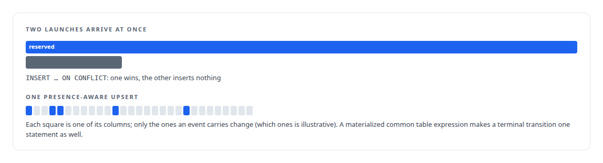
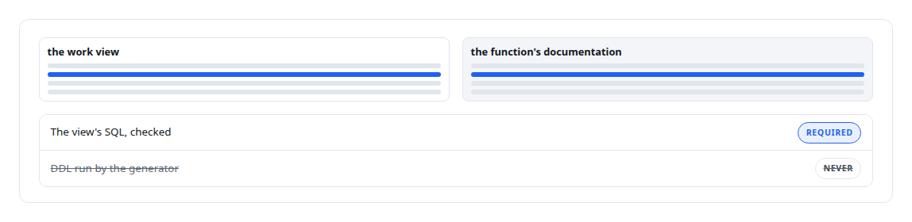

# SQL

**SQL is how I query the stores everything else projects from: work graphs, tuple statistics, retrieval tables, cost ledgers.**

Canonical: https://coreyjames.ai/technologies/sql/  
Author: Corey James · Published: 2026-10-28 · Kind: technology  
Systems: [AgentOS](https://github.com/coreyjames-ai/agentos) · [Agent Swarm](https://github.com/coreyjames-ai/agent-swarm) · [FAFO Core and Function Forge](https://github.com/coreyjames-ai/fafo-core) · [Helix](https://github.com/coreyjames-ai/helix) · [PostgreSQL Fabric](https://github.com/coreyjames-ai/postgresql-fabric)  
Skills: [PostgreSQL performance tuning](https://github.com/coreyjames-ai/portfolio/tree/main/skills/postgresql-performance-tuning)  


## Result

| Figure | What it measures |
| --- | --- |
| **88** | tables in the AgentOS schema, from 79 forward-only migrations |
| **13,000** | lines of SQL in that schema |
| **178** | tables in Helix's collaboration control store |
| **29** | columns in one presence-aware upsert |

## What was built

I use SQL to design state, contracts and correctness under concurrency, from a governance state machine to an agent runtime's event writer. The databases are PostgreSQL. [Helix](https://coreyjames.ai/systems/helix) keeps the durable state of its collaboration shell in its own PostgreSQL control store, grown alongside the shell's features through numbered migrations.

## A state machine kept as data

[AgentOS](https://coreyjames.ai/systems/agentos) runs a multi-agent state machine, and I chose to model it relationally, in forward-only migrations. A generic registry sits underneath and the domain sits on top.



## A reported number computed next to its data

Logic that defines a reported number lives with the data. Validated human-equivalent hours, the labour measure AgentOS reports, is computed by PL/pgSQL functions in the database, with the old and new formulas side by side so a recalibration can be compared. See [Why long agent runs fail](https://coreyjames.ai/stories/why-long-agent-runs-fail).



## One statement per concurrent write

[Agent Swarm](https://coreyjames.ai/systems/agent-swarm) writes agent state under heavy concurrency, and I wanted each write to be one exact statement. The schema uses partitioned tables and paired up and down migrations.



## A view as a function's contract

[FAFO Core and Function Forge](https://coreyjames.ai/systems/fafo-core) starts every function from a PostgreSQL work view, and I made that view the function's data contract, so schema design stays a human step.



[196 deadlocks to zero](https://coreyjames.ai/stories/196-deadlocks-to-zero) came from the same habit.


> In a performance diagnosis, the database's tuple statistics are the ground truth.

## What was verified

Each line is a claim the canonical page supports, with the figure as the page states it.

- Relational state-machine design: a multi-agent workflow modelled as data in 88 tables from 79 forward-only migrations, a generic registry under the domain tables.
- PostgreSQL concurrency design: single-statement writes under load, including a 29-column presence-aware upsert and conflict-aware launch reservations where one of two wins.
- In-database metric logic: PL/pgSQL functions computing a reported labour measure, with the old and new formulas kept side by side for comparison.
- PostgreSQL performance tuning: the database's tuple statistics taken as the ground truth about committed work, the habit behind 196 deadlocks to zero.

## Related

- [Why long agent runs fail](https://github.com/coreyjames-ai/agentos/tree/main/stories/why-long-agent-runs-fail) · https://coreyjames.ai/stories/why-long-agent-runs-fail/
- [196 deadlocks to zero](https://github.com/coreyjames-ai/fafo-core/tree/main/stories/196-deadlocks-to-zero) · https://coreyjames.ai/stories/196-deadlocks-to-zero/
- System: [AgentOS](https://github.com/coreyjames-ai/agentos)
- System: [Agent Swarm](https://github.com/coreyjames-ai/agent-swarm)
- System: [FAFO Core and Function Forge](https://github.com/coreyjames-ai/fafo-core)
- System: [Helix](https://github.com/coreyjames-ai/helix)
- System: [PostgreSQL Fabric](https://github.com/coreyjames-ai/postgresql-fabric)

## Citation

Corey James. "SQL." coreyjames.ai, 2026. https://coreyjames.ai/technologies/sql/

```bibtex
@misc{coreyjames-sql,
  author = {Corey James},
  title = {SQL},
  year = {2026},
  howpublished = {\url{https://coreyjames.ai/technologies/sql/}},
  note = {GitHub copy: https://github.com/coreyjames-ai/portfolio/tree/main/technologies/sql}
}
```

Part of [Corey James's portfolio](https://github.com/coreyjames-ai/portfolio) · site: https://coreyjames.ai/ · MCP server: https://coreyjames.ai/mcp · agent card: https://coreyjames.ai/.well-known/agent.json
