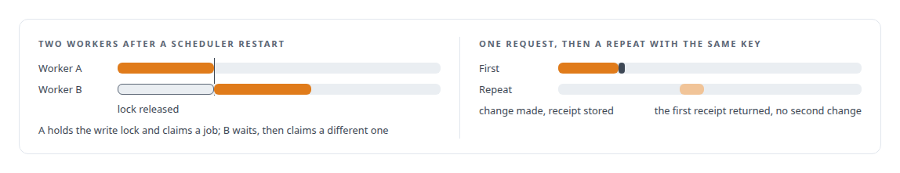
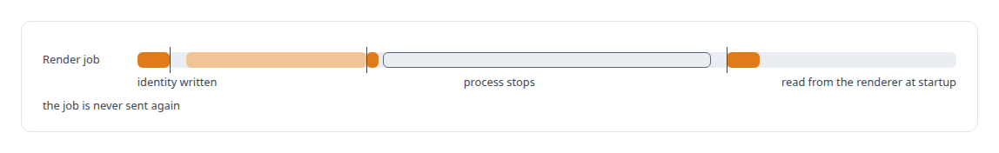

# SQLite

**SQLite gives each of FAFOHive's social and media modules durable, transactional state that one process owns.**

Canonical: https://coreyjames.ai/technologies/sqlite/  
Author: Corey James · Published: 2026-10-28 · Kind: technology  
Systems: [FAFOHive](https://github.com/coreyjames-ai/fafohive)  
Skills: [exactly-once delivery and crash recovery](https://github.com/coreyjames-ai/portfolio/tree/main/skills/exactly-once-delivery-and-crash-recovery) · [inference serving architecture](https://github.com/coreyjames-ai/portfolio/tree/main/skills/inference-serving-architecture) · [distributed systems correctness](https://github.com/coreyjames-ai/portfolio/tree/main/skills/distributed-systems-correctness)  


## What was built

### One database per social module

[FAFOHive](https://coreyjames.ai/systems/fafohive)'s in-house social modules each need durable, transactional state owned by one process, and I gave each its own SQLite database. Where one process owns the state, most concurrency turns into ordinary transactions.

The X module keeps a work queue in SQLite and claims jobs inside `BEGIN IMMEDIATE` transactions, which take the write lock up front, so two workers never claim the same job after a scheduler restart. The Facebook module keeps an inventory of every object it creates, which gives cleanup and reconciliation an exact list. The Reddit module stores a receipt for every change and an archive of every response it reads, so a repeated request with the same idempotency key returns the first receipt.



SQLite is a library inside these services, run with write-ahead logging and explicit transaction modes; the engineering is the state design.

### Render jobs written down before they are sent

The media studio behind FAFOHive's media tools uses the same pattern for GPU rendering jobs. Each submission's identity is written to SQLite, under a uniqueness constraint on actor and request, before the job goes to the renderer, so a crash cannot leave an untracked job.

A job whose outcome is unknown, because a process stopped between sending and hearing back, sits in an explicit outcome-unknown state and is settled by reading the renderer at startup. The gateway these modules join is described in [Agents with real tools and no keys](https://coreyjames.ai/stories/agents-with-real-tools-and-no-keys).




> I pick the smallest storage that gives a component its guarantee, and I design around the moment between sent and confirmed.

## What was verified

Each line is a claim the canonical page supports, with the figure as the page states it.

- Embedded database design with SQLite: one database per process-owned module, so work-queue claims, object inventories and idempotent receipts are ordinary transactions.
- Exactly-once delivery and crash recovery: render-job identity written before sending, and an explicit outcome-unknown state settled by reading the renderer at startup, never resubmitted.

## Related

- [Agents with real tools and no keys](https://github.com/coreyjames-ai/fafohive/tree/main/stories/agents-with-real-tools-and-no-keys) · https://coreyjames.ai/stories/agents-with-real-tools-and-no-keys/
- System: [FAFOHive](https://github.com/coreyjames-ai/fafohive)

## Citation

Corey James. "SQLite." coreyjames.ai, 2026. https://coreyjames.ai/technologies/sqlite/

```bibtex
@misc{coreyjames-sqlite,
  author = {Corey James},
  title = {SQLite},
  year = {2026},
  howpublished = {\url{https://coreyjames.ai/technologies/sqlite/}},
  note = {GitHub copy: https://github.com/coreyjames-ai/portfolio/tree/main/technologies/sqlite}
}
```

Part of [Corey James's portfolio](https://github.com/coreyjames-ai/portfolio) · site: https://coreyjames.ai/ · MCP server: https://coreyjames.ai/mcp · agent card: https://coreyjames.ai/.well-known/agent.json
