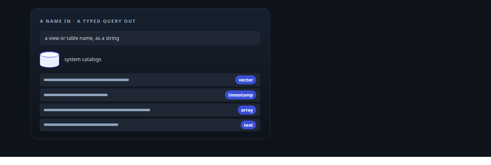
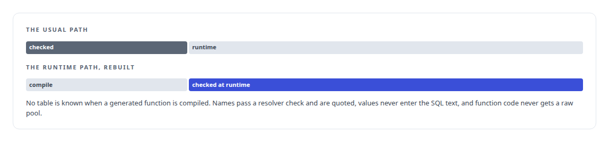
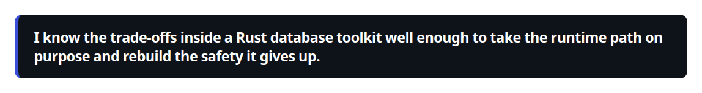
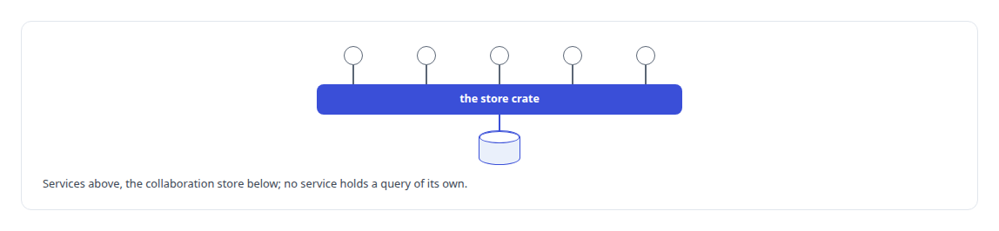
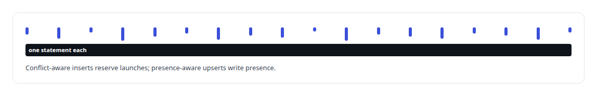

# sqlx

**sqlx carries my Rust services' PostgreSQL access; where no table is known at compile time, I check against the schema itself instead.**

Canonical: https://coreyjames.ai/technologies/sqlx/  
Author: Corey James · Published: 2026-10-28 · Kind: technology  
Systems: [FAFO Core and Function Forge](https://github.com/coreyjames-ai/fafo-core) · [Helix](https://github.com/coreyjames-ai/helix) · [Agent Swarm](https://github.com/coreyjames-ai/agent-swarm)  
Skills: [Rust systems engineering](https://github.com/coreyjames-ai/portfolio/tree/main/skills/rust-systems-engineering) · [tool synthesis and governed API integration](https://github.com/coreyjames-ai/portfolio/tree/main/skills/tool-synthesis-and-governed-api-integration)  



## What was built

### Runtime queries checked against the catalog

[FAFO Core and Function Forge](https://coreyjames.ai/systems/fafo-core) has a database layer where no table is known at compile time, so I built it on sqlx's runtime query API. Every operation takes a view or table name as a string and reads its shape from PostgreSQL's system catalogs, cached with vector dimensions and array element types. See [Tools that build tools, under governance](https://coreyjames.ai/stories/tools-that-build-tools-under-governance).





### One owner for a store's SQL

[Helix](https://coreyjames.ai/systems/helix) needed one owner for the SQL of its collaboration store. A dedicated sqlx crate holds all PostgreSQL access for the collaboration shell, the other services call its typed store functions, and its schema evolves through numbered migrations.



### Single-statement writes under concurrency

[Agent Swarm](https://coreyjames.ai/systems/agent-swarm) uses the Rust PostgreSQL clients in the services that write agent state, where many events land at once and each write must be exact.



sqlx is third-party; the schema resolution, the type-directed binding and the boundary around generated code are mine.

> I know the trade-offs inside a Rust database toolkit well enough to take the runtime path on purpose and rebuild the safety it gives up.

## What was verified

Each line is a claim the canonical page supports, with the figure as the page states it.

- Rust database engineering with sqlx: a runtime query layer that reads each table's shape from PostgreSQL's catalogs and binds every value by its column's type, pgvector included.
- SQL injection prevention by design: identifiers through a checking resolver and quoting, values only as bound parameters, and raw pools kept from generated code.
- Data access architecture: one store crate owning all PostgreSQL access for a collaboration shell, with its schema evolved through numbered migrations.

## Related

- [Tools that build tools, under governance](https://github.com/coreyjames-ai/fafo-core/tree/main/stories/tools-that-build-tools-under-governance) · https://coreyjames.ai/stories/tools-that-build-tools-under-governance/
- System: [FAFO Core and Function Forge](https://github.com/coreyjames-ai/fafo-core)
- System: [Helix](https://github.com/coreyjames-ai/helix)
- System: [Agent Swarm](https://github.com/coreyjames-ai/agent-swarm)

## Citation

Corey James. "sqlx." coreyjames.ai, 2026. https://coreyjames.ai/technologies/sqlx/

```bibtex
@misc{coreyjames-sqlx,
  author = {Corey James},
  title = {sqlx},
  year = {2026},
  howpublished = {\url{https://coreyjames.ai/technologies/sqlx/}},
  note = {GitHub copy: https://github.com/coreyjames-ai/portfolio/tree/main/technologies/sqlx}
}
```

Part of [Corey James's portfolio](https://github.com/coreyjames-ai/portfolio) · site: https://coreyjames.ai/ · MCP server: https://coreyjames.ai/mcp · agent card: https://coreyjames.ai/.well-known/agent.json
