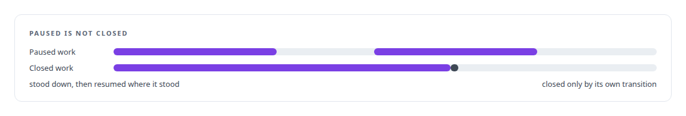
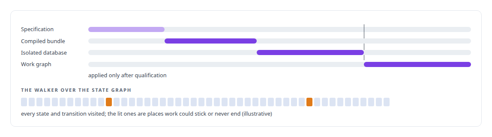

# State-machine design for multi-agent workflows

**Work-order lifecycles, stand-down and resume, and transition compilation: the governance platform is state machines all the way down.**

Canonical: https://coreyjames.ai/technologies/state-machine-design-for-multi-agent-workflows/  
Author: Corey James · Published: 2026-10-28 · Kind: technology  
Systems: [AgentOS](https://github.com/coreyjames-ai/agentos)  
Skills: [exactly-once delivery and crash recovery](https://github.com/coreyjames-ai/portfolio/tree/main/skills/exactly-once-delivery-and-crash-recovery) · [multi-agent governance](https://github.com/coreyjames-ai/portfolio/tree/main/skills/multi-agent-governance) · [agent orchestration](https://github.com/coreyjames-ai/portfolio/tree/main/skills/agent-orchestration) · [distributed systems correctness](https://github.com/coreyjames-ai/portfolio/tree/main/skills/distributed-systems-correctness)  


## What was built

### The state machine lives in data

[AgentOS](https://coreyjames.ai/systems/agentos) is a state machine for multi-agent work, and I decided the state machine would live in data where agents cannot rewrite it. A PostgreSQL registry holds objects with kinds, typed edges between them, and a stored transition for every change of state. Work orders, tasks, evidence and verdicts are all instances of that model.

Where a piece of work stands is in the graph, and the documents agents read are generated from it. Because the machine is data, it can be queried, audited and changed under migration discipline.


### Every move leaves a receipt

Movement is deterministic. A pending step is stored durably and maps to exactly one next step. When it runs, it leaves a receipt, and only that receipt can consume it, so resume is a replay and no agent has to reconstruct what happened from prose or files. Faults are typed and route to defined handling, which ends improvised recoveries.

Pausing is its own state, separate from closing, so stood-down work resumes and is never taken for finished.




### Workflow law is compiled

New workflow law enters only through a compiler. To test the machine itself I had a pure, I/O-free walker built that traverses states and transitions looking for places where work can get stuck or never reach an end, before an agent finds them. Its first runs found real gaps in the platform's own design, and they were fixed as governed work.



[Why long agent runs fail](https://coreyjames.ai/stories/why-long-agent-runs-fail) and [Separation of duties for AI work](https://coreyjames.ai/stories/separation-of-duties-for-ai-work) tell where this design came from.

> A system that cannot tell stopped from done eventually closes unfinished work.

## What was verified

Each line is a claim the canonical page supports, with the figure as the page states it.

- Control-plane and state-machine architecture: a multi-agent workflow kept as data in a PostgreSQL registry of typed objects, edges and stored transitions that agents cannot rewrite.
- Crash recovery by replay: every pending step maps to exactly one next step and is consumed only by its receipt, so resuming after a crash is a replay of the graph.
- Formal checks of workflow design: workflow changes compiled and qualified on an isolated database, and a pure walker that found real dead-end gaps in the platform's own state graph.

## Related

- [Why long agent runs fail](https://github.com/coreyjames-ai/agentos/tree/main/stories/why-long-agent-runs-fail) · https://coreyjames.ai/stories/why-long-agent-runs-fail/
- [Separation of duties for AI work](https://github.com/coreyjames-ai/agentos/tree/main/stories/separation-of-duties-for-ai-work) · https://coreyjames.ai/stories/separation-of-duties-for-ai-work/
- System: [AgentOS](https://github.com/coreyjames-ai/agentos)

## Citation

Corey James. "State-machine design for multi-agent workflows." coreyjames.ai, 2026. https://coreyjames.ai/technologies/state-machine-design-for-multi-agent-workflows/

```bibtex
@misc{coreyjames-state-machine-design-for-multi-agent-workflows,
  author = {Corey James},
  title = {State-machine design for multi-agent workflows},
  year = {2026},
  howpublished = {\url{https://coreyjames.ai/technologies/state-machine-design-for-multi-agent-workflows/}},
  note = {GitHub copy: https://github.com/coreyjames-ai/portfolio/tree/main/technologies/state-machine-design-for-multi-agent-workflows}
}
```

Part of [Corey James's portfolio](https://github.com/coreyjames-ai/portfolio) · site: https://coreyjames.ai/ · MCP server: https://coreyjames.ai/mcp · agent card: https://coreyjames.ai/.well-known/agent.json
