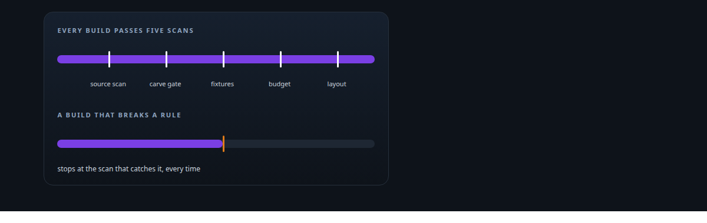
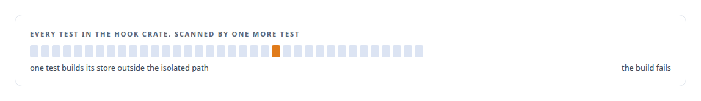
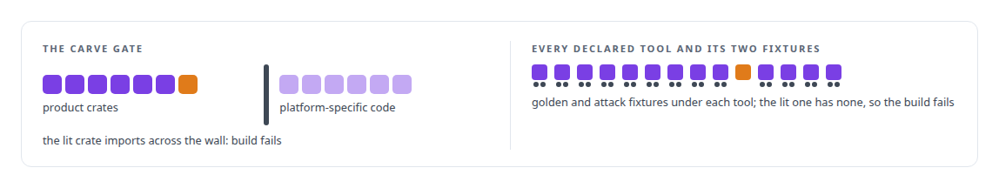
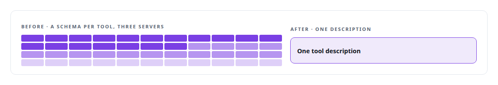
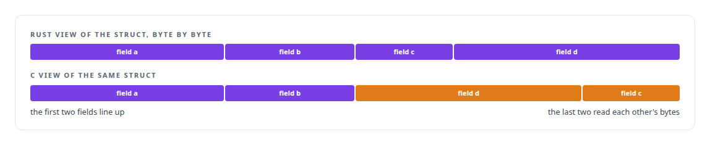

# Static analysis as tests

**Static checks run as tests in my governance platform: a carve gate on imports, a check that no hook can surface a non-operation.**

Canonical: https://coreyjames.ai/technologies/static-analysis-as-tests/  
Author: Corey James · Published: 2026-10-28 · Kind: technology  
Systems: [AgentOS](https://github.com/coreyjames-ai/agentos) · [Agent Swarm](https://github.com/coreyjames-ai/agent-swarm) · [Capabilities model](https://github.com/coreyjames-ai/capabilities-model)  
Skills: [Rust systems engineering](https://github.com/coreyjames-ai/portfolio/tree/main/skills/rust-systems-engineering) · [AI-assisted engineering methodology](https://github.com/coreyjames-ai/portfolio/tree/main/skills/ai-assisted-engineering-methodology) · [tool synthesis and governed API integration](https://github.com/coreyjames-ai/portfolio/tree/main/skills/tool-synthesis-and-governed-api-integration)  



## Result

| Figure | What it measures |
| --- | --- |
| **41,990** | tokens of tool schemas replaced by one description |
| **44** | tools across three servers behind that description |
| **520** | characters, the cap a test holds the description to |

## What was built

### A test that scans its own crate

[AgentOS](https://coreyjames.ai/systems/agentos) once had a test that built a real store and wrote synthetic rows into the real work graph. I had a test added to the hook crate that scans the crate's own source and fails the build if any test constructs a store outside the isolated path. Test isolation became a property of the build, enforced by a source scan that sees a structural rule no unit test can.




### Boundaries and fixtures in Agent Swarm

[Agent Swarm](https://coreyjames.ai/systems/agent-swarm) needed its runtime to stay separable from the estate it grew up in, so a carve gate in CI fails the build when a product crate imports platform-specific code. Its tool test runner fails the build for any declared tool without golden and attack fixtures, one-line tools included; a rule with no exceptions is simple enough to automate. See [Tools are the platform](https://coreyjames.ai/stories/tools-are-the-platform).



### A budget on one description

[Capabilities model](https://coreyjames.ai/systems/capabilities-model) replaced the tool schemas of three servers with one tool description, and I wanted that description to stay small. A budget that protects a design goal is a test, so a test caps its length. See [A hundred tokens instead of forty-two thousand](https://coreyjames.ai/stories/a-hundred-tokens-instead-of-forty-two-thousand).



### Layouts checked across the CUDA boundary

Layout tests compare the Rust and C views of each shared struct and fail when they diverge, because a mismatch there corrupts data silently.



Checks the build runs every time matter most when AI agents write most of the code and do not remember the last incident.

> When a rule breaks once, I add a test that fails the build for the whole class of mistake.

## What was verified

Each line is a claim the canonical page supports, with the figure as the page states it.

- Static analysis as tests: source-scanning tests and a CI carve gate that fail the build for a whole class of mistake, such as any test building a store outside the isolated path.
- FFI safety across Rust and CUDA: layout tests that compare the Rust and C views of every shared struct and fail the build when they diverge.
- Design budgets enforced in CI: a test caps the one tool description that replaced 41,990 tokens of schemas for 44 tools at 520 characters.

## Related

- [Tools are the platform](https://github.com/coreyjames-ai/agent-swarm/tree/main/stories/tools-are-the-platform) · https://coreyjames.ai/stories/tools-are-the-platform/
- [A hundred tokens instead of forty-two thousand](https://github.com/coreyjames-ai/capabilities-model/tree/main/stories/a-hundred-tokens-instead-of-forty-two-thousand) · https://coreyjames.ai/stories/a-hundred-tokens-instead-of-forty-two-thousand/
- System: [AgentOS](https://github.com/coreyjames-ai/agentos)
- System: [Agent Swarm](https://github.com/coreyjames-ai/agent-swarm)
- System: [Capabilities model](https://github.com/coreyjames-ai/capabilities-model)

## Citation

Corey James. "Static analysis as tests." coreyjames.ai, 2026. https://coreyjames.ai/technologies/static-analysis-as-tests/

```bibtex
@misc{coreyjames-static-analysis-as-tests,
  author = {Corey James},
  title = {Static analysis as tests},
  year = {2026},
  howpublished = {\url{https://coreyjames.ai/technologies/static-analysis-as-tests/}},
  note = {GitHub copy: https://github.com/coreyjames-ai/portfolio/tree/main/technologies/static-analysis-as-tests}
}
```

Part of [Corey James's portfolio](https://github.com/coreyjames-ai/portfolio) · site: https://coreyjames.ai/ · MCP server: https://coreyjames.ai/mcp · agent card: https://coreyjames.ai/.well-known/agent.json
