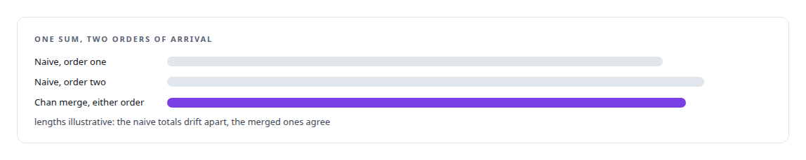
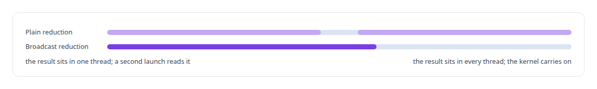
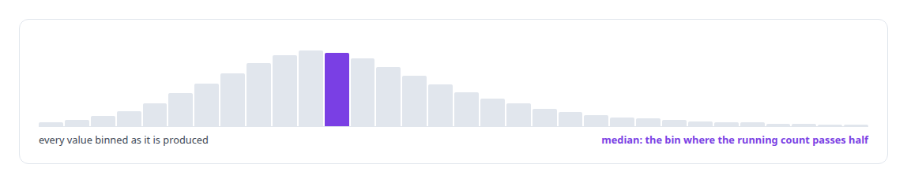
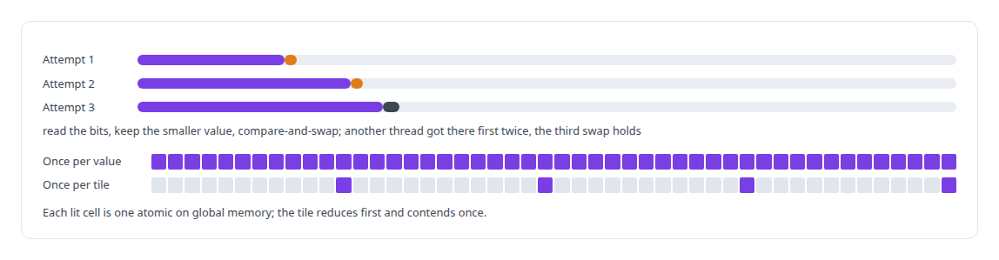

# Streaming statistics in CUDA

**Welford and Chan moments, histogram quantiles and compare-and-swap float atomics, written once in a device library and tested on their own, so every metric kernel is numerically stable in single precision.**

Canonical: https://coreyjames.ai/technologies/streaming-statistics-in-cuda/  
Author: Corey James · Published: 2026-10-28 · Kind: technology  
Systems: [Inference Fabric](https://github.com/coreyjames-ai/inference-fabric)  
Skills: [CUDA kernel development](https://github.com/coreyjames-ai/portfolio/tree/main/skills/cuda-kernel-development)  


## Result

| Figure | What it measures |
| --- | --- |
| **256** | bins in the shared-memory block histogram |
| **10 KB** | of shared memory for a median of millions of distances |
| **0.4%** | resolution of that median, about |

## What was built

### Three ways single precision goes wrong

Statistics over a hundred thousand vectors in single precision across thousands of threads go wrong in familiar ways: a naive variance cancels catastrophically, a sum depends on the order of the adds, and the minimum of a float cannot be taken atomically because the hardware has no such instruction. The device library under my CUDA engine solves each of those once, and every metric kernel in the [Inference Fabric](https://coreyjames.ai/systems/inference-fabric) reads from it.



Every primitive has its own CUDA test, including the block Welford and its broadcast form, the reductions and the tile machinery.


### Stable moments, finished in one launch

Moments are accumulated with Welford's method, each thread carrying a count, a running mean and a sum of squared deviations, and merged with Chan's combination formula at the warp and block levels, so the moments come out stable whatever the order of arrival. The convention is population statistics throughout, written into the reference so the GPU and CPU agree on the denominator.

Block reductions for sums, minima and maxima are templated with broadcast variants that leave the result in every thread, which the streaming kernels use to finish a cluster without a second launch.



### Quantiles without keeping the data

A block histogram lives in shared memory, every value is binned as it is produced, and the median or any percentile is read from the cumulative counts by one thread, with a documented resolution instead of a sort. That is how the characteristic scale in [Physics as a lens on embeddings](https://coreyjames.ai/stories/physics-as-a-lens-on-embeddings) finds the median of millions of pairwise distances.



### Atomics the hardware does not provide

Floating-point minimum and maximum atomics are built from compare-and-swap on the integer bit pattern, looping until the swap succeeds, and are issued once per tile, never per element. They are what let the diversity kernels find a cluster's distance range in one pass before the histogram pass that needs it.



> The kernels that call tested primitives inherit tested ground.

## What was verified

Each line is a claim the canonical page supports, with the figure as the page states it.

- CUDA kernel development: a device library of Welford and Chan moments, block reductions with broadcast variants and compare-and-swap float atomics, each with its own CUDA test.
- Numerically stable GPU statistics: single-precision moments that stay stable whatever the order of arrival, with the population convention fixed so GPU and CPU agree.
- Streaming quantiles on GPU: a 256-bin shared-memory histogram finds the median of millions of distances at about 0.4% resolution in 10 KB.

## Related

- [Thirty-eight metrics in a dozen passes](https://github.com/coreyjames-ai/inference-fabric/tree/main/stories/thirty-eight-metrics-in-a-dozen-passes) · https://coreyjames.ai/stories/thirty-eight-metrics-in-a-dozen-passes/
- [Every metric gets a CPU twin](https://github.com/coreyjames-ai/inference-fabric/tree/main/stories/every-metric-gets-a-cpu-twin) · https://coreyjames.ai/stories/every-metric-gets-a-cpu-twin/
- [Removing the sampling caps](https://github.com/coreyjames-ai/inference-fabric/tree/main/stories/removing-the-sampling-caps) · https://coreyjames.ai/stories/removing-the-sampling-caps/
- [Where a cluster sits](https://github.com/coreyjames-ai/inference-fabric/tree/main/stories/where-a-cluster-sits) · https://coreyjames.ai/stories/where-a-cluster-sits/
- [Diversity in three kernels](https://github.com/coreyjames-ai/inference-fabric/tree/main/stories/diversity-in-three-kernels) · https://coreyjames.ai/stories/diversity-in-three-kernels/
- [Physics as a lens on embeddings](https://github.com/coreyjames-ai/inference-fabric/tree/main/stories/physics-as-a-lens-on-embeddings) · https://coreyjames.ai/stories/physics-as-a-lens-on-embeddings/
- [Two-means as a measuring instrument](https://github.com/coreyjames-ai/inference-fabric/tree/main/stories/two-means-as-a-measuring-instrument) · https://coreyjames.ai/stories/two-means-as-a-measuring-instrument/
- [From health scores to decisions](https://github.com/coreyjames-ai/inference-fabric/tree/main/stories/from-health-scores-to-decisions) · https://coreyjames.ai/stories/from-health-scores-to-decisions/
- System: [Inference Fabric](https://github.com/coreyjames-ai/inference-fabric)

## Citation

Corey James. "Streaming statistics in CUDA." coreyjames.ai, 2026. https://coreyjames.ai/technologies/streaming-statistics-in-cuda/

```bibtex
@misc{coreyjames-streaming-statistics-in-cuda,
  author = {Corey James},
  title = {Streaming statistics in CUDA},
  year = {2026},
  howpublished = {\url{https://coreyjames.ai/technologies/streaming-statistics-in-cuda/}},
  note = {GitHub copy: https://github.com/coreyjames-ai/portfolio/tree/main/technologies/streaming-statistics-in-cuda}
}
```

Part of [Corey James's portfolio](https://github.com/coreyjames-ai/portfolio) · site: https://coreyjames.ai/ · MCP server: https://coreyjames.ai/mcp · agent card: https://coreyjames.ai/.well-known/agent.json
