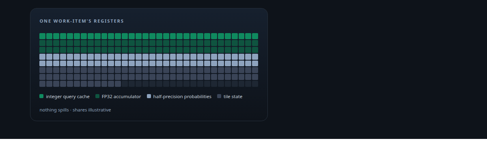
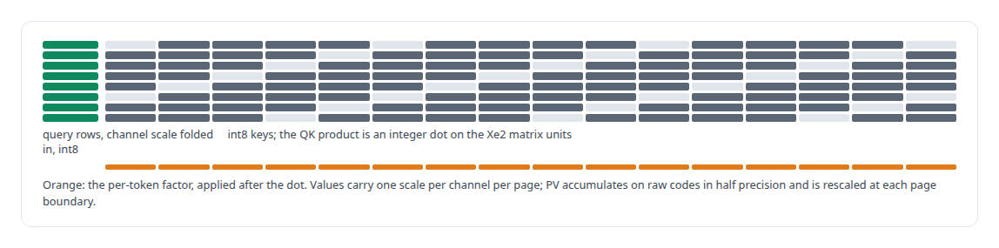
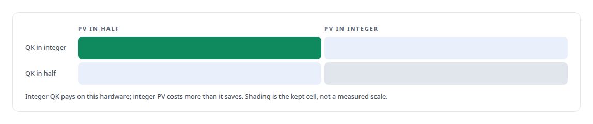
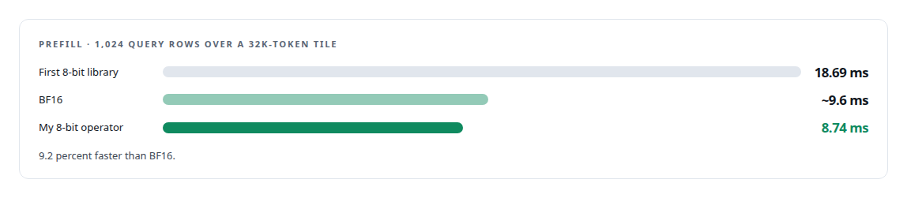
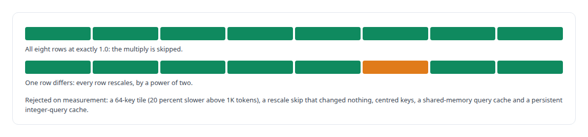
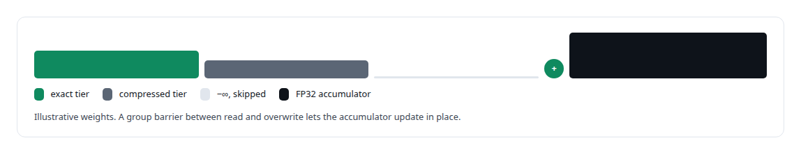
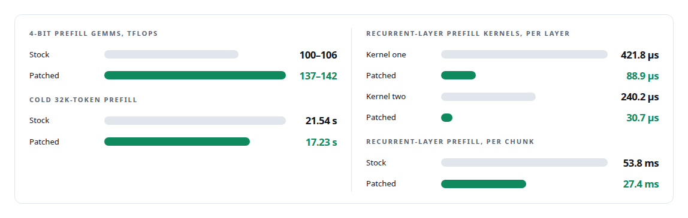

# SYCL

**ActiveKV's attention operators and its kernel patches on Intel Xe2 are SYCL, each gated on bit-identical outputs.**

Canonical: https://coreyjames.ai/technologies/sycl/  
Author: Corey James · Published: 2026-10-28 · Kind: technology  
Systems: [ActiveKV](https://github.com/coreyjames-ai/activekv)  
Skills: [Intel GPU and SYCL/oneAPI engineering](https://github.com/coreyjames-ai/portfolio/tree/main/skills/intel-gpu-and-sycl-oneapi-engineering) · [GPU inference optimisation](https://github.com/coreyjames-ai/portfolio/tree/main/skills/gpu-inference-optimisation) · [AI-assisted engineering methodology](https://github.com/coreyjames-ai/portfolio/tree/main/skills/ai-assisted-engineering-methodology) · [LLM quantization (FP8, INT8, 4-bit)](https://github.com/coreyjames-ai/portfolio/tree/main/skills/llm-quantization-fp8-int8-4-bit)  



## Result

| Figure | What it measures |
| --- | --- |
| **26%** | faster one-row decode than BF16, reading 8-bit history directly |
| **31%** | less device time for the two-owner decoder than two one-row calls |
| **256** | registers per work-item; every candidate fits with no spills |
| **2 KB** | integer query cache held in registers |

## What was built

I can work at the kernel level on hardware the ecosystem has not caught up with: design the operator, fit it into the register file, prove it exact or bounded, and patch the vendor stack where it falls short.

[ActiveKV](https://coreyjames.ai/systems/activekv) runs on an [Intel Arc Pro GPU](https://coreyjames.ai/technologies/intel-arc-gpus), a new architecture whose open kernel stacks had gaps. I wrote two kinds of SYCL: my own attention operators for the compressed history tier and the merge that joins the tiers, built on Intel's open SYCL attention sources, and patches to the vendor's kernels, credited as such. Every figure below is on one Intel Arc Pro GPU serving a 4-bit-weight build of a 27-billion-parameter hybrid recurrent-attention open-weight model.

## Attention that reads 8-bit history

The compressed-tier operators start from the vendor's SYCL flash-attention sources ([CUTLASS](https://coreyjames.ai/technologies/cutlass) for SYCL) and read 8-bit history without expanding it. I shaped the data format around the kernel that reads it, choosing each scale so it can leave the inner loop: keys carry a separable scale, a per-channel factor times a per-token factor, and values carry one scale per channel per page.



Each subgroup handles 8 query rows over 32-key tiles at head size 256, holding the integer query cache, one FP32 output accumulator and a half-precision probability plane in registers, with no spills and no shared local memory. Every candidate must fit before I time it. A two-by-two experiment decided which products run on integers.



## Exact tricks and a two-owner decoder

I keep a kernel optimisation only if it is exact or passes the fixed quality gate. Two exact tricks made the cut: an eight-row vote skips the online-softmax rescale only when every row's factor is exactly 1.0, and a running reference rounded up to an integer in base 2 turns every rescale into a power of two. A two-owner decode operator serves two requests with the same page count in one launch, each with its own metadata address and its own merge accumulator.





## A merge that joins the tiers

The merge kernel runs one work-group per token and head and one work-item per channel, and folds the partials from each tier into one FP32 accumulator. The vendor's paged-decode kernel had no log-sum-exp output, so I added one, initialised to negative infinity so an unwritten row is a valid empty partial.



## Patching the vendor stacks

The vendor patches build from the vendor's own sources with the [oneAPI](https://coreyjames.ai/technologies/intel-oneapi) compiler inside the vendor image, so the binaries match the ABI the serving engine loads. One new entry in [oneDNN](https://coreyjames.ai/technologies/onednn)'s Xe2 GEMM catalogue lifted the 4-bit prefill GEMMs on the model's K=5120 shapes, with identical outputs. In the recurrent-layer prefill library, two kernels ran on 16 work-groups, each looping over all 48 heads, and giving each chunk and head its own work-group fixed that.



The bit-for-bit comparison against stock then exposed a cross-subgroup visibility race that stock avoided only by timing. Five barriers that also publish global memory close it. Output stayed bit-identical to stock, and decode log-probabilities became repeatable from run to run.


Later patches reworked the 4-bit GEMM lowering: a wider workgroup for weight reuse, integer conversion fused with scaling, one instruction that widens and broadcasts each scale, and pruning of inactive systolic columns on a hardware tile tail. Recurrent-layer temporaries became one slab, and normalised queries and keys are now shared across subgroups. A validation switch makes 4-bit GEMM reductions deterministic and leaves release builds bit-identical when it is off. I kept one GEMM rewrite that gave exact instruction-level arithmetic across 48 special-value combinations with no speed-up, because it removes work and stays exact. See [Bringing a serving stack up on new silicon](https://coreyjames.ai/stories/bringing-a-serving-stack-up-on-new-silicon) and [Judge a representation by the bytes it stops moving](https://coreyjames.ai/stories/judge-a-representation-by-the-bytes-it-stops-moving).

> A bitwise mismatch is a finding.

## What was verified

Each line is a claim the canonical page supports, with the figure as the page states it.

- Intel GPU and SYCL/oneAPI engineering: attention operators reading 8-bit history without expanding it, prefill of 1,024 rows over a 32K tile cut from 18.69 ms to 8.74 ms, 9.2 percent faster than BF16.
- GPU kernel register-level optimisation: every candidate fitted in 256 registers with no spills, one-row decode 26% faster than BF16 and a two-owner decoder using 31% less device time.
- Vendor kernel patching with bit-exact gates: oneDNN and recurrent-layer patches with identical outputs, per-chunk prefill from 53.8 to 27.4 ms, and a visibility race found by bitwise comparison.
- Numerical reproducibility: deterministic 4-bit GEMM reductions under a validation switch, and exact arithmetic kept across 48 special-value combinations.

## Related

- [Rewriting an engine extension without changing a token](https://github.com/coreyjames-ai/activekv/tree/main/stories/rewriting-an-engine-extension-without-changing-a-token) · https://coreyjames.ai/stories/rewriting-an-engine-extension-without-changing-a-token/
- [Context beyond VRAM](https://github.com/coreyjames-ai/activekv/tree/main/stories/context-beyond-vram) · https://coreyjames.ai/stories/context-beyond-vram/
- [Judge a representation by the bytes it stops moving](https://github.com/coreyjames-ai/activekv/tree/main/stories/judge-a-representation-by-the-bytes-it-stops-moving) · https://coreyjames.ai/stories/judge-a-representation-by-the-bytes-it-stops-moving/
- [Bringing a serving stack up on new silicon](https://github.com/coreyjames-ai/activekv/tree/main/stories/bringing-a-serving-stack-up-on-new-silicon) · https://coreyjames.ai/stories/bringing-a-serving-stack-up-on-new-silicon/
- [Intel Arc GPUs](https://github.com/coreyjames-ai/portfolio/tree/main/technologies/intel-arc-gpus) · https://coreyjames.ai/technologies/intel-arc-gpus/
- [CUTLASS](https://github.com/coreyjames-ai/portfolio/tree/main/technologies/cutlass) · https://coreyjames.ai/technologies/cutlass/
- [Intel oneAPI](https://github.com/coreyjames-ai/portfolio/tree/main/technologies/intel-oneapi) · https://coreyjames.ai/technologies/intel-oneapi/
- [oneDNN](https://github.com/coreyjames-ai/portfolio/tree/main/technologies/onednn) · https://coreyjames.ai/technologies/onednn/
- System: [ActiveKV](https://github.com/coreyjames-ai/activekv)

## Citation

Corey James. "SYCL." coreyjames.ai, 2026. https://coreyjames.ai/technologies/sycl/

```bibtex
@misc{coreyjames-sycl,
  author = {Corey James},
  title = {SYCL},
  year = {2026},
  howpublished = {\url{https://coreyjames.ai/technologies/sycl/}},
  note = {GitHub copy: https://github.com/coreyjames-ai/portfolio/tree/main/technologies/sycl}
}
```

Part of [Corey James's portfolio](https://github.com/coreyjames-ai/portfolio) · site: https://coreyjames.ai/ · MCP server: https://coreyjames.ai/mcp · agent card: https://coreyjames.ai/.well-known/agent.json
