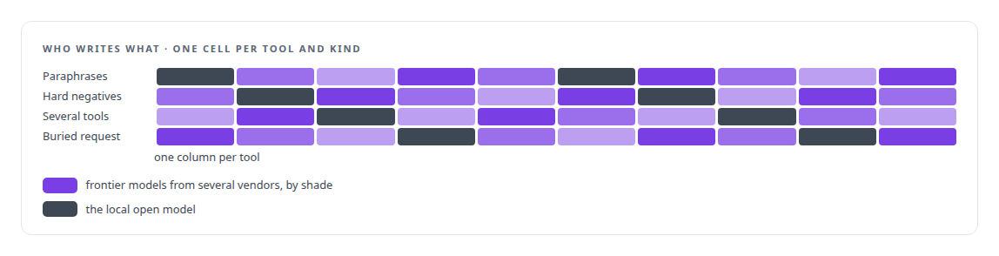
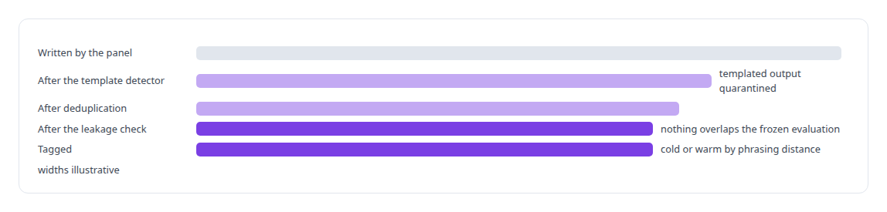
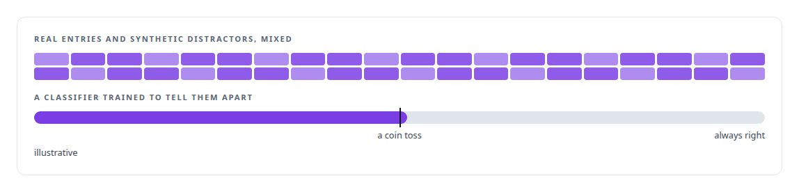
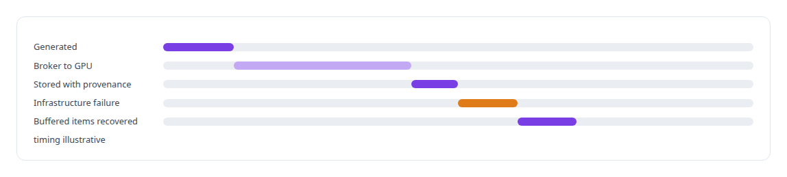

# Synthetic training-data generation

**The capabilities model's training corpus is generated from the tool registry by a data factory, so the model is rebuilt from the catalog whenever the catalog changes.**

Canonical: https://coreyjames.ai/technologies/synthetic-training-data-generation/  
Author: Corey James · Published: 2026-10-28 · Kind: technology  
Systems: [Capabilities model](https://github.com/coreyjames-ai/capabilities-model) · [FAFO Core and Function Forge](https://github.com/coreyjames-ai/fafo-core)  
Skills: [AI-assisted engineering methodology](https://github.com/coreyjames-ai/portfolio/tree/main/skills/ai-assisted-engineering-methodology) · [tool synthesis and governed API integration](https://github.com/coreyjames-ai/portfolio/tree/main/skills/tool-synthesis-and-governed-api-integration) · [evidence-gated acceptance](https://github.com/coreyjames-ai/portfolio/tree/main/skills/evidence-gated-acceptance)  


## Result

| Figure | What it measures |
| --- | --- |
| **336** | templated entries the statistical detector quarantined |
| **1,958** | synthetic distractor tools generated for the evaluation |
| **≈30B** | parameters in the local open model on the panel |

## What was built

### Authored from the tool registry

[Capabilities model](https://coreyjames.ai/systems/capabilities-model) learns its tool catalog from data, and I decided every example would be generated from the tool registry it serves, so retraining after a catalog change is a pipeline run. Seeds come from the tool servers' own listings into a YAML registry.

For each tool a panel writes intents of several kinds: paraphrases, hard negatives from pairs of tools that are easy to confuse, requests that need several tools, and long paragraphs with the real request buried inside. The panel mixes frontier models from several vendors with a local open model, and the work is split per tool and kind so no one model's habits dominate. The authoring models are third-party and open models; the factory, the gates and the evaluation design are mine.



### Gates between the panel and the training set

Most of the engineering is in the gates. A statistical detector catches a panel model that scripts templated output and quarantines what it writes. Every item is deduplicated and checked for leakage against the frozen evaluation set, so the evaluation measures generalisation, and items are tagged cold or warm by how far their phrasing sits from the training data.




### Distractors that pass for real

For the evaluation, a synthetic catalog of distractor tools was generated with its style measured against real entries. Before it was used, it was attacked with classifiers trained to tell real from synthetic, so no classifier can pick out the fakes by style. See [A hundred tokens instead of forty-two thousand](https://coreyjames.ai/stories/a-hundred-tokens-instead-of-forty-two-thousand) and [The baseline that tied us](https://coreyjames.ai/stories/the-baseline-that-tied-us).



### Tens of millions of traceable items

[FAFO Core and Function Forge](https://coreyjames.ai/systems/fafo-core) runs my other large generation pipeline: a Rust function that produced tens of millions of model-generated dataset items, each traceable to the knowledge it came from. It submits work through the token-aware broker to GPU inference, stores results with full provenance and recovers buffered items after an infrastructure failure. The design of the items themselves belongs to research. See [The workload that shaped the platform](https://coreyjames.ai/stories/the-workload-that-shaped-the-platform).



> Templated output looks plentiful and teaches little.

## What was verified

Each line is a claim the canonical page supports, with the figure as the page states it.

- Synthetic training data generation: a corpus generated from the tool registry by a panel of model families, with a local open model of ≈30B parameters among them.
- Data quality gates for ML: a statistical detector quarantined 336 templated entries, with deduplication and item-by-item leakage checks against the frozen evaluation.
- Adversarial evaluation design: 1,958 synthetic distractor tools tested against classifiers trained to tell real from synthetic before use.

## Related

- [A hundred tokens instead of forty-two thousand](https://github.com/coreyjames-ai/capabilities-model/tree/main/stories/a-hundred-tokens-instead-of-forty-two-thousand) · https://coreyjames.ai/stories/a-hundred-tokens-instead-of-forty-two-thousand/
- [The baseline that tied us](https://github.com/coreyjames-ai/capabilities-model/tree/main/stories/the-baseline-that-tied-us) · https://coreyjames.ai/stories/the-baseline-that-tied-us/
- [The workload that shaped the platform](https://github.com/coreyjames-ai/fafo-core/tree/main/stories/the-workload-that-shaped-the-platform) · https://coreyjames.ai/stories/the-workload-that-shaped-the-platform/
- System: [Capabilities model](https://github.com/coreyjames-ai/capabilities-model)
- System: [FAFO Core and Function Forge](https://github.com/coreyjames-ai/fafo-core)

## Citation

Corey James. "Synthetic training-data generation." coreyjames.ai, 2026. https://coreyjames.ai/technologies/synthetic-training-data-generation/

```bibtex
@misc{coreyjames-synthetic-training-data-generation,
  author = {Corey James},
  title = {Synthetic training-data generation},
  year = {2026},
  howpublished = {\url{https://coreyjames.ai/technologies/synthetic-training-data-generation/}},
  note = {GitHub copy: https://github.com/coreyjames-ai/portfolio/tree/main/technologies/synthetic-training-data-generation}
}
```

Part of [Corey James's portfolio](https://github.com/coreyjames-ai/portfolio) · site: https://coreyjames.ai/ · MCP server: https://coreyjames.ai/mcp · agent card: https://coreyjames.ai/.well-known/agent.json
