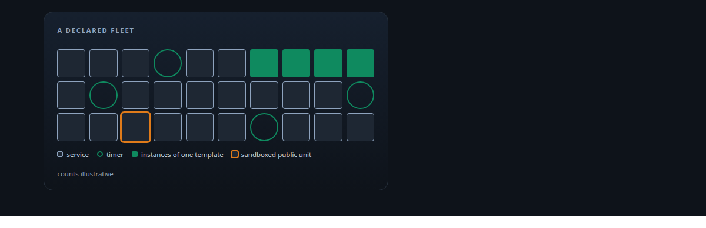
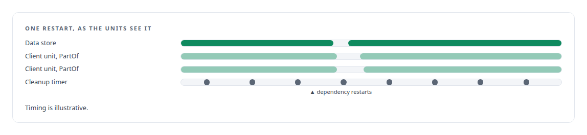
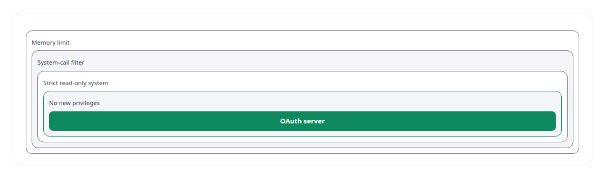
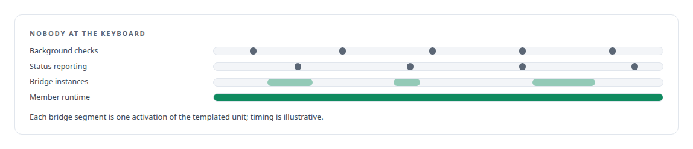
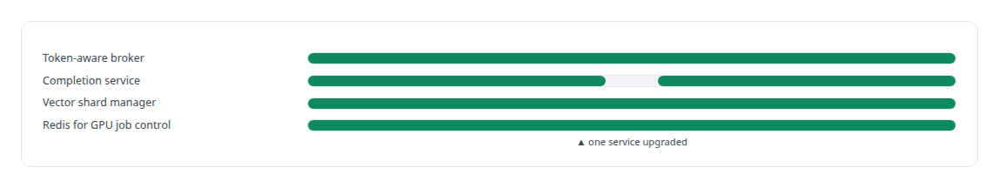
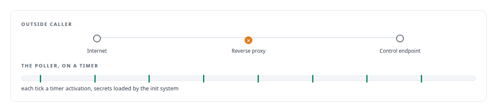

# systemd

**Every service in my estate that stays up is a locked-down systemd unit; the agent runtime, the credential service and the governance watcher among them.**

Canonical: https://coreyjames.ai/technologies/systemd/  
Author: Corey James · Published: 2026-10-28 · Kind: technology  
Systems: [Auth and access plane](https://github.com/coreyjames-ai/auth-and-access-plane) · [AgentOS](https://github.com/coreyjames-ai/agentos) · [Inference Fabric](https://github.com/coreyjames-ai/inference-fabric) · [FAFOHive](https://github.com/coreyjames-ai/fafohive)  
Skills: [sandboxing and container hardening](https://github.com/coreyjames-ai/portfolio/tree/main/skills/sandboxing-and-container-hardening) · [inference serving architecture](https://github.com/coreyjames-ai/portfolio/tree/main/skills/inference-serving-architecture)  



## Result

| Figure | What it measures |
| --- | --- |
| **1 min** | timer cadence for container cleanup |
| **2 min** | poller cadence in FAFOHive |

## What was built

### One declared fleet for the access plane

[Auth and access plane](https://coreyjames.ai/systems/auth-and-access-plane) holds the operations layer, and I wanted the fleet's behaviour fixed in configuration. A few dozen services sit under one stack target, with explicit ordering, and the unit files and an inventory are versioned with the code.

PartOf cascades carry a dependency's restart through to its dependants, drop-ins make data-store clients wait for the network and declare cascade membership, and Docker-wrapped services are managed like native ones. Routine work such as container cleanup is a timer, visible and controllable on its own rather than a loop hidden in a script.



### Sandboxing the unit that faces the public

The OAuth server faces the public, so its unit runs sandboxed. Its secrets arrive through `LoadCredential`, so they sit in no environment variable or readable file.



### Governance work that runs with nobody present

[AgentOS](https://coreyjames.ai/systems/agentos) has governance work that must carry on with nobody present. Timers drive its background checks and work-order status reporting. A templated unit runs one bridge instance per activation, so many instances come from one definition, and the member runtime that hosts managed agent seats is its own service.



### Pipeline services that restart on their own

[Inference Fabric](https://coreyjames.ai/systems/inference-fabric) is a set of systemd services, each restartable on its own, so one service can be upgraded without draining the pipeline. See [Millions of queued items that were not there](https://coreyjames.ai/stories/millions-of-queued-items-that-were-not-there).



### Secrets and timers for the social modules

[FAFOHive](https://coreyjames.ai/systems/fafohive)'s in-house social modules get their secrets through `LoadCredential`, and their poller runs as a timer. The reverse proxy in front refuses outside callers on the modules' control endpoints.




> I build services to be operated: declared dependencies, sandboxing on anything public, secrets handled by the init system and recurring work in the open.

## What was verified

Each line is a claim the canonical page supports, with the figure as the page states it.

- Linux service operations with systemd: a declared fleet under one stack target, with PartOf restart cascades and timers instead of hidden loops.
- Sandboxing and container hardening: the public OAuth server's unit with no new privileges, a read-only system, a system-call filter and a memory limit, secrets through LoadCredential.
- Inference serving architecture: pipeline services each restartable on its own, so one can be upgraded without draining the pipeline.

## Related

- [Why long agent runs fail](https://github.com/coreyjames-ai/agentos/tree/main/stories/why-long-agent-runs-fail) · https://coreyjames.ai/stories/why-long-agent-runs-fail/
- [The hardening fix that locked everyone out](https://github.com/coreyjames-ai/auth-and-access-plane/tree/main/stories/the-hardening-fix-that-locked-everyone-out) · https://coreyjames.ai/stories/the-hardening-fix-that-locked-everyone-out/
- [Millions of queued items that were not there](https://github.com/coreyjames-ai/inference-fabric/tree/main/stories/millions-of-queued-items-that-were-not-there) · https://coreyjames.ai/stories/millions-of-queued-items-that-were-not-there/
- System: [Auth and access plane](https://github.com/coreyjames-ai/auth-and-access-plane)
- System: [AgentOS](https://github.com/coreyjames-ai/agentos)
- System: [Inference Fabric](https://github.com/coreyjames-ai/inference-fabric)
- System: [FAFOHive](https://github.com/coreyjames-ai/fafohive)

## Citation

Corey James. "systemd." coreyjames.ai, 2026. https://coreyjames.ai/technologies/systemd/

```bibtex
@misc{coreyjames-systemd,
  author = {Corey James},
  title = {systemd},
  year = {2026},
  howpublished = {\url{https://coreyjames.ai/technologies/systemd/}},
  note = {GitHub copy: https://github.com/coreyjames-ai/portfolio/tree/main/technologies/systemd}
}
```

Part of [Corey James's portfolio](https://github.com/coreyjames-ai/portfolio) · site: https://coreyjames.ai/ · MCP server: https://coreyjames.ai/mcp · agent card: https://coreyjames.ai/.well-known/agent.json
