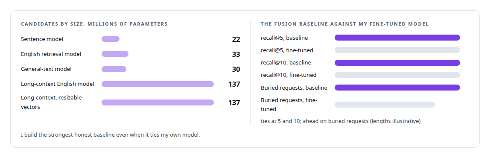
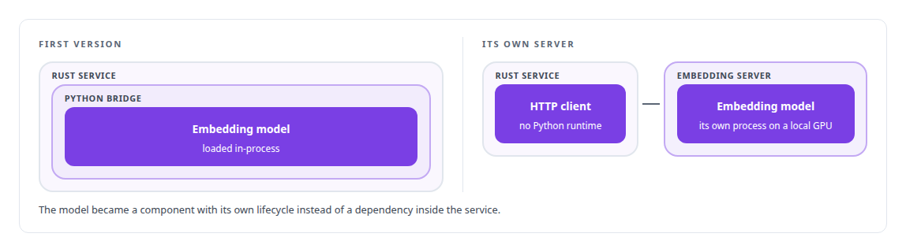
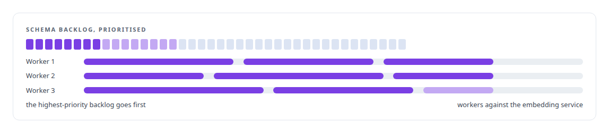

# Text embedding models

**I ran a bake-off across embedding families for retrieval and replaced an incumbent chosen by habit with one chosen by measurement.**

Canonical: https://coreyjames.ai/technologies/text-embedding-models/  
Author: Corey James · Published: 2026-10-28 · Kind: technology  
Systems: [Capabilities model](https://github.com/coreyjames-ai/capabilities-model) · [FAFOHive](https://github.com/coreyjames-ai/fafohive) · [FAFO Core and Function Forge](https://github.com/coreyjames-ai/fafo-core)  
Skills: [AI-assisted engineering methodology](https://github.com/coreyjames-ai/portfolio/tree/main/skills/ai-assisted-engineering-methodology) · [inference serving architecture](https://github.com/coreyjames-ai/portfolio/tree/main/skills/inference-serving-architecture) · [tool synthesis and governed API integration](https://github.com/coreyjames-ai/portfolio/tree/main/skills/tool-synthesis-and-governed-api-integration)  


## Result

| Figure | What it measures |
| --- | --- |
| **5** | embedding models through one harness on the frozen evaluation |
| **1,024** | dimensions per vector in the memory index |
| **568M** | parameters in the multilingual memory embedder |

## What was built

### A bake-off instead of habit

[Capabilities model](https://coreyjames.ai/systems/capabilities-model) needed a retrieval baseline strong enough that beating it would mean something. The incumbent embedding model had been picked only because the rest of the estate used it.


I had a bake-off run on the frozen evaluation. The candidates went through the same harness on ONNX Runtime, and disqualifiers for latency and context length stopped an accurate but undeployable model from winning. The winner went into a fusion baseline with BM25. GPU scoring runs with TF32 pinned off, after a known-answer control showed that the precision setting changed rankings. The models are third-party open models; the bake-off, the serving architecture and the retrieval design are mine. See [The baseline that tied us](https://coreyjames.ai/stories/the-baseline-that-tied-us).



### The memory embedder as its own server

The memory capability in [FAFOHive](https://coreyjames.ai/systems/fafohive) embeds code, documents and observations with a multilingual model that has dense and sparse outputs, on a local text-embedding inference server on my own GPU. The first version ran the model in-process through a Python bridge. I moved it to its own server behind an HTTP client, which took the Python runtime out of the Rust service.

Dense retrieval there always pairs with lexical search and a reranker, because similarity misses exact identifiers. See [A code explainer that is not allowed to invent](https://coreyjames.ai/stories/a-code-explainer-that-is-not-allowed-to-invent).



### Backfill as an ordinary job

[FAFO Core and Function Forge](https://coreyjames.ai/systems/fafo-core) runs embedding backfill as an ordinary function. A job finds schema backlog, prioritises it and spawns workers against the same kind of embedding service, so embedding a new corpus is a scheduled, controllable job with the same controls as any other workload.



> Estate consistency is no evidence.

## What was verified

Each line is a claim the canonical page supports, with the figure as the page states it.

- Embedding model selection: a bake-off of 5 embedding models through one harness on the frozen evaluation, with latency and context-length disqualifiers.
- Retrieval baselines: a BM25 and dense fusion baseline with every weight chosen by sweep, built as strong as it honestly could be even where it tied my own model.
- Embedding serving architecture: a multilingual 568M-parameter embedder moved from an in-process Python bridge to its own server, producing 1,024-dimension vectors.

## Related

- [The baseline that tied us](https://github.com/coreyjames-ai/capabilities-model/tree/main/stories/the-baseline-that-tied-us) · https://coreyjames.ai/stories/the-baseline-that-tied-us/
- [A code explainer that is not allowed to invent](https://github.com/coreyjames-ai/fafohive/tree/main/stories/a-code-explainer-that-is-not-allowed-to-invent) · https://coreyjames.ai/stories/a-code-explainer-that-is-not-allowed-to-invent/
- System: [Capabilities model](https://github.com/coreyjames-ai/capabilities-model)
- System: [FAFOHive](https://github.com/coreyjames-ai/fafohive)
- System: [FAFO Core and Function Forge](https://github.com/coreyjames-ai/fafo-core)

## Citation

Corey James. "Text embedding models." coreyjames.ai, 2026. https://coreyjames.ai/technologies/text-embedding-models/

```bibtex
@misc{coreyjames-text-embedding-models,
  author = {Corey James},
  title = {Text embedding models},
  year = {2026},
  howpublished = {\url{https://coreyjames.ai/technologies/text-embedding-models/}},
  note = {GitHub copy: https://github.com/coreyjames-ai/portfolio/tree/main/technologies/text-embedding-models}
}
```

Part of [Corey James's portfolio](https://github.com/coreyjames-ai/portfolio) · site: https://coreyjames.ai/ · MCP server: https://coreyjames.ai/mcp · agent card: https://coreyjames.ai/.well-known/agent.json
