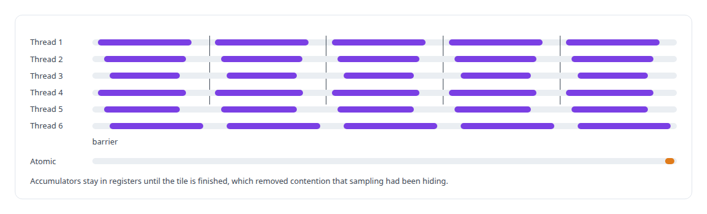
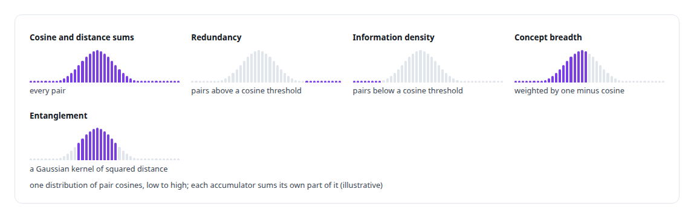
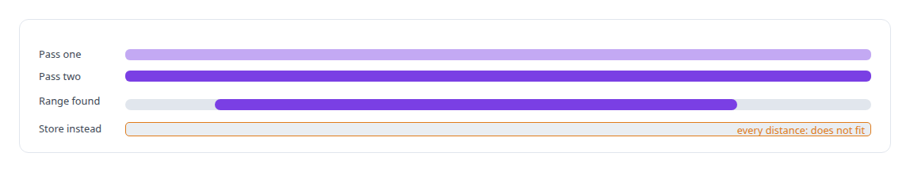

# Tiled pairwise kernels

**One tiling design makes every quadratic cluster metric exact at a hundred thousand members, with bounded memory and no sampling.**

Canonical: https://coreyjames.ai/technologies/tiled-pairwise-kernels/  
Author: Corey James · Published: 2026-10-28 · Kind: technology  
Systems: [Inference Fabric](https://github.com/coreyjames-ai/inference-fabric)  
Skills: [CUDA kernel development](https://github.com/coreyjames-ai/portfolio/tree/main/skills/cuda-kernel-development) · [GPU inference optimisation](https://github.com/coreyjames-ai/portfolio/tree/main/skills/gpu-inference-optimisation) · [embedding analytics and cluster metrics](https://github.com/coreyjames-ai/portfolio/tree/main/skills/embedding-analytics-and-cluster-metrics) · [AI-assisted engineering methodology](https://github.com/coreyjames-ai/portfolio/tree/main/skills/ai-assisted-engineering-methodology)  


## Result

| Figure | What it measures |
| --- | --- |
| **6** | accumulator types the pairwise kernels declare |
| **≈8 KB** | of shared memory per block for a tile pair |
| **1** | atomic per tile into the cluster totals |

## What was built

### One tile shape for every quadratic metric

Half of my cluster metrics are quadratic: they need every pair of members. The tiled pairwise machinery in the [Inference Fabric](https://coreyjames.ai/systems/inference-fabric)'s CUDA engine makes those metrics exact at a hundred thousand members with bounded memory, and it is the step that let me take every sampling cap out of the metrics in [Removing the sampling caps](https://coreyjames.ai/stories/removing-the-sampling-caps).

The cluster is cut into tiles of sixteen rows by sixty-four, and the grid is flattened so one block owns one tile pair. Diagonal tiles visit each pair once over the upper triangle, rectangular tiles visit the full cross product, and a tile prefix sum maps a flat block index back to its cluster and tile pair without a search. The vectors for a tile pair are loaded into shared memory, and the loop runs with the dimension on the outside and the pair on the inside, so every thread reaches every barrier by construction and no thread stalls on a divergent exit.



The tile loader, the pair-index decoder for diagonal and rectangular tiles and multi-tile processing each have their own CUDA tests.

### Accumulators as declared types

The pairwise, diversity, silhouette and entanglement kernels share that machinery, so each of them is a short declaration of what it accumulates. The accumulator is a type, and adding a pairwise metric is adding an accumulator.



### Recompute, never store

Where a metric needs the cluster's distance range before it can bin, as entropy does, the kernel runs two tiled passes and recomputes the distances in the second rather than storing them.




> Five billion distances do not fit, and a second sweep is cheap.

## What was verified

Each line is a claim the canonical page supports, with the figure as the page states it.

- CUDA kernel development: one tiling design for every quadratic cluster metric, exact over 5 billion pairs in a cluster of a hundred thousand members.
- GPU memory and contention design: tile pairs in ≈8 KB of shared memory per block, register accumulation and 1 atomic per tile, with every thread at every barrier.
- Extensible kernel design: six declared accumulator types share one tile loop, and a second pass recomputes distances instead of storing them.

## Related

- [Thirty-eight metrics in a dozen passes](https://github.com/coreyjames-ai/inference-fabric/tree/main/stories/thirty-eight-metrics-in-a-dozen-passes) · https://coreyjames.ai/stories/thirty-eight-metrics-in-a-dozen-passes/
- [Every metric gets a CPU twin](https://github.com/coreyjames-ai/inference-fabric/tree/main/stories/every-metric-gets-a-cpu-twin) · https://coreyjames.ai/stories/every-metric-gets-a-cpu-twin/
- [Removing the sampling caps](https://github.com/coreyjames-ai/inference-fabric/tree/main/stories/removing-the-sampling-caps) · https://coreyjames.ai/stories/removing-the-sampling-caps/
- [Where a cluster sits](https://github.com/coreyjames-ai/inference-fabric/tree/main/stories/where-a-cluster-sits) · https://coreyjames.ai/stories/where-a-cluster-sits/
- [Diversity in three kernels](https://github.com/coreyjames-ai/inference-fabric/tree/main/stories/diversity-in-three-kernels) · https://coreyjames.ai/stories/diversity-in-three-kernels/
- [Physics as a lens on embeddings](https://github.com/coreyjames-ai/inference-fabric/tree/main/stories/physics-as-a-lens-on-embeddings) · https://coreyjames.ai/stories/physics-as-a-lens-on-embeddings/
- [Two-means as a measuring instrument](https://github.com/coreyjames-ai/inference-fabric/tree/main/stories/two-means-as-a-measuring-instrument) · https://coreyjames.ai/stories/two-means-as-a-measuring-instrument/
- [From health scores to decisions](https://github.com/coreyjames-ai/inference-fabric/tree/main/stories/from-health-scores-to-decisions) · https://coreyjames.ai/stories/from-health-scores-to-decisions/
- System: [Inference Fabric](https://github.com/coreyjames-ai/inference-fabric)

## Citation

Corey James. "Tiled pairwise kernels." coreyjames.ai, 2026. https://coreyjames.ai/technologies/tiled-pairwise-kernels/

```bibtex
@misc{coreyjames-tiled-pairwise-kernels,
  author = {Corey James},
  title = {Tiled pairwise kernels},
  year = {2026},
  howpublished = {\url{https://coreyjames.ai/technologies/tiled-pairwise-kernels/}},
  note = {GitHub copy: https://github.com/coreyjames-ai/portfolio/tree/main/technologies/tiled-pairwise-kernels}
}
```

Part of [Corey James's portfolio](https://github.com/coreyjames-ai/portfolio) · site: https://coreyjames.ai/ · MCP server: https://coreyjames.ai/mcp · agent card: https://coreyjames.ai/.well-known/agent.json
