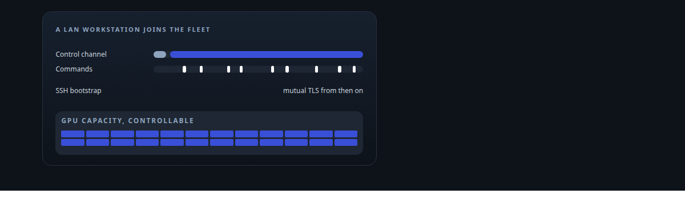
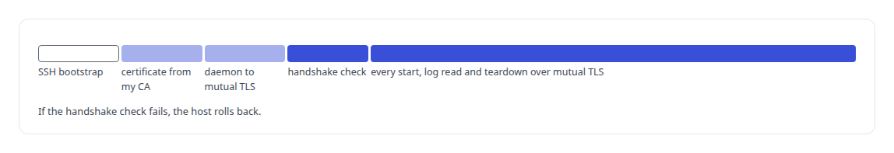
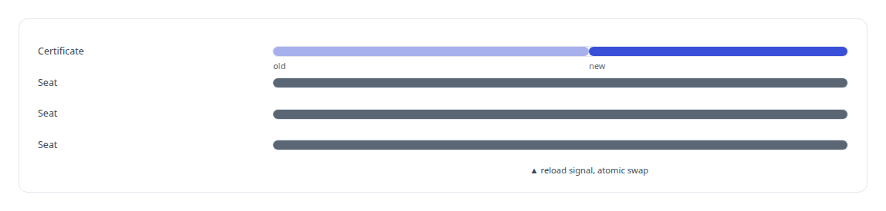
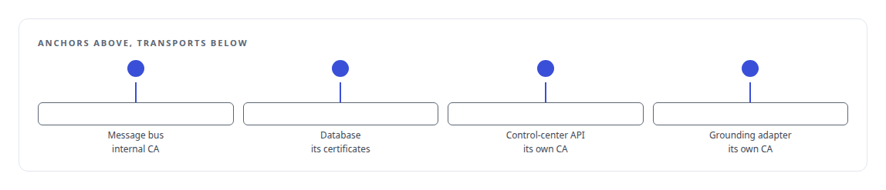
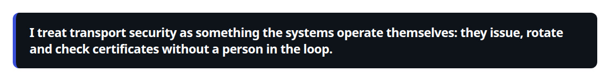
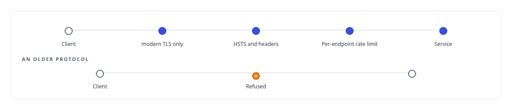

# TLS and mTLS

**TLS with hot certificate rotation on every public surface; mutual TLS between my hosts for LAN GPU provisioning.**

Canonical: https://coreyjames.ai/technologies/tls-and-mtls/  
Author: Corey James · Published: 2026-10-28 · Kind: technology  
Systems: [Inference Fabric](https://github.com/coreyjames-ai/inference-fabric) · [FAFO Core and Function Forge](https://github.com/coreyjames-ai/fafo-core) · [FAFOHive](https://github.com/coreyjames-ai/fafohive) · [Agent Swarm](https://github.com/coreyjames-ai/agent-swarm) · [Helix](https://github.com/coreyjames-ai/helix) · [Auth and access plane](https://github.com/coreyjames-ai/auth-and-access-plane) · [Capabilities model](https://github.com/coreyjames-ai/capabilities-model)  
Skills: [distributed systems correctness](https://github.com/coreyjames-ai/portfolio/tree/main/skills/distributed-systems-correctness) · [zero-trust and zero-inbound networking](https://github.com/coreyjames-ai/portfolio/tree/main/skills/zero-trust-and-zero-inbound-networking)  



## Result

| Figure | What it measures |
| --- | --- |
| **1.2/1.3** | the only TLS versions the public fronts accept |
| **0** | certificate files on disk for the embedding-service client |
| **once** | SSH login per host, then never again |

## What was built

### SSH once, then mutual TLS for a GPU fleet

[Inference Fabric](https://coreyjames.ai/systems/inference-fabric) and [FAFO Core and Function Forge](https://coreyjames.ai/systems/fafo-core) needed to drive Docker on spare LAN workstations, and I did not want a shell login to be the control channel for a GPU fleet.

One call bootstraps the machine over SSH, issues it a certificate from my own certificate authority, reconfigures its Docker daemon to accept only mutually authenticated TLS, checks the handshake and rolls back if the check fails. From then on every container start, log read and teardown on that host goes over mutual TLS. A LAN machine becomes controllable capacity without Kubernetes and without a shared password.



### Rotating certificates without disconnecting anyone

[FAFOHive](https://coreyjames.ai/systems/fafohive) is the endpoint every agent seat connects to, so restarting it to change a certificate would disconnect all of them. I made rotation an operation under traffic: the listener holds its certificate behind an atomic swap and replaces it on a reload signal. Its calls to the shared embedding service use client certificates held in memory.



### One trust anchor per transport

[Agent Swarm](https://coreyjames.ai/systems/agent-swarm) runs its message bus and database connections over TLS only. I made the Redis client accept my internal CA as its sole trust anchor and reject a plaintext URL when configuration loads, so a mistake fails at start-up. Database access uses certificate-based mutual TLS through a connector that accepts the connection strings the standard PostgreSQL tools use.

[Helix](https://coreyjames.ai/systems/helix) uses mutual TLS for its control-center API and for the adapter that reads grounding documents, each with its own CA, so a service's identity comes from its certificate and the copied-token problem goes away. I kept every anchor separate so a certificate change on one transport cannot break another.



### Hardened public fronts

[Auth and access plane](https://coreyjames.ai/systems/auth-and-access-plane) fronts hosted services with NGINX, HSTS, security headers and per-endpoint rate limits, with an ACME responder for certificates. The voice endpoint sits behind an access policy that answers authenticated callers and refuses anonymous ones, and the [Capabilities model](https://coreyjames.ai/systems/capabilities-model) discovery service serves its HTTP face over rustls against the estate CA with an origin lock.

The TLS libraries are standard; my work is the certificate authorities, the trust layout and the rotation.





> I treat transport security as something the systems operate themselves: they issue, rotate and check certificates without a person in the loop.

## What was verified

Each line is a claim the canonical page supports, with the figure as the page states it.

- Zero-trust networking: LAN GPU hosts bootstrapped once over SSH, then controlled only over mutual TLS to the Docker daemon, with a handshake check and automatic rollback.
- Certificate management: certificates rotated under traffic through an atomic swap, with no agent seat disconnected.
- Transport security architecture: one trust anchor per transport, plaintext connection strings refused when configuration loads, public fronts on TLS 1.2 and 1.3 only.

## Related

- System: [Inference Fabric](https://github.com/coreyjames-ai/inference-fabric)
- System: [FAFO Core and Function Forge](https://github.com/coreyjames-ai/fafo-core)
- System: [FAFOHive](https://github.com/coreyjames-ai/fafohive)
- System: [Agent Swarm](https://github.com/coreyjames-ai/agent-swarm)
- System: [Helix](https://github.com/coreyjames-ai/helix)
- System: [Auth and access plane](https://github.com/coreyjames-ai/auth-and-access-plane)
- System: [Capabilities model](https://github.com/coreyjames-ai/capabilities-model)

## Citation

Corey James. "TLS and mTLS." coreyjames.ai, 2026. https://coreyjames.ai/technologies/tls-and-mtls/

```bibtex
@misc{coreyjames-tls-and-mtls,
  author = {Corey James},
  title = {TLS and mTLS},
  year = {2026},
  howpublished = {\url{https://coreyjames.ai/technologies/tls-and-mtls/}},
  note = {GitHub copy: https://github.com/coreyjames-ai/portfolio/tree/main/technologies/tls-and-mtls}
}
```

Part of [Corey James's portfolio](https://github.com/coreyjames-ai/portfolio) · site: https://coreyjames.ai/ · MCP server: https://coreyjames.ai/mcp · agent card: https://coreyjames.ai/.well-known/agent.json
