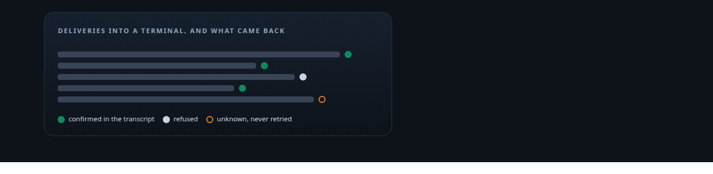
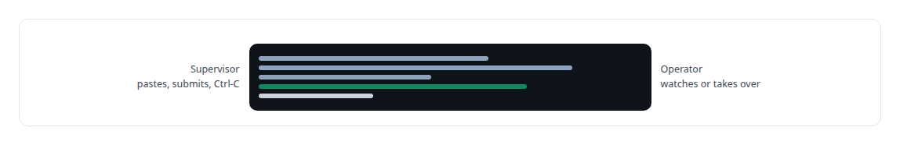
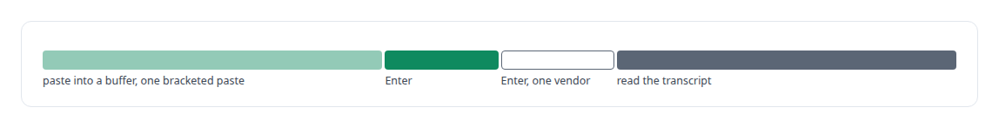
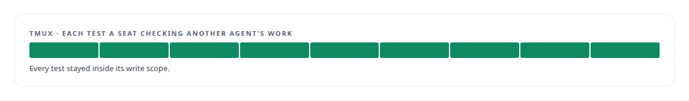
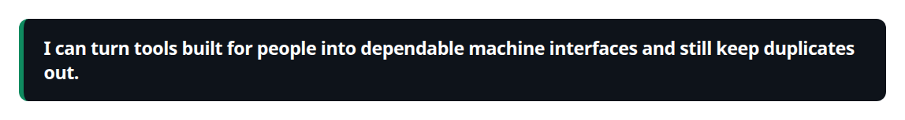
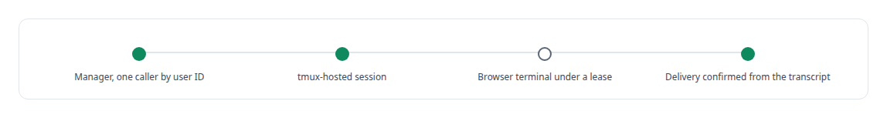

# tmux

**tmux is how my governance platform drives vendors' interactive command-line tools as persistent governed sessions, and how I verify that a message actually landed.**

Canonical: https://coreyjames.ai/technologies/tmux/  
Author: Corey James · Published: 2026-10-28 · Kind: technology  
Systems: [AgentOS](https://github.com/coreyjames-ai/agentos) · [Agent Swarm](https://github.com/coreyjames-ai/agent-swarm) · [Helix](https://github.com/coreyjames-ai/helix)  
Skills: [agent orchestration](https://github.com/coreyjames-ai/portfolio/tree/main/skills/agent-orchestration) · [separation of duties for AI work](https://github.com/coreyjames-ai/portfolio/tree/main/skills/separation-of-duties-for-ai-work) · [tool synthesis and governed API integration](https://github.com/coreyjames-ai/portfolio/tree/main/skills/tool-synthesis-and-governed-api-integration) · [multi-agent governance](https://github.com/coreyjames-ai/portfolio/tree/main/skills/multi-agent-governance)  



## Result

| Figure | What it measures |
| --- | --- |
| **PID 1** | the supervisor's place in each seat's container |
| **1** | vendor TUI per tmux session |
| **2** | Enter keys for the vendor whose composer swallows the first |
| **9** | tests in the transport experiment for checking seats |

## What was built

### Driving vendor CLIs as governed sessions

[AgentOS](https://coreyjames.ai/systems/agentos) governs coding agents that live inside the vendors' own command-line tools, and those tools are terminal programs built for a person at a keyboard. I chose to drive them the way a person does, through a terminal, and to make every delivery's outcome explicit.

The supervisor for each agent seat owns a tmux session in its container. Operators attach to the same session to watch or take over, so humans and the automation see the same screen. The wider program is in [Directing AI coding agents at program scale](https://coreyjames.ai/stories/directing-ai-coding-agents-at-program-scale).



### A delivery protocol for a terminal

I treat a terminal UI as an unreliable transport. A message is loaded into a tmux buffer, pasted as one bracketed paste, and submitted with separately delivered Enter keys.

Delivery is confirmed from the agent's transcript, because a successful tmux command only proves bytes left. When I cannot confirm a message was taken, the supervisor reports it as unknown and never retries it, because a duplicated instruction to a coding agent does more harm than a missing one.



### Choosing the transport by experiment

[Agent Swarm](https://coreyjames.ai/systems/agent-swarm) uses the same supervisor for its managed seats. For the seats that check other agents' work I compared tmux with a vendor plugin in an experiment, judged on one property: whether the seat stays inside its write scope. tmux held it. That property carries the governance design in [Separation of duties for AI work](https://coreyjames.ai/stories/separation-of-duties-for-ai-work).



### Durable sessions behind a least-authority manager

[Helix](https://coreyjames.ai/systems/helix) hosts durable vendor CLI sessions for its multi-model workspace. A small privileged manager creates the tmux-hosted sessions and answers only one caller, checked by user ID over a Unix socket. CLIs with a protocol get structured adapters; the one that offers only a terminal runs through tmux and lists its reduced capabilities with the session.

A browser terminal attaches under a lease, and idle sessions raise a notification and stay open. One finding changed the delivery code: a very large prompt pasted into a terminal could vanish without an error, so Helix now confirms delivery from the session transcript. tmux is used as published; the delivery protocol, the confirmation logic and the supervision are mine.





> I can turn tools built for people into dependable machine interfaces and still keep duplicates out.

## What was verified

Each line is a claim the canonical page supports, with the figure as the page states it.

- Agent orchestration: vendor coding CLIs driven as governed sessions, 1 vendor TUI per tmux session under a supervisor at PID 1 of each container.
- Delivery semantics for terminal interfaces: every delivery ends accepted, rejected or unknown, confirmed from the transcript and never retried when unknown.
- Separation of duties for AI work: the transport for checking seats chosen by a 9-test experiment on write-scope integrity.

## Related

- [Directing AI coding agents at program scale](https://github.com/coreyjames-ai/agentos/tree/main/stories/directing-ai-coding-agents-at-program-scale) · https://coreyjames.ai/stories/directing-ai-coding-agents-at-program-scale/
- [Separation of duties for AI work](https://github.com/coreyjames-ai/agentos/tree/main/stories/separation-of-duties-for-ai-work) · https://coreyjames.ai/stories/separation-of-duties-for-ai-work/
- System: [AgentOS](https://github.com/coreyjames-ai/agentos)
- System: [Agent Swarm](https://github.com/coreyjames-ai/agent-swarm)
- System: [Helix](https://github.com/coreyjames-ai/helix)

## Citation

Corey James. "tmux." coreyjames.ai, 2026. https://coreyjames.ai/technologies/tmux/

```bibtex
@misc{coreyjames-tmux,
  author = {Corey James},
  title = {tmux},
  year = {2026},
  howpublished = {\url{https://coreyjames.ai/technologies/tmux/}},
  note = {GitHub copy: https://github.com/coreyjames-ai/portfolio/tree/main/technologies/tmux}
}
```

Part of [Corey James's portfolio](https://github.com/coreyjames-ai/portfolio) · site: https://coreyjames.ai/ · MCP server: https://coreyjames.ai/mcp · agent card: https://coreyjames.ai/.well-known/agent.json
