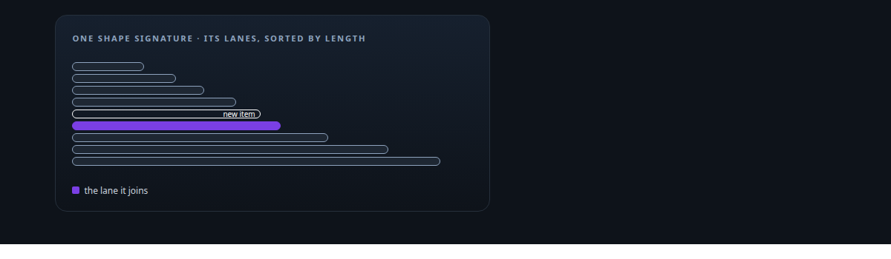
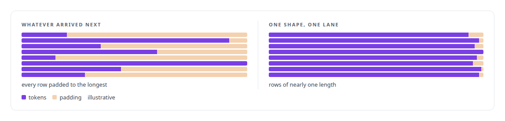
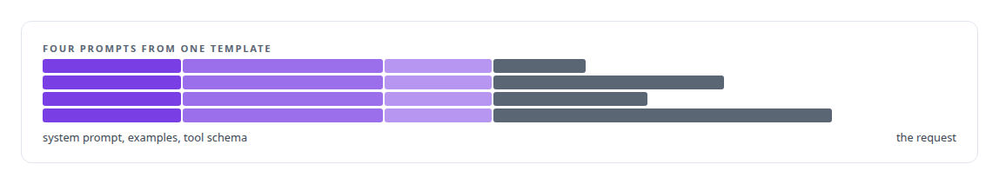
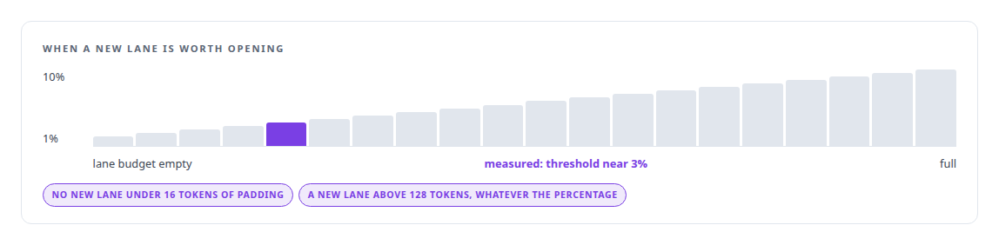
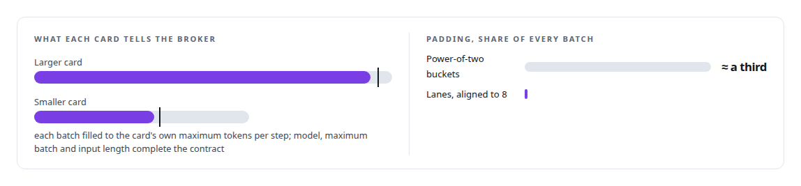
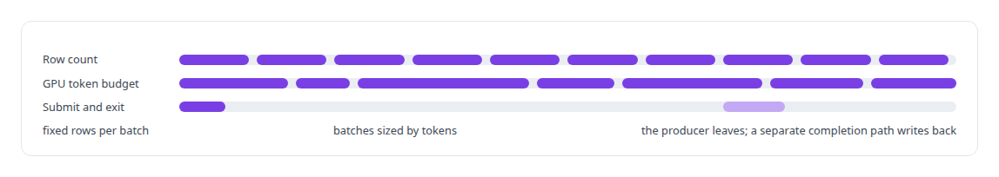

# Token-aware GPU batch scheduling

**The token is the unit of GPU scheduling in my broker: shape-pure batches packed to each card's declared limits, across two different GPUs.**

Canonical: https://coreyjames.ai/technologies/token-aware-gpu-batch-scheduling/  
Author: Corey James · Published: 2026-10-28 · Kind: technology  
Systems: [Inference Fabric](https://github.com/coreyjames-ai/inference-fabric) · [FAFO Core and Function Forge](https://github.com/coreyjames-ai/fafo-core)  
Skills: [token-aware scheduling](https://github.com/coreyjames-ai/portfolio/tree/main/skills/token-aware-scheduling) · [message broker and queue design](https://github.com/coreyjames-ai/portfolio/tree/main/skills/message-broker-and-queue-design) · [GPU inference optimisation](https://github.com/coreyjames-ai/portfolio/tree/main/skills/gpu-inference-optimisation) · [Rust systems engineering](https://github.com/coreyjames-ai/portfolio/tree/main/skills/rust-systems-engineering)  



## Result

| Figure | What it measures |
| --- | --- |
| **0.421%** | padding waste across both cards |
| **99.9%** | key-value cache hit rate on both cards, zero shape switches |
| **2,280** | lanes in use at 22 percent lane pressure |
| **≈17,800** | lane reuses a second, one new lane every two seconds |

## What was built

### The token as the unit of scheduling

[Inference Fabric](https://coreyjames.ai/systems/inference-fabric) started from a backlog of billions of tokens and two GPUs of different sizes. A queue that hands each card whatever arrived next mixes short and long prompts, fills the gaps with padding, thrashes the engine's key-value cache and sends the smaller card work it cannot hold. I made the token the broker's unit of scheduling and split the problem into two separate axes: a signature for cacheable structure and lanes for length.



### Shape: a signature, not a parse

Shape is declared by the producer, which knows its own prompt template. Each cacheable component of a prompt is hashed and appended in order, and the list is reduced to one 64-bit signature. The broker never parses a prompt and never sees the model.



### Length: rolling lanes

Length is handled inside each shape by what I call rolling lanes. A shape owns up to 2,048 lanes kept sorted by a representative length; I raised the budget from 128 after busy shapes ran out of lanes and padding climbed steadily. A new item binary-searches for its two neighbours and takes the one that pads it less.

It opens a new lane instead when the padding is above a threshold that rises as the shape's lane budget fills, with a floor so short prompts do not spawn lanes over trivial waste and a hard cap so a long prompt never absorbs large padding because its percentage looks small. Lanes only grow their length, are never merged, and go quiet after a few seconds without traffic so their ids can be reused.




### A four-number contract with each card

Each GPU describes itself to the broker in four numbers. A batch pads to its longest item rounded up to 8 tokens and fills in padded tokens. Anything that does not fit, or belongs to another model, goes back to the front of the queue in order for the next consumer. I took input-length filtering out of the broker: it stranded work no consumer would take, and the runtime handles an oversized item more cheaply.



On disk every segment holds a single model, shape and lane, so purity is a property of the file. Dispatch stays on one shape until it has nothing left, then moves to the shape with the most waiting tokens, and the broker stops itself before it would emit a batch that mixes shapes. The dispatch hot path is one owner on dedicated threads with no async machinery.

The broker is about 24,000 lines of Rust in four crates, and its figures come from serving a 7-billion-parameter dense model in FP8 from one backlog to two NVIDIA Blackwell GPUs, each on its own engine build. The inference engines are NVIDIA's; the scheduling layer, the consumer contract and the broker are mine. The design is in [A message broker that understands tokens](https://coreyjames.ai/stories/a-message-broker-that-understands-tokens); its effect on throughput, up to 163,000 tokens per second across those two cards, is in [From 44K to 163K tokens per second](https://coreyjames.ai/stories/from-44k-to-163k-tokens-per-second); a failure in its accounting is in [Millions of queued items that were not there](https://coreyjames.ai/stories/millions-of-queued-items-that-were-not-there).

### The producer side

[FAFO Core and Function Forge](https://coreyjames.ai/systems/fafo-core) had the same problem from the producer side. Its job conductor has a batching mode keyed to a GPU token budget next to the usual row-count mode, and a decoupled mode in which a producer submits and exits while a separate completion path writes the results back.



> The rule I wrote at the top of that code: spend structure before spending waste.

## What was verified

Each line is a claim the canonical page supports, with the figure as the page states it.

- Token-aware scheduling: a Rust broker that packs shape-pure batches to each GPU's declared limits, at 0.421% padding waste across both cards.
- KV-cache-aware batching: a 64-bit shape signature per prompt template held a 99.9% key-value cache hit rate on both cards with zero shape switches.
- Message broker and queue design: rolling lanes with a pressure-adaptive threshold, 2,280 lanes in use at 22 percent lane pressure and ≈17,800 lane reuses a second.

## Related

- [A message broker that understands tokens](https://github.com/coreyjames-ai/inference-fabric/tree/main/stories/a-message-broker-that-understands-tokens) · https://coreyjames.ai/stories/a-message-broker-that-understands-tokens/
- [The workload that shaped the platform](https://github.com/coreyjames-ai/fafo-core/tree/main/stories/the-workload-that-shaped-the-platform) · https://coreyjames.ai/stories/the-workload-that-shaped-the-platform/
- [From 44K to 163K tokens per second](https://github.com/coreyjames-ai/inference-fabric/tree/main/stories/from-44k-to-163k-tokens-per-second) · https://coreyjames.ai/stories/from-44k-to-163k-tokens-per-second/
- [Millions of queued items that were not there](https://github.com/coreyjames-ai/inference-fabric/tree/main/stories/millions-of-queued-items-that-were-not-there) · https://coreyjames.ai/stories/millions-of-queued-items-that-were-not-there/
- System: [Inference Fabric](https://github.com/coreyjames-ai/inference-fabric)
- System: [FAFO Core and Function Forge](https://github.com/coreyjames-ai/fafo-core)

## Citation

Corey James. "Token-aware GPU batch scheduling." coreyjames.ai, 2026. https://coreyjames.ai/technologies/token-aware-gpu-batch-scheduling/

```bibtex
@misc{coreyjames-token-aware-gpu-batch-scheduling,
  author = {Corey James},
  title = {Token-aware GPU batch scheduling},
  year = {2026},
  howpublished = {\url{https://coreyjames.ai/technologies/token-aware-gpu-batch-scheduling/}},
  note = {GitHub copy: https://github.com/coreyjames-ai/portfolio/tree/main/technologies/token-aware-gpu-batch-scheduling}
}
```

Part of [Corey James's portfolio](https://github.com/coreyjames-ai/portfolio) · site: https://coreyjames.ai/ · MCP server: https://coreyjames.ai/mcp · agent card: https://coreyjames.ai/.well-known/agent.json
