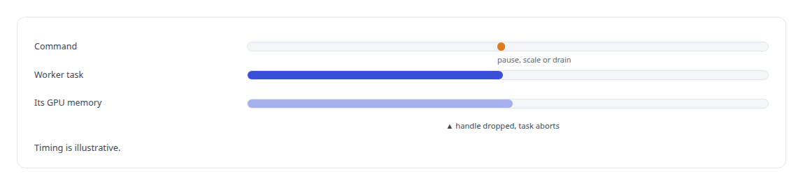
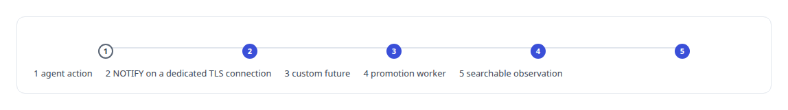
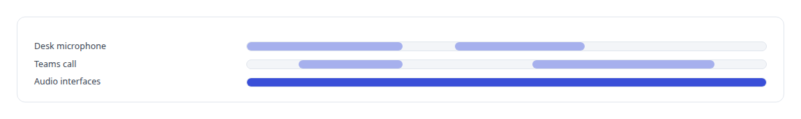
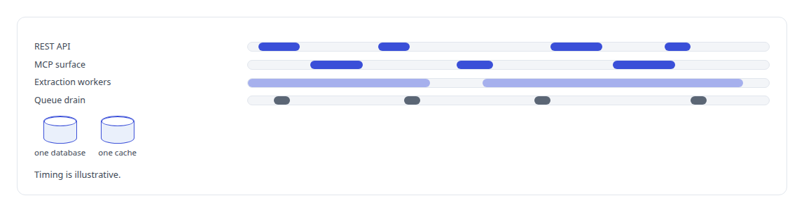
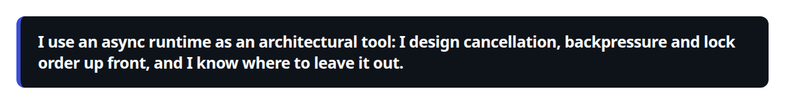
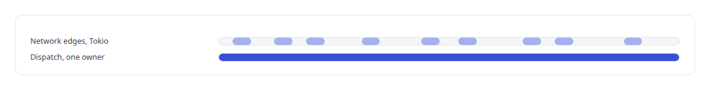

# Tokio

**Tokio is under every Rust service I run. Where the hot path is small, as in the broker's dispatch loop, I keep it synchronous on purpose and say why.**

Canonical: https://coreyjames.ai/technologies/tokio/  
Author: Corey James · Published: 2026-10-28 · Kind: technology  
Systems: [FAFO Core and Function Forge](https://github.com/coreyjames-ai/fafo-core) · [Agent Swarm](https://github.com/coreyjames-ai/agent-swarm) · [Helix](https://github.com/coreyjames-ai/helix) · [FAFOHive](https://github.com/coreyjames-ai/fafohive) · [AgentOS](https://github.com/coreyjames-ai/agentos) · [Inference Fabric](https://github.com/coreyjames-ai/inference-fabric)  
Skills: [Rust systems engineering](https://github.com/coreyjames-ai/portfolio/tree/main/skills/rust-systems-engineering) · [message broker and queue design](https://github.com/coreyjames-ai/portfolio/tree/main/skills/message-broker-and-queue-design)  


## What was built

### Cancellation and lock order for the GPU conductor

[FAFO Core and Function Forge](https://coreyjames.ai/systems/fafo-core) accepts commands such as pause, scale and drain while jobs run on GPUs, and I knew that combination breeds stuck workers and lock-order deadlocks. I built the conductor on Tokio with two rules.

Each worker handle aborts its task when dropped, so a worker cancelled mid-flight releases its GPU memory without every code path having to clean up. The conductor's locks follow an acquisition order written in the code beside them.



### Database notifications as an event stream

[Agent Swarm](https://coreyjames.ai/systems/agent-swarm) needed agent actions to become searchable observations without a polling loop. I wrote a future that pumps PostgreSQL LISTEN/NOTIFY notifications from a dedicated TLS connection and feeds them to the promotion worker.

Every service crate runs a multi-threaded Tokio runtime. The agentic loop applies a timeout and retry policy per tool step, the message router has a backpressure drainer, and the registry's heartbeat and reaper loops fall back from push to polling when queues saturate. See [Tools are the platform](https://coreyjames.ai/stories/tools-are-the-platform).



### Voice and Teams on Tokio and Axum

[Helix](https://coreyjames.ai/systems/helix) builds its voice engine and control center on Tokio and Axum. The Teams endpoint is an Axum WebSocket server that admits one session per call and feeds the same audio interfaces the local microphone uses. Cancellation is structured so a failure in one part of a conversation cannot strand the rest. See [A self-hosted colleague in a Teams call](https://coreyjames.ai/stories/a-self-hosted-colleague-in-a-teams-call).



### One binary, several surfaces

[FAFOHive](https://coreyjames.ai/systems/fafohive) is one Tokio binary that serves several surfaces at once over one database and one cache. [AgentOS](https://coreyjames.ai/systems/agentos) runs its member runtime, the service between public tools and agent containers, as a Unix-socket server that fans requests out with join sets.



### Where I left Tokio out

[Inference Fabric](https://coreyjames.ai/systems/inference-fabric) is where I left Tokio out. The broker's dispatch path is a single-owner actor on blocking threads with lock-free channels, because task scheduling overhead there is paid on every item. Tokio serves the broker's network edges. Tokio is the open-source runtime; the concurrency design on top is mine.





> I use an async runtime as an architectural tool: I design cancellation, backpressure and lock order up front, and I know where to leave it out.

## What was verified

Each line is a claim the canonical page supports, with the figure as the page states it.

- Rust systems engineering: async services on Tokio with worker handles that abort on drop, so a cancelled GPU worker releases its memory.
- Concurrency design: lock acquisition order written beside the locks, backpressure drainers, and push-to-poll fallback when queues saturate.
- Low-latency system design: the broker's dispatch path kept off the async runtime as a single-owner actor on blocking threads.

## Related

- [Tools are the platform](https://github.com/coreyjames-ai/agent-swarm/tree/main/stories/tools-are-the-platform) · https://coreyjames.ai/stories/tools-are-the-platform/
- [A self-hosted colleague in a Teams call](https://github.com/coreyjames-ai/helix/tree/main/stories/a-self-hosted-colleague-in-a-teams-call) · https://coreyjames.ai/stories/a-self-hosted-colleague-in-a-teams-call/
- System: [FAFO Core and Function Forge](https://github.com/coreyjames-ai/fafo-core)
- System: [Agent Swarm](https://github.com/coreyjames-ai/agent-swarm)
- System: [Helix](https://github.com/coreyjames-ai/helix)
- System: [FAFOHive](https://github.com/coreyjames-ai/fafohive)
- System: [AgentOS](https://github.com/coreyjames-ai/agentos)
- System: [Inference Fabric](https://github.com/coreyjames-ai/inference-fabric)

## Citation

Corey James. "Tokio." coreyjames.ai, 2026. https://coreyjames.ai/technologies/tokio/

```bibtex
@misc{coreyjames-tokio,
  author = {Corey James},
  title = {Tokio},
  year = {2026},
  howpublished = {\url{https://coreyjames.ai/technologies/tokio/}},
  note = {GitHub copy: https://github.com/coreyjames-ai/portfolio/tree/main/technologies/tokio}
}
```

Part of [Corey James's portfolio](https://github.com/coreyjames-ai/portfolio) · site: https://coreyjames.ai/ · MCP server: https://coreyjames.ai/mcp · agent card: https://coreyjames.ai/.well-known/agent.json
