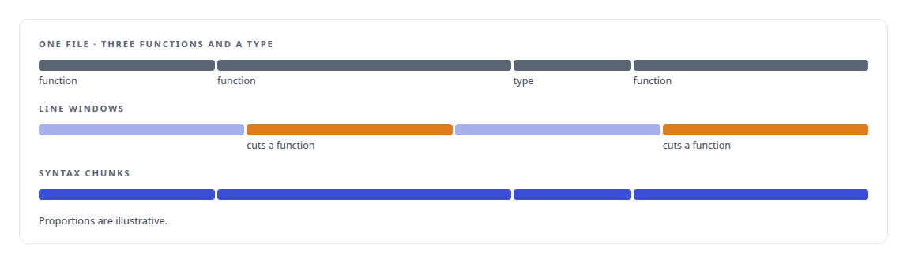
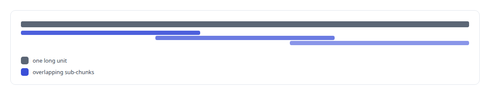

# tree-sitter

**tree-sitter parses a multi-language monorepo into the chunks and edges behind my code search and dependency graph.**

Canonical: https://coreyjames.ai/technologies/tree-sitter/  
Author: Corey James · Published: 2026-10-28 · Kind: technology  
Systems: [FAFOHive](https://github.com/coreyjames-ai/fafohive)  
Skills: [AI-assisted engineering methodology](https://github.com/coreyjames-ai/portfolio/tree/main/skills/ai-assisted-engineering-methodology)  


## Result

| Figure | What it measures |
| --- | --- |
| **19,000** | files in the multi-language monorepo |
| **294,000** | chunks from the monorepo |
| **100** | lines, the longest unit kept whole |
| **40** | lines per overlapping sub-chunk |

## What was built

### Answers from the code's structure

[FAFOHive](https://coreyjames.ai/systems/fafohive) serves AI agents that ask questions about a large multi-language monorepo, and I wanted their answers to come from the code's structure. Embeddings of arbitrary line windows give agents half a function and a guess. I decided to parse every file with tree-sitter and use the syntax tree twice: to cut code into meaningful chunks for search, and to extract the dependency graph the code tools traverse.



### Chunks that follow syntax

The chunker uses pinned grammars for Rust, Python, JavaScript, TypeScript, C, C++, Go and Java and cuts along function, class and module boundaries. A long unit splits into overlapping sub-chunks, so a long function stays findable without becoming one diluted vector. Files in other languages go through a plain chunker.

Every chunk carries its path, line range and language, so every hit points at a file and line. Grammar versions are pinned, which keeps chunk boundaries and edge identities stable between runs; I first built this in a small standalone code-search server, and the index pins the same grammar versions so boundaries stayed stable when the work moved.



### A graph that is never half built

The graph extractor re-parses those chunks and extracts calls, imports, implementations, references, definitions and re-exports. An edge waits in a pending state until both of its ends are indexed, and every edge belongs to a graph generation, so I can rebuild an index while queries read the previous complete graph. Graph coverage on the monorepo reached all but a few hundred chunks.


### A model that may only explain

Dependency tracing is a bounded breadth-first search in SQL with no model in it, and path explanation lets a language model narrate only edges the graph already holds. When coverage for a query is incomplete, the explainer says "coverage incomplete". That design is [A code explainer that is not allowed to invent](https://coreyjames.ai/stories/a-code-explainer-that-is-not-allowed-to-invent). tree-sitter and its grammars are used as published; the chunking strategy, the edge model and the graph lifecycle are mine.


> I give AI agents computed facts about code and limit the model to explaining them.

## What was verified

Each line is a claim the canonical page supports, with the figure as the page states it.

- Code intelligence for AI agents: a 19,000-file multi-language monorepo parsed with tree-sitter into 294,000 syntax-aligned chunks for code search.
- Static dependency analysis: calls, imports and implementations extracted into a generation-versioned graph whose edges appear only when both ends are indexed.
- Evidence-grounded LLM output: dependency tracing by bounded search in SQL, with a model allowed to narrate only edges the graph holds.

## Related

- [A code explainer that is not allowed to invent](https://github.com/coreyjames-ai/fafohive/tree/main/stories/a-code-explainer-that-is-not-allowed-to-invent) · https://coreyjames.ai/stories/a-code-explainer-that-is-not-allowed-to-invent/
- System: [FAFOHive](https://github.com/coreyjames-ai/fafohive)

## Citation

Corey James. "tree-sitter." coreyjames.ai, 2026. https://coreyjames.ai/technologies/tree-sitter/

```bibtex
@misc{coreyjames-tree-sitter,
  author = {Corey James},
  title = {tree-sitter},
  year = {2026},
  howpublished = {\url{https://coreyjames.ai/technologies/tree-sitter/}},
  note = {GitHub copy: https://github.com/coreyjames-ai/portfolio/tree/main/technologies/tree-sitter}
}
```

Part of [Corey James's portfolio](https://github.com/coreyjames-ai/portfolio) · site: https://coreyjames.ai/ · MCP server: https://coreyjames.ai/mcp · agent card: https://coreyjames.ai/.well-known/agent.json
