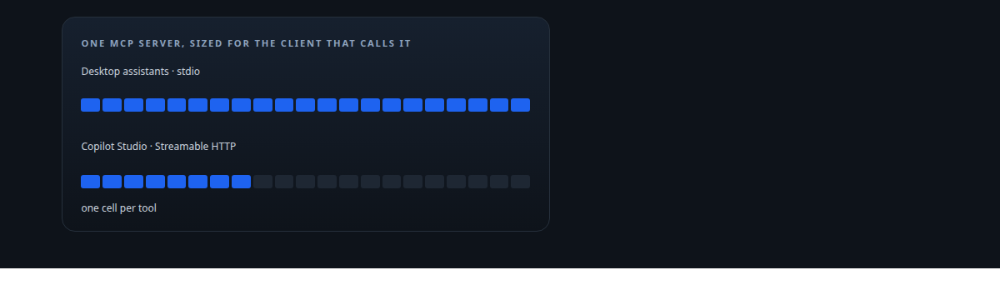
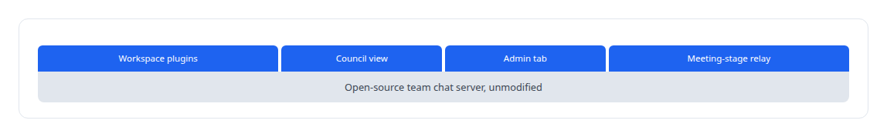
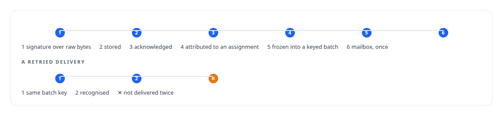

# TypeScript

**TypeScript builds the meeting-stage app, the relay between Teams and my agent, the public site runtime, and the in-house social integrations.**

Canonical: https://coreyjames.ai/technologies/typescript/  
Author: Corey James · Published: 2026-10-28 · Kind: technology  
Systems: [Auth and access plane](https://github.com/coreyjames-ai/auth-and-access-plane) · [Helix](https://github.com/coreyjames-ai/helix) · [FAFOHive](https://github.com/coreyjames-ai/fafohive)  
Skills: [MCP server design](https://github.com/coreyjames-ai/portfolio/tree/main/skills/mcp-server-design) · [tool synthesis and governed API integration](https://github.com/coreyjames-ai/portfolio/tree/main/skills/tool-synthesis-and-governed-api-integration) · [inference serving architecture](https://github.com/coreyjames-ai/portfolio/tree/main/skills/inference-serving-architecture) · [AI-assisted engineering methodology](https://github.com/coreyjames-ai/portfolio/tree/main/skills/ai-assisted-engineering-methodology)  



## Result

| Figure | What it measures |
| --- | --- |
| **16,200** | lines in the weather-intelligence MCP server |
| **9** | public data-service clients behind both surfaces |
| **12,400** | lines of TypeScript plugins on an unmodified chat server |
| **6,500** | lines in the vendor event intake, tests and migrations included |

## What was built

### One MCP server, sized for two kinds of client

[Auth and access plane](https://coreyjames.ai/systems/auth-and-access-plane) includes a product I built to learn what an enterprise agent platform needs from an MCP server: a weather-intelligence server on Express 5 and the official MCP TypeScript SDK. I gave it two surfaces. Desktop assistants get the full set over the local stdio transport; Microsoft Copilot Studio gets a trimmed set over Streamable HTTP, with the session header its connector expects, because that platform copes poorly with large catalogs.


I later ported it to C# on the official .NET MCP SDK.


### Living inside the tools people already use

[Helix](https://coreyjames.ai/systems/helix) needed to live inside the tools people already use. I wrote a Teams admin tab in React and Fluent UI so an administrator manages the digital employee from inside Teams. The multi-model workspace runs on an unmodified open-source team chat server; its behaviour, including the council view where models deliberate and ratify, lives in plugins, TypeScript alongside 11,000 lines of JavaScript, so I never had to fork the server and upstream upgrades stay open. A Node relay with twenty tests serves the meeting-stage app the digital employee presents through.



### Vendor events, stored before they are acknowledged

[FAFOHive](https://coreyjames.ai/systems/fafohive) receives vendor events for governed agent teams, and I wanted that intake on the platform the vendors' own examples use. It is a TypeScript service on Node and PostgreSQL. It checks each vendor's signature over the raw bytes before any parsing, stores the event before acknowledging it, works out which governed assignment caused it, and freezes events into delivery batches with stable keys, so a retried delivery is recognised as the same batch and a team's mailbox receives each batch once. Thin per-vendor edge workers sit in front. See [Agents with real tools and no keys](https://coreyjames.ai/stories/agents-with-real-tools-and-no-keys).



I pick TypeScript where the surrounding platform lives in it, Node services, web plugins and Microsoft's client surfaces, and keep system cores in Rust. The weather data comes from public services and the chat server is open source; the tool design, plugins, event handling and packaging are mine.

> Building the same server on two official SDKs showed me which decisions were mine and which were the SDK's.

## What was verified

Each line is a claim the canonical page supports, with the figure as the page states it.

- MCP server design: a 16,200-line TypeScript weather-intelligence MCP server, the full tool set over stdio and a trimmed set over Streamable HTTP for Copilot Studio.
- Event ingestion and idempotency: a 6,500-line vendor event intake that checks signatures over raw bytes, stores before acknowledging and delivers each keyed batch once.
- Platform extension without forking: 12,400 lines of TypeScript plugins on an unmodified open-source team chat server.

## Related

- [Agents with real tools and no keys](https://github.com/coreyjames-ai/fafohive/tree/main/stories/agents-with-real-tools-and-no-keys) · https://coreyjames.ai/stories/agents-with-real-tools-and-no-keys/
- System: [Auth and access plane](https://github.com/coreyjames-ai/auth-and-access-plane)
- System: [Helix](https://github.com/coreyjames-ai/helix)
- System: [FAFOHive](https://github.com/coreyjames-ai/fafohive)

## Citation

Corey James. "TypeScript." coreyjames.ai, 2026. https://coreyjames.ai/technologies/typescript/

```bibtex
@misc{coreyjames-typescript,
  author = {Corey James},
  title = {TypeScript},
  year = {2026},
  howpublished = {\url{https://coreyjames.ai/technologies/typescript/}},
  note = {GitHub copy: https://github.com/coreyjames-ai/portfolio/tree/main/technologies/typescript}
}
```

Part of [Corey James's portfolio](https://github.com/coreyjames-ai/portfolio) · site: https://coreyjames.ai/ · MCP server: https://coreyjames.ai/mcp · agent card: https://coreyjames.ai/.well-known/agent.json
