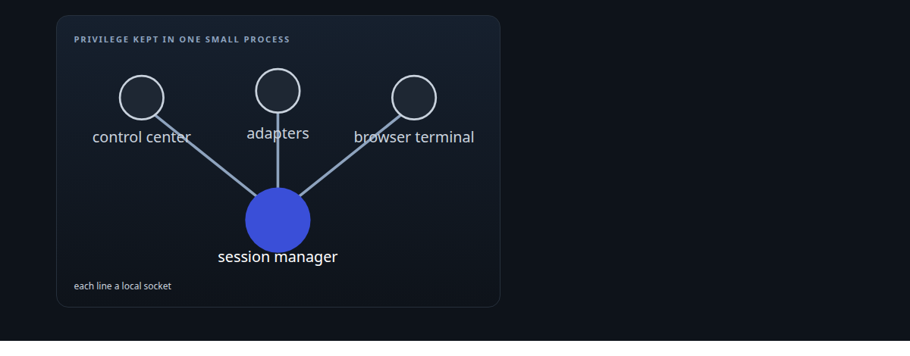
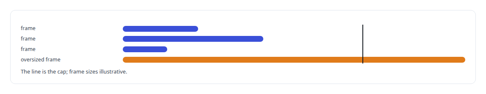
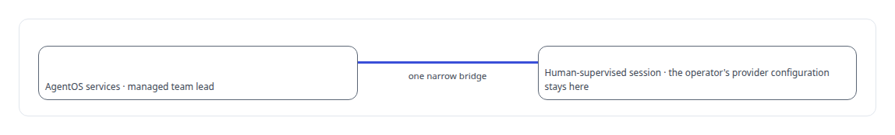
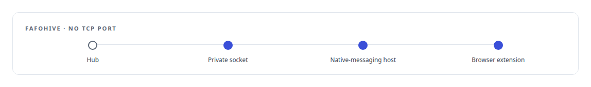
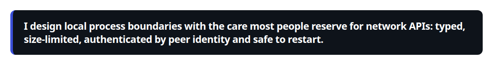

# Unix domain sockets

**Unix sockets are the transport between my governance hooks and their runtime, between the voice engine and its clients, and between the capabilities model's decoder and its callers.**

Canonical: https://coreyjames.ai/technologies/unix-domain-sockets/  
Author: Corey James · Published: 2026-10-28 · Kind: technology  
Systems: [Helix](https://github.com/coreyjames-ai/helix) · [AgentOS](https://github.com/coreyjames-ai/agentos) · [FAFOHive](https://github.com/coreyjames-ai/fafohive) · [Capabilities model](https://github.com/coreyjames-ai/capabilities-model)  
Skills: [exactly-once delivery and crash recovery](https://github.com/coreyjames-ai/portfolio/tree/main/skills/exactly-once-delivery-and-crash-recovery) · [zero-trust and zero-inbound networking](https://github.com/coreyjames-ai/portfolio/tree/main/skills/zero-trust-and-zero-inbound-networking) · [inference serving architecture](https://github.com/coreyjames-ai/portfolio/tree/main/skills/inference-serving-architecture) · [tool synthesis and governed API integration](https://github.com/coreyjames-ai/portfolio/tree/main/skills/tool-synthesis-and-governed-api-integration)  



## Result

| Figure | What it measures |
| --- | --- |
| **1 MiB** | cap on every frame a privileged server will read |
| **3** | JSON-lines protocols over local sockets |
| **1** | account each server will answer |

## What was built

### A privileged manager behind typed local protocols

[Helix](https://coreyjames.ai/systems/helix) has to create and control vendor CLI sessions, which takes privileges I did not want in the processes that talk to models. I split the privileged part into a small manager and put Unix sockets between it and everything else.

The control center speaks JSON-lines protocols over local sockets: service to session manager, service to the per-vendor adapters, and browser terminal attach. Every server checks the connecting process's user ID against the one account allowed to call it, because a socket path says nothing about who connected, and a hard frame cap keeps a misbehaving client from making a privileged process allocate without bound.

Adapter replies carry correlation fence tokens, so a late reply from an older session generation is dropped. Outgoing events pass through an outbox flushed to disk, so a restart loses nothing and duplicates nothing.



### Narrow bridges that start on demand

[AgentOS](https://coreyjames.ai/systems/agentos) needed a way for exactly one service account to start governed work. I used a systemd socket-activated Unix socket, which starts the bridge on demand and sets its permissions in one place: when a request arrives, the activation bridge checks the caller's user ID and only then grants an execution lease on a work order.

A similar narrow bridge crosses user boundaries for the helpdesk channel, through which a managed team lead reports harness defects to a human-supervised session, so AgentOS services never read the operator's own provider configuration. Messages reach frontier model command-line sessions through that tool's local inbox socket.



### No network listener where none is needed

[FAFOHive](https://coreyjames.ai/systems/fafohive) reaches its Reddit integration through a private Unix socket. I gave that provider no TCP port: the hub forwards to the socket, and on the other side a native-messaging host links it to a browser extension. A service that needs no network listener gets none.



The sockets are standard operating-system facilities; the protocols on them are mine.



> I design local process boundaries with the care most people reserve for network APIs: typed, size-limited, authenticated by peer identity and safe to restart.

## What was verified

Each line is a claim the canonical page supports, with the figure as the page states it.

- Least-privilege process design: a privileged session manager behind local sockets that answers 1 account, checked by the caller's user ID.
- Protocol design: 3 JSON-lines protocols over local sockets with a 1 MiB frame cap, fence tokens and an on-disk outbox that survives restarts.
- Zero-inbound networking: a provider with no TCP port, reached through a private socket and a native-messaging host.

## Related

- [A router beside a production model](https://github.com/coreyjames-ai/capabilities-model/tree/main/stories/a-router-beside-a-production-model) · https://coreyjames.ai/stories/a-router-beside-a-production-model/
- System: [Helix](https://github.com/coreyjames-ai/helix)
- System: [AgentOS](https://github.com/coreyjames-ai/agentos)
- System: [FAFOHive](https://github.com/coreyjames-ai/fafohive)
- System: [Capabilities model](https://github.com/coreyjames-ai/capabilities-model)

## Citation

Corey James. "Unix domain sockets." coreyjames.ai, 2026. https://coreyjames.ai/technologies/unix-domain-sockets/

```bibtex
@misc{coreyjames-unix-domain-sockets,
  author = {Corey James},
  title = {Unix domain sockets},
  year = {2026},
  howpublished = {\url{https://coreyjames.ai/technologies/unix-domain-sockets/}},
  note = {GitHub copy: https://github.com/coreyjames-ai/portfolio/tree/main/technologies/unix-domain-sockets}
}
```

Part of [Corey James's portfolio](https://github.com/coreyjames-ai/portfolio) · site: https://coreyjames.ai/ · MCP server: https://coreyjames.ai/mcp · agent card: https://coreyjames.ai/.well-known/agent.json
