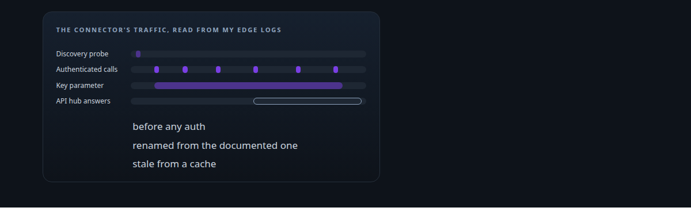
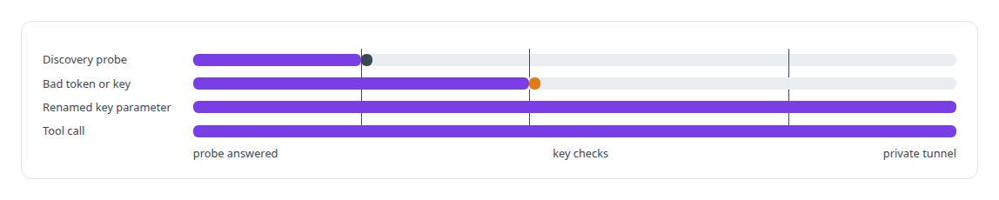
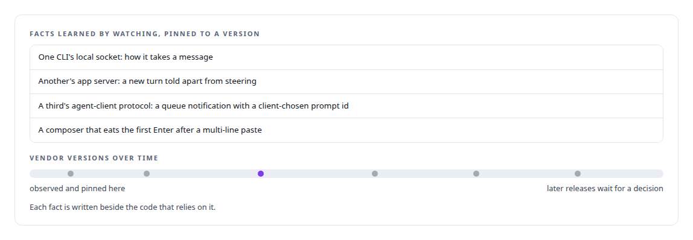
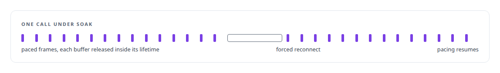
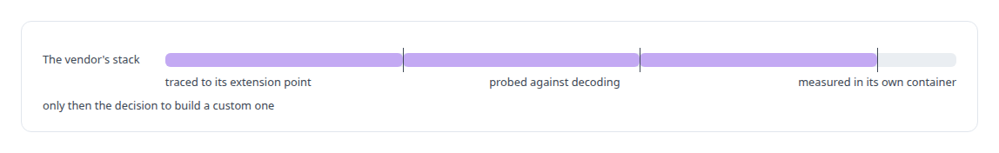
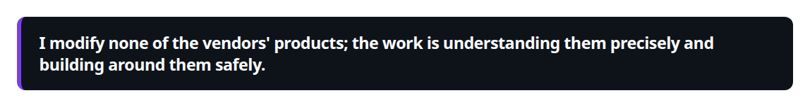

# Vendor-integration reverse engineering

**When vendor documentation runs out I probe the platform itself, capture the wire, and compose what actually works.**

Canonical: https://coreyjames.ai/technologies/vendor-integration-reverse-engineering/  
Author: Corey James · Published: 2026-10-28 · Kind: technology  
Systems: [Auth and access plane](https://github.com/coreyjames-ai/auth-and-access-plane) · [AgentOS](https://github.com/coreyjames-ai/agentos) · [Agent Swarm](https://github.com/coreyjames-ai/agent-swarm) · [Helix](https://github.com/coreyjames-ai/helix) · [Capabilities model](https://github.com/coreyjames-ai/capabilities-model)  
Skills: [Microsoft Teams real-time media](https://github.com/coreyjames-ai/portfolio/tree/main/skills/microsoft-teams-real-time-media) · [tool synthesis and governed API integration](https://github.com/coreyjames-ai/portfolio/tree/main/skills/tool-synthesis-and-governed-api-integration) · [distributed systems correctness](https://github.com/coreyjames-ai/portfolio/tree/main/skills/distributed-systems-correctness) · [evidence-gated acceptance](https://github.com/coreyjames-ai/portfolio/tree/main/skills/evidence-gated-acceptance)  



## Result

| Figure | What it measures |
| --- | --- |
| **≈300** | lines in the edge Worker built around the connector's real behaviour |
| **20 ms** | audio pacing the real-time media SDK expects |
| **30 min** | soak with a forced mid-call reconnect |

## What was built

### A connector learned from the wire

[Auth and access plane](https://coreyjames.ai/systems/auth-and-access-plane) has to expose private tools to Microsoft Copilot Studio, whose MCP connector behaves differently from its documentation. I decided to learn the connector from my own edge logs and build to what it does, and each undocumented quirk gets explicit handling.

I built an edge Worker around what I found, with two key slots because rotation has to work against a client configuration I do not control. A cache-busting procedure covers the API hub, which can keep returning stale answers from a fixed server.



### Coding CLIs pinned to what was observed

[AgentOS](https://coreyjames.ai/systems/agentos) and [Agent Swarm](https://coreyjames.ai/systems/agent-swarm) depend on exact behaviours of the vendors' coding CLIs. Each came from watching the tool, and I pinned the versions those behaviours were observed on, so an upgrade is a decision.



### A media SDK with strict rules

[Helix](https://coreyjames.ai/systems/helix) runs on Microsoft's real-time media SDK, which hands out unmanaged audio buffers with strict lifetimes and expects strict pacing. I built the bridge to those rules and soak-tested it, because reconnects and buffer lifetimes only show their faults under fault. See [A self-hosted colleague in a Teams call](https://coreyjames.ai/stories/a-self-hosted-colleague-in-a-teams-call).



### A vendor stack measured before replacing it

The [Capabilities model](https://coreyjames.ai/systems/capabilities-model) needed a serving stack, and before replacing the vendor's I traced it to its extension point in source, probed it against the model's decoding constraints and measured it in the vendor's own container. See [Trying the industrial path first](https://coreyjames.ai/stories/trying-the-industrial-path-first).





> I modify none of the vendors' products; the work is understanding them precisely and building around them safely.

## What was verified

Each line is a claim the canonical page supports, with the figure as the page states it.

- Vendor integration reverse engineering: an MCP connector learned from my own edge logs, answered by an edge Worker of ≈300 lines built to its real behaviour.
- Microsoft Teams real-time media: a bridge to the real-time media SDK's buffer lifetimes and 20 ms pacing, soak-tested for 30 min with a forced mid-call reconnect.
- Dependency pinning by observed contract: coding-CLI behaviours pinned to the version they were observed on, so an upgrade is a decision.

## Related

- [A self-hosted colleague in a Teams call](https://github.com/coreyjames-ai/helix/tree/main/stories/a-self-hosted-colleague-in-a-teams-call) · https://coreyjames.ai/stories/a-self-hosted-colleague-in-a-teams-call/
- [Trying the industrial path first](https://github.com/coreyjames-ai/capabilities-model/tree/main/stories/trying-the-industrial-path-first) · https://coreyjames.ai/stories/trying-the-industrial-path-first/
- System: [Auth and access plane](https://github.com/coreyjames-ai/auth-and-access-plane)
- System: [AgentOS](https://github.com/coreyjames-ai/agentos)
- System: [Agent Swarm](https://github.com/coreyjames-ai/agent-swarm)
- System: [Helix](https://github.com/coreyjames-ai/helix)
- System: [Capabilities model](https://github.com/coreyjames-ai/capabilities-model)

## Citation

Corey James. "Vendor-integration reverse engineering." coreyjames.ai, 2026. https://coreyjames.ai/technologies/vendor-integration-reverse-engineering/

```bibtex
@misc{coreyjames-vendor-integration-reverse-engineering,
  author = {Corey James},
  title = {Vendor-integration reverse engineering},
  year = {2026},
  howpublished = {\url{https://coreyjames.ai/technologies/vendor-integration-reverse-engineering/}},
  note = {GitHub copy: https://github.com/coreyjames-ai/portfolio/tree/main/technologies/vendor-integration-reverse-engineering}
}
```

Part of [Corey James's portfolio](https://github.com/coreyjames-ai/portfolio) · site: https://coreyjames.ai/ · MCP server: https://coreyjames.ai/mcp · agent card: https://coreyjames.ai/.well-known/agent.json
