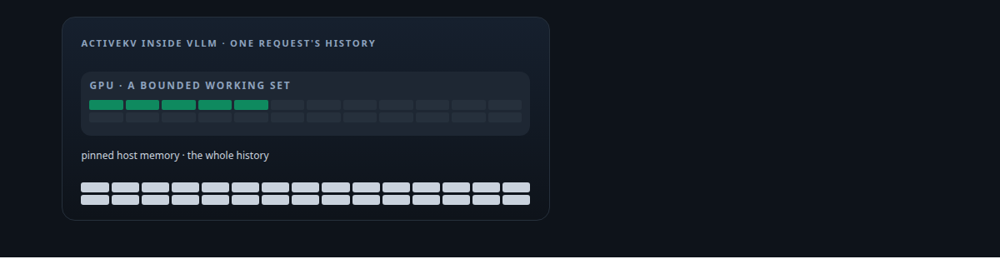
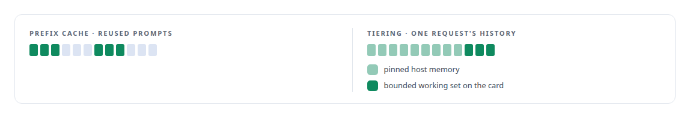
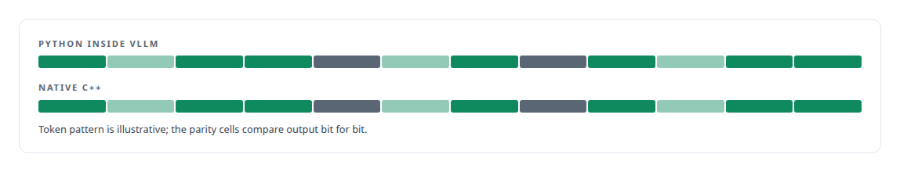
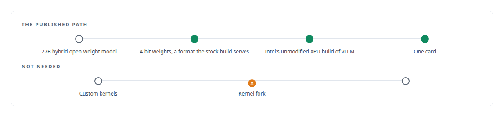
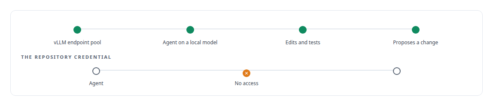

# vLLM

**vLLM is the engine ActiveKV lives inside, patched at the scheduler, worker and attention backend, and the server under my local open-source models.**

Canonical: https://coreyjames.ai/technologies/vllm/  
Author: Corey James · Published: 2026-10-28 · Kind: technology  
Systems: [ActiveKV](https://github.com/coreyjames-ai/activekv) · [Capabilities model](https://github.com/coreyjames-ai/capabilities-model) · [Agent Swarm](https://github.com/coreyjames-ai/agent-swarm)  
Skills: [KV-cache offload for LLM inference](https://github.com/coreyjames-ai/portfolio/tree/main/skills/kv-cache-offload-for-llm-inference) · [C++ and native ports with parity proof](https://github.com/coreyjames-ai/portfolio/tree/main/skills/c-and-native-ports-with-parity-proof) · [vLLM internals](https://github.com/coreyjames-ai/portfolio/tree/main/skills/vllm-internals) · [inference serving architecture](https://github.com/coreyjames-ai/portfolio/tree/main/skills/inference-serving-architecture)  



## Result

| Figure | What it measures |
| --- | --- |
| **128,000** | token histories for a 27B hybrid model on one card |
| **32 GB** | the single card it runs on |
| **36%** | more sustained throughput than a mixed 4-bit/8-bit control |
| **3%** | higher perplexity than full precision |

## What was built

### Moving a request's history off the card

[ActiveKV](https://coreyjames.ai/systems/activekv) began with a limit I kept hitting in vLLM: it keeps a model's whole key-value cache for a request in GPU memory, and its offload is a prefix cache that reuses prompts it has seen. Once a request's history outgrew the card, the request could not continue. I treated prefix reuse and active-context tiering as separate problems from the start.



I decided to move the history to host memory and keep it inside vLLM, at its own extension points, delivered as compiled binaries plus a patch to the user's own vLLM, so users keep their own engine. Attention history lives in pinned host memory and the card keeps a bounded working set. On one Intel Arc Pro GPU it serves a 27B hybrid model with long histories, and on a single 8,000-token request it beats stock vLLM on the same card on every metric I track.

At the longest contexts with a single request, stock vLLM is still faster per token. See [Context beyond VRAM](https://coreyjames.ai/stories/context-beyond-vram).

### From Python inside vLLM to native C++

The runtime then moved from Python inside vLLM to native C++. Exact mode requires output bit-identical to fully resident attention, and the port kept it bit-identical in every parity cell; see [Rewriting an engine extension without changing a token](https://coreyjames.ai/stories/rewriting-an-engine-extension-without-changing-a-token) and [Proving a rewrite is the same system](https://coreyjames.ai/stories/proving-a-rewrite-is-the-same-system).



### A 27B model on a stock build

The [Capabilities model](https://coreyjames.ai/systems/capabilities-model) work needed a 27B model on the same card. I quantized a 27-billion-parameter hybrid recurrent-attention open-weight model to 4-bit weights in a format Intel's unmodified XPU build of vLLM already serves, so no kernel fork was needed. Against a mixed 4-bit/8-bit control on the same card it gave more sustained throughput for a small rise in perplexity over full precision. See [A 27B model on one 32 GB Intel card](https://coreyjames.ai/stories/a-27b-model-on-one-32gb-intel-card).

The model's evaluation scaffold also ran vLLM with guided decoding as a comparison arm, and I corrected an early finding that concurrency added nothing: the client was misusing continuous batching.




### Local models for agents

[Agent Swarm](https://coreyjames.ai/systems/agent-swarm) runs agents on local open-source models served by vLLM through an endpoint pool. One of those agents edited, tested and proposed a change with no access to the repository credential; see [A coding agent that never holds the keys](https://coreyjames.ai/stories/a-coding-agent-that-never-holds-the-keys).



I can change how a large serving engine manages memory from inside its extension points, keep its output exact, and measure the result against the stock engine on the same hardware. vLLM is the open-source project's; ActiveKV, the quantization and the integration code are mine.

> A flat throughput curve under concurrency now sends me to the client first.

## What was verified

Each line is a claim the canonical page supports, with the figure as the page states it.

- vLLM internals: ActiveKV built into vLLM at its scheduler, key-value connector, worker, attention backend and plugin system, delivered as binaries plus a patch.
- KV-cache offload for LLM inference: attention history in pinned host memory with a bounded working set on the card, 128,000-token histories for a 27B model on one 32 GB card.
- LLM quantization (4-bit): a 27B model quantized to a format the stock XPU build serves, 36% more sustained throughput for 3% higher perplexity.
- C++ and native ports with parity proof: the runtime moved from Python inside vLLM to native C++ with bit-identical output in every parity cell.

## Related

- [A coding agent that never holds the keys](https://github.com/coreyjames-ai/agent-swarm/tree/main/stories/a-coding-agent-that-never-holds-the-keys) · https://coreyjames.ai/stories/a-coding-agent-that-never-holds-the-keys/
- [A hundred tokens instead of forty-two thousand](https://github.com/coreyjames-ai/capabilities-model/tree/main/stories/a-hundred-tokens-instead-of-forty-two-thousand) · https://coreyjames.ai/stories/a-hundred-tokens-instead-of-forty-two-thousand/
- [Rewriting an engine extension without changing a token](https://github.com/coreyjames-ai/activekv/tree/main/stories/rewriting-an-engine-extension-without-changing-a-token) · https://coreyjames.ai/stories/rewriting-an-engine-extension-without-changing-a-token/
- [Proving a rewrite is the same system](https://github.com/coreyjames-ai/activekv/tree/main/stories/proving-a-rewrite-is-the-same-system) · https://coreyjames.ai/stories/proving-a-rewrite-is-the-same-system/
- [Context beyond VRAM](https://github.com/coreyjames-ai/activekv/tree/main/stories/context-beyond-vram) · https://coreyjames.ai/stories/context-beyond-vram/
- [Judge a representation by the bytes it stops moving](https://github.com/coreyjames-ai/activekv/tree/main/stories/judge-a-representation-by-the-bytes-it-stops-moving) · https://coreyjames.ai/stories/judge-a-representation-by-the-bytes-it-stops-moving/
- [A 27B model on one 32 GB Intel card](https://github.com/coreyjames-ai/capabilities-model/tree/main/stories/a-27b-model-on-one-32gb-intel-card) · https://coreyjames.ai/stories/a-27b-model-on-one-32gb-intel-card/
- System: [ActiveKV](https://github.com/coreyjames-ai/activekv)
- System: [Capabilities model](https://github.com/coreyjames-ai/capabilities-model)
- System: [Agent Swarm](https://github.com/coreyjames-ai/agent-swarm)

## Citation

Corey James. "vLLM." coreyjames.ai, 2026. https://coreyjames.ai/technologies/vllm/

```bibtex
@misc{coreyjames-vllm,
  author = {Corey James},
  title = {vLLM},
  year = {2026},
  howpublished = {\url{https://coreyjames.ai/technologies/vllm/}},
  note = {GitHub copy: https://github.com/coreyjames-ai/portfolio/tree/main/technologies/vllm}
}
```

Part of [Corey James's portfolio](https://github.com/coreyjames-ai/portfolio) · site: https://coreyjames.ai/ · MCP server: https://coreyjames.ai/mcp · agent card: https://coreyjames.ai/.well-known/agent.json
