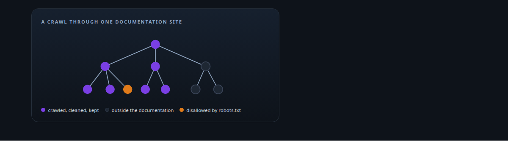
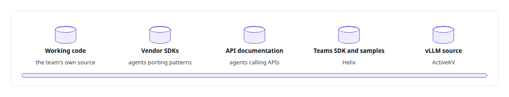
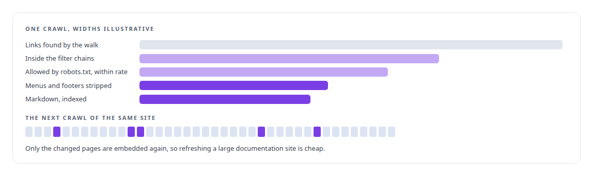
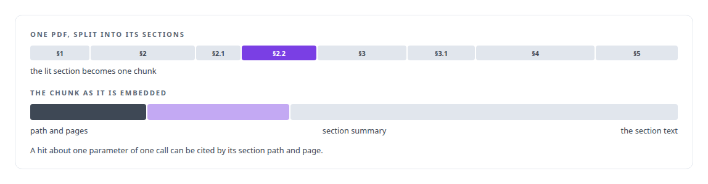

# Web crawling and document extraction

**A native crawler and section extractor for PDFs, Markdown and HTML feed the reference index behind my memory service.**

Canonical: https://coreyjames.ai/technologies/web-crawling-and-document-extraction/  
Author: Corey James · Published: 2026-10-28 · Kind: technology  
Systems: [FAFOHive](https://github.com/coreyjames-ai/fafohive)  
Skills: [Rust systems engineering](https://github.com/coreyjames-ai/portfolio/tree/main/skills/rust-systems-engineering) · [tool synthesis and governed API integration](https://github.com/coreyjames-ai/portfolio/tree/main/skills/tool-synthesis-and-governed-api-integration) · [AI-assisted engineering methodology](https://github.com/coreyjames-ai/portfolio/tree/main/skills/ai-assisted-engineering-methodology)  



## What was built

### A reference library beside the code

The memory capability in [FAFOHive](https://coreyjames.ai/systems/fafohive) serves agents that port patterns from vendor SDKs and call vendor APIs.


I decided agents should cite the vendor's own source and documentation, so I built a reference library next to the code index: vendor SDK repositories, API documentation and crawled developer sites, each in its own named index so a vendor sample never surfaces as the team's code, and all searched under one contract with the same tools as the working code.

Other systems lean on these indexes. Microsoft's Teams SDK, Graph API reference and Copilot Studio samples back the work in [Helix](https://coreyjames.ai/systems/helix), and the vLLM source backs [ActiveKV](https://coreyjames.ai/systems/activekv). The same evidence-first idea governs the code tools in [A code explainer that is not allowed to invent](https://coreyjames.ai/stories/a-code-explainer-that-is-not-allowed-to-invent).



### A crawler that keeps only the documentation

The first ingestion path is a documentation crawler I wrote in Rust. It walks a site breadth-first, depth-first or best-first by link score, honours robots.txt and rate limits by default, stays inside the documentation that matters and converts pages to Markdown. Pages are cleaned before indexing, because menus and footers repeated on every page distort retrieval. Pages that render only in a browser go through optional headless rendering, and re-crawls are incremental.



### Documents turned into citable structure

The second turns documents into structure. PDF, Markdown and HTML split into hierarchical sections with breadcrumbs and, for PDFs, page ranges. Each chunk carries a prefix naming where it sits, and a language model adds section summaries before embedding.



PDF text extraction uses a vendored open-source parser; the crawler, the sectioning and the enrichment are mine, and the sites and SDKs belong to their owners.

> An agent that guesses an API produces code that compiles and fails.

## What was verified

Each line is a claim the canonical page supports, with the figure as the page states it.

- Web crawling and document extraction: a Rust documentation crawler honouring robots.txt and rate limits, stripping boilerplate and re-crawling incrementally.
- Document structuring for RAG: PDF, Markdown and HTML split into hierarchical sections with breadcrumbs and page ranges, with model-written section summaries before embedding.
- Retrieval for AI agents: vendor SDKs, API documentation and crawled sites in separate named indexes under one search contract with the working code.

## Related

- [A code explainer that is not allowed to invent](https://github.com/coreyjames-ai/fafohive/tree/main/stories/a-code-explainer-that-is-not-allowed-to-invent) · https://coreyjames.ai/stories/a-code-explainer-that-is-not-allowed-to-invent/
- System: [FAFOHive](https://github.com/coreyjames-ai/fafohive)

## Citation

Corey James. "Web crawling and document extraction." coreyjames.ai, 2026. https://coreyjames.ai/technologies/web-crawling-and-document-extraction/

```bibtex
@misc{coreyjames-web-crawling-and-document-extraction,
  author = {Corey James},
  title = {Web crawling and document extraction},
  year = {2026},
  howpublished = {\url{https://coreyjames.ai/technologies/web-crawling-and-document-extraction/}},
  note = {GitHub copy: https://github.com/coreyjames-ai/portfolio/tree/main/technologies/web-crawling-and-document-extraction}
}
```

Part of [Corey James's portfolio](https://github.com/coreyjames-ai/portfolio) · site: https://coreyjames.ai/ · MCP server: https://coreyjames.ai/mcp · agent card: https://coreyjames.ai/.well-known/agent.json
