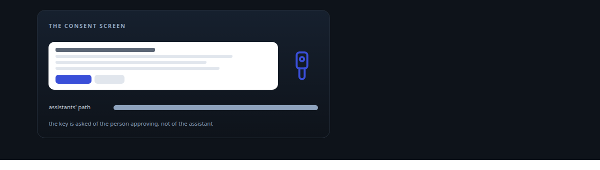
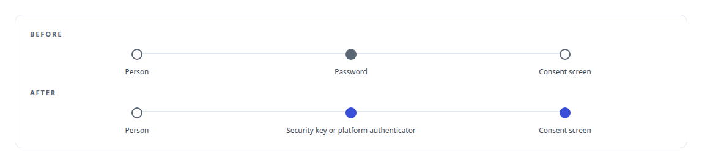
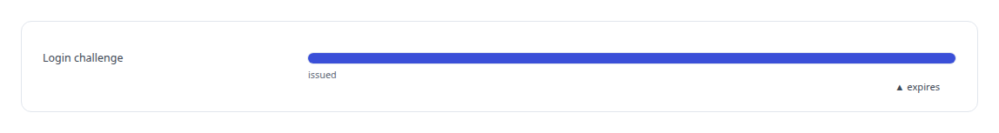
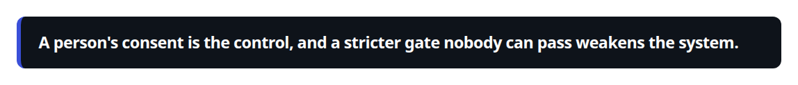
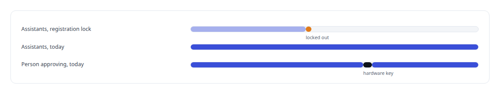

# WebAuthn

**Hardware-key sign-in for the person who approves an OAuth grant, on an alternate entrypoint of the server, with the assistants' path left unchanged.**

Canonical: https://coreyjames.ai/technologies/webauthn/  
Author: Corey James · Published: 2026-10-28 · Kind: technology  
Systems: [Auth and access plane](https://github.com/coreyjames-ai/auth-and-access-plane)  
Skills: [OAuth 2.0 and identity architecture](https://github.com/coreyjames-ai/portfolio/tree/main/skills/oauth-2-0-and-identity-architecture)  



## Result

| Figure | What it measures |
| --- | --- |
| **300 s** | life of a login challenge |
| **1 day** | before the locking change was reverted |

## What was built

### Hardware keys at the consent screen

[Auth and access plane](https://coreyjames.ai/systems/auth-and-access-plane) is the OAuth server through which commercial AI assistants and my own agents get access to my tool estate. The control point there is a person approving each grant on a consent screen. I added WebAuthn hardware-key sign-in to an alternate entrypoint of that server, so the person approving a grant can be asked to prove presence with a security key or platform authenticator instead of a password.



### The flow around the protocol

The open-source python-fido2 library handles the FIDO2 protocol. My work is the flow around it. A visitor who reaches the authorize endpoint unauthenticated is sent to a login page. Registration binds a credential to the user. Login challenges expire, so an abandoned or half-finished ceremony cannot be replayed. Credentials sit in Redis with the rest of the server's session state. A successful assertion returns the visitor to the consent screen with the original authorization request intact, so a person returns to the exact grant they were approving. The ceremonies and their endpoints come to several hundred lines.



### Where strong authentication belongs

Where to put hardware keys was the real decision. An earlier hardening change on the same server added an administrative lock to client registration and locked out every legitimate assistant, and I reverted it. The lesson was about where the control sits.



So hardware keys strengthen the person who consents and leave the assistants' path unchanged. See [The hardening fix that locked everyone out](https://coreyjames.ai/stories/the-hardening-fix-that-locked-everyone-out).



> A person's consent is the control, and a stricter gate nobody can pass weakens the system.

## What was verified

Each line is a claim the canonical page supports, with the figure as the page states it.

- OAuth and identity architecture: WebAuthn hardware-key sign-in for the person who approves an OAuth grant, returning them to the exact grant they were approving.
- Security design: login challenges that expire after 300 s, and a registration lock reverted because it locked out every legitimate assistant.

## Related

- [The hardening fix that locked everyone out](https://github.com/coreyjames-ai/auth-and-access-plane/tree/main/stories/the-hardening-fix-that-locked-everyone-out) · https://coreyjames.ai/stories/the-hardening-fix-that-locked-everyone-out/
- System: [Auth and access plane](https://github.com/coreyjames-ai/auth-and-access-plane)

## Citation

Corey James. "WebAuthn." coreyjames.ai, 2026. https://coreyjames.ai/technologies/webauthn/

```bibtex
@misc{coreyjames-webauthn,
  author = {Corey James},
  title = {WebAuthn},
  year = {2026},
  howpublished = {\url{https://coreyjames.ai/technologies/webauthn/}},
  note = {GitHub copy: https://github.com/coreyjames-ai/portfolio/tree/main/technologies/webauthn}
}
```

Part of [Corey James's portfolio](https://github.com/coreyjames-ai/portfolio) · site: https://coreyjames.ai/ · MCP server: https://coreyjames.ai/mcp · agent card: https://coreyjames.ai/.well-known/agent.json
